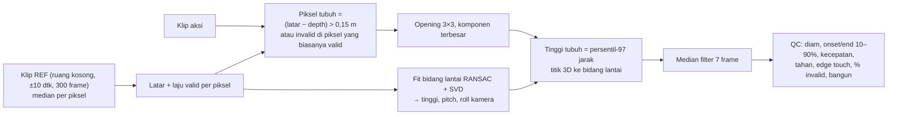

# Analisis data ToF FallPrevent — catatan lengkap hasil kerja Claude (PC server)

Dibuat 18 Oktober 2026 oleh Claude Code di PC server `aiserver-B450M` (user `aiserver-kiki`), sesi `https://claude.ai/code/session_01KZCMca1y1Yt8KZRZ28FUc6`. Mencakup **semua** analisis data rekaman yang dilakukan di server ini dari 12 sampai 18 Oktober 2026, atas data sesi 9, 12, 13, 14 dan 17 Oktober 2026. Dokumen ini sengaja tidak diringkas: semua angka per klip, koreksi, bug, dan keputusan terbuka dicantumkan.

## 0. Cara membaca dan batas bukti

- **Sumber data:** bag ROS 2 MCAP di `~/FallPrevent/bags_YYYYMMDD/` (PC) dan `~/Falldetect/P1_R1_Nanas/` (salinan pilot). Di Pi bag ada di `~/tof_data/bags`.
- **Alat:** `tof_tools/qc_clip.py`, `tof_tools/calib_live.py`, dan skrip analisis sementara di scratchpad sesi (`qc_dump2.py`, `pos.py`, `run14.sh`, `reanalyze*.py`, dll., tidak disimpan di repo).
- **Status QC (`PASS` / `CEK`) adalah saran otomatis, bukan label dataset.** Label (fall/no_fall, `t_onset`) belum dibuat. Kalau QC bertentangan dengan tampilan frame, yang dipercaya adalah tampilan frame.
- **Waktu GO:** sesi 12 Okt memakai `cue_log.csv` asli. Sesi 13, 14, 17 Okt **mengasumsikan GO = 5,0 dtk** dari awal bag, karena `cue_log.csv` sesi itu belum dikirim ke PC. Waktu reaksi yang konsisten (1,4–2,5 dtk) menunjukkan asumsi ini wajar, tapi belum terverifikasi. Pilot 9 Okt memakai GO perkiraan dari kode `rec_clip.sh`.
- **Asal skenario N1–N8b, HN, OL tidak terlacak ke literatur.** N1–N8b dan konsep HN/OL, `Q(x)`, Sistem A/B/C sudah ada di repo sejak commit pertama `e6a5a19` (4 Okt 2026), tanpa sitasi. Rincian protokol HN/OL (`tof_tools/Skenario_Uji_HN_OL.md`, 13 Okt) ditulis Claude dari `PLAN_OVERVIEW.md` dan pertimbangan teknis, **tanpa rujukan paper**. Pemeriksaan 12 Okt atas semua `.md` di vault dan repo: tidak ada sitasi, nama penulis, DOI, atau dataset publik pembanding. Ini konsisten dengan arsip `Arsip_Lengkap_Sesi_Thesis_ToF_Kiki_2026-10-18.md` ("kode belum terlacak").
- Angka yang pernah dikoreksi ditandai di Bagian 9 (log koreksi). Bila ada konflik, versi di bagian terakhir yang berlaku.

---

## 1. Perangkat, format data, dan kode skenario

| Item | Nilai terverifikasi |
|---|---|
| Sensor | Arducam ToF, Raspberry Pi 5 4 GB, Ubuntu 24.04, ROS 2 Jazzy |
| Driver | `arducam_rclpy_tof_pointcloud` (node `tof_pointcloud`) |
| `ROS_DOMAIN_ID` | 42 (PC dan Pi; Pi sempat 7) |
| Topik depth | `/depth_frame`, `std_msgs/Float32MultiArray`, 43.200 nilai = 180 baris × 240 kolom, satuan meter, 0 = invalid |
| Topik cloud | `/point_cloud`, `PointCloud2` xyz tak terorganisir, frame_id `map` padahal koordinat kamera |
| Laju | 30 Hz di Pi. Lewat Wi-Fi hotspot ke PC hanya 5–6 Hz (173 KB/frame ≈ 5 MB/dtk) |
| Intrinsik pinhole | fx = 190,92, fy = 191,25, cx = 120, cy = 90. Diperoleh dari fit depth ↔ cloud, galat 0 mm |
| Redundansi cloud | `/point_cloud` = `/depth_frame` diproyeksikan dengan intrinsik di atas (selisih 0 mm) → `REC_CLOUD=0` untuk klip aksi, cloud hanya di klip REF |
| Area piksel valid | Elips, ±36–42% piksel frame |
| Noise depth lantai | ±11–14 cm (median noise REF 11–14 cm) |
| Kuantisasi depth | Langkah ±9–13 mm, hanya puluhan level nilai |
| Orientasi | Kode lama memutar frame 180° (kamera terpasang terbalik) |
| Kepala | Rambut sering tanpa depth (IR terserap). Pada posisi tertentu tinggi terukur = tinggi bahu |

**Kode skenario baseline** (dari `tof_tools/clips_template.csv`):

| Kode | Aktivitas | Label | Durasi aksi di skrip (dtk) | Kriteria kecepatan |
|---|---|---|---|---|
| N1 | Berdiri diam | no_fall | 5 | – |
| N2 | Jalan melintas | no_fall | 5 | – |
| N3 | Duduk di kursi | no_fall | 3 | – |
| N4 | Jatuh ke depan, cepat | fall | 1 | ≤ 1 dtk |
| N5 | Jatuh ke depan, pelan | fall | 3 | 1,5–3,5 dtk |
| N6 | Jatuh ke belakang, cepat | fall | 1 | ≤ 1 dtk |
| N7 | Jatuh ke belakang, pelan | fall | 3 | 1,5–3,5 dtk |
| N8a | Jatuh ke samping, cepat | fall | 1 | ≤ 1 dtk |
| N8b | Jatuh ke samping, pelan | fall | 3 | 1,5–3,5 dtk |

Baseline: 9 aktivitas × 2 partisipan (P1, P2) × 2 repetisi = 36 slot (24 jatuh, 12 tidak jatuh).

**Tata waktu klip (skrip baru):** pre 5 dtk → GO → aksi → post 5 dtk. Bag 15/13/11 dtk untuk aksi 5/3/1 dtk.

**Kriteria QC (usulan protokol, bukan dari literatur):**

| Cek | Ambang |
|---|---|
| Diam sebelum GO | ≥ 3 dtk |
| Reaksi (aksi mulai setelah GO) | ≤ 3 dtk |
| Durasi turun (10% → 90% penurunan tinggi) | cepat ≤ 1 dtk; pelan 1,5–3,5 dtk |
| Penurunan minimum agar dianggap jatuh | > 0,4 m |
| Tahan di posisi akhir | ≥ 3 dtk |
| Edge touch (keliling tubuh yang menyentuh batas area valid) | rendah; nilai tinggi → CEK |
| Piksel tubuh invalid | dicatat; > 20% → CATAT |
| `bangun` | tinggi akhir naik lagi > 0,3 m dari posisi terendah (partisipan bangun/keluar sebelum klip selesai) |

---

## 2. Metode analisis



- **Tinggi diukur tegak lurus bidang lantai.** Selisih depth terhadap latar melebih-lebihkan tinggi karena kamera menyorot miring. Koreksi lama "×0,87 (sin 60°)" sudah tidak berlaku.
- **Latar = median REF.** Persentil-85 sempat dipakai (12 Okt) lalu dibatalkan karena menggeser lantai ±14 cm dan menambah semua tinggi ±14 cm.
- **REF harus satu pemasangan kamera dengan klip.** REF yang meleset menimbulkan bias lantai (Bagian 7).
- **Tanpa REF**, latar ditebak dari persentil-85 klip itu sendiri: gagal bila orang lama diam (tubuh ikut jadi latar), menaksir tinggi kamera ±14 cm terlalu tinggi.
- **Posisi tubuh di lantai** (`pos.py`): titik tubuh diproyeksikan ke bidang lantai, diukur maju dari kaki tiang (titik lantai tepat di bawah kamera) dan ke samping.
- **Geometri kamera** (`calib_live.py`): median 60 frame per pembacaan, rata-rata 10 pembacaan. Satu pembacaan 15 frame bergoyang ±2 cm, ±1° pitch, ±4–5° roll. Perubahan < 3 cm atau < 1° = noise.

---

## 3. Inventaris sesi

| Sesi | Folder PC | Isi | REF | GO | Skrip |
|---|---|---|---|---|---|
| 8 Okt | `TEST_1`, `TEST_2`, `TEST_DEBUG` | Uji teknis | – | – | lama |
| 9 Okt (pilot) | `bags_20261009/P1_R1/`, `~/Falldetect/P1_R1_Nanas/` | P1 R1, 13 bag (3 dihapus 12 Okt: `N2_x1`, `N4_x1`, `N6_RETRY1`; salinan di Drive) | tidak ada | perkiraan | lama |
| 12 Okt | `bags_20261012/P1_R1_1/` (15), `P2_R1/` (13) | P1 R1 ulang + P2 R1 | `S20261012_REF` **36 frame @ 4,3 Hz** (PC sedang subscribe) | `cue_log.csv` | lama (`/point_cloud` ikut, durasi pola lama) |
| 13 Okt | `bags_20261013/P1_R2/` (11), `P2_R2/` (9) + 3 rekaman ulang di folder 12 Okt | P1 R2 + P2 R2 | `P1_S2` (308 frame, 30 Hz, ruang kosong) | asumsi 5,0 | baru (30 Hz, durasi tepat) |
| 14 Okt | `bags_20261014/` | 9 rekaman ulang `*_RETRY*` (16.18–17.34) | `S20261014_REF` (305 frame, ada `/point_cloud`) | asumsi 5,0 | baru |
| 17 Okt | `bags_20261017/` | `P2_R1_N7` ×3 take (21.16–21.19) | `20261017_REF` (305 frame + `/point_cloud`, 21.08) | asumsi 5,0 | baru |

Rekaman ulang 13 Okt yang tersimpan di folder 12 Okt: `P1_R1_1_N7_x3`, `P1_R1_1_N8b_x1`, `P2_R1_N7_x1`.

Integritas: semua bag punya `metadata.yaml`, MCAP tertutup (magic `894d434150300d0a`), jumlah frame depth = cloud (selisih ≤ 3). Bag pilot di Drive sama per byte dengan salinan server; kesimpulan "file Drive rusak" dari sesi laptop disebabkan unduhan yang belum selesai.

---

## 4. Geometri kamera per sesi

| Sesi | Tinggi | Pitch | Roll | Pusat gambar di lantai | Lantai valid | Sumber |
|---|---|---|---|---|---|---|
| 9 Okt | 2,84–2,98 m | 76–77° | −7° | – | ±2,2 × 1,9 m | fit lantai tanpa REF (2,98 = bias tanpa REF) |
| 12 Okt | 2,48 m | 68,7–68,9° | −9° (tidak andal) | 0,96 m | 1,9 × 1,8 m | `calib_live --bag S20261012_REF` |
| 13 Okt | 2,51–2,52 m | 68,8–69,0° | – | 0,97 m | – | REF `P1_S2`, klip P1_R2_N1 |
| 14 Okt | 2,49 m | 69,0° | −10,4° | 0,96 m | maju 0,12–1,99 m, samping ±0,9–1,0 m | `calib_live --bag S20261014_REF` |
| **17 Okt** | **2,50–2,51 m** | **72,1–72,2°** | **−14,1°** | **0,81 m** | maju −0,04–2,03 m, samping −0,84…+0,94 m (2,1 × 1,8 m) | `calib_live --bag 20261017_REF` |

Rencana di protokol: tinggi ±2,5 m, pitch 60° ("sementara"), roll 0°, area 2×2 m.

**Kamera stabil 12–14 Okt.** Rata-rata REF, P1, P2 12 Okt sama (2,46–2,51 m, 68,4–68,9°). REF13 dan REF14 memberi verdict QC yang sama untuk 9 klip 14 Okt.

**Kamera bergeser pada 17 Okt** (pitch +3,3°, roll −3,7°, tinggi tetap):

| Uji | Hasil |
|---|---|
| Normal bidang lantai REF14 | [−0,064, 0,356, 0,932], h 2,489 m, pitch 68,8° |
| Normal bidang lantai REF17 | [−0,070, 0,299, 0,952], h 2,498 m, pitch 72,1° |
| Selisih median REF17 − REF14 | −0,020 m; 6,7% piksel bersama berselisih > 0,15 m |
| Lokasi selisih | 4 pita di permukaan lantai (tinggi 0–0,07 m di REF17), selisih ±0,11–0,14 m; tidak ada bagian "lebih jauh". Pola kemiringan kamera, bukan benda baru |
| Stabilitas dalam REF17 | 2 dtk awal vs 2 dtk akhir: 0,4% piksel berubah > 0,15 m (stabil) |
| Kecocokan klip 17 Okt terhadap REF17 (frame awal) | selisih median absolut 0,000–0,010 m, 0,3–0,4% piksel "dekat" |
| Kecocokan klip 17 Okt terhadap REF14 | 0,053–0,058 m, 9,3–9,6% piksel "dekat" palsu |

Kesimpulan: klip 17 Okt **wajib** memakai REF17. Selisih melebihi toleransi protokol (> 3 cm atau > 1°).

---

## 5. Hasil QC lengkap per klip (sesi 9–14 Okt, 71 klip)

Dihasilkan `qc_clip.py` (via `qc_dump2.py`) dengan ambang tubuh 0,15 m. REF: 9 Okt tanpa REF; 12 Okt `S20261012_REF`; 13 Okt dan rekaman ulang 13 Okt `P1_S2`; 14 Okt `S20261014_REF`. Sesi "13*" = rekaman ulang 13 Okt di folder 12 Okt. Penamaan folder P1_R1_1_N6/N7 sudah dikoreksi 13 Okt (`N6`↔`N6_x1`, `N7`↔`N7_x1`). Nilai `nan` = tubuh tidak terdeteksi di jendela itu.

| Sesi | Klip | REF | Frame | fps | Jeda maks ms | GO s | Diam s | H berdiri m | H akhir m | Onset s | End s | Durasi s | V maks m/s | Reaksi s | Kecepatan | Tahan s | Tepi | Invalid % | SARAN |
|---|---|---|---|---|---|---|---|---|---|---|---|---|---|---|---|---|---|---|---|
| 09 | P1_R1_N1 | tanpa REF (p85 klip) | 489 | 30.0 | 42 | 6.26 | 2.8 | 1.62 | 1.63 | – | – | – | – | – | – | – | 0.06 | 4 | CEK → diam |
| 09 | P1_R1_N2 | tanpa REF (p85 klip) | 493 | 30.0 | 55 | 6.40 | 1.9 | 1.88 | 1.73 | – | – | – | – | – | – | – | 0.04 | 4 | CEK → diam |
| 09 | P1_R1_N2_x1 | tanpa REF (p85 klip) | 493 | 30.0 | 51 | 6.41 | 0.6 | 0.70 | 0.65 | – | – | – | – | – | – | – | 0.21 | 7 | CEK → diam, tepi |
| 09 | P1_R1_N3 | tanpa REF (p85 klip) | 434 | 30.0 | 315 | 6.42 | 0.3 | 1.88 | 0.78 | 8.22 | 12.12 | 3.90 | 1.11 | 1.8 | – | 2.3 | 0.00 | 8 | CEK → diam, tahan |
| 09 | P1_R1_N4 | tanpa REF (p85 klip) | 373 | 30.0 | 35 | 6.40 | 0.1 | 1.63 | 0.79 | 8.60 | 9.33 | 0.73 | 1.26 | 2.2 | cepat (<= 1 dtk) → OK | 3.1 | 0.00 | 7 | CEK → diam |
| 09 | P1_R1_N4_x1 | tanpa REF (p85 klip) | 350 | 30.0 | 37 | 5.63 | 0.0 | 1.84 | 0.86 | 8.36 | 10.13 | 1.77 | 2.01 | 2.7 | cepat (<= 1 dtk) → CEK, terlalu lambat | 1.5 | 0.05 | 5 | CEK → diam, kecepatan, tahan |
| 09 | P1_R1_N5 | tanpa REF (p85 klip) | 433 | 30.0 | 62 | 6.42 | 1.1 | 1.62 | 0.74 | 8.43 | 9.77 | 1.33 | 1.11 | 2.0 | pelan (1,5-3,5 dtk) → CEK, terlalu cepat | 4.6 | 0.00 | 6 | CEK → diam, kecepatan |
| 09 | P1_R1_N6 | tanpa REF (p85 klip) | 309 | 30.0 | 42 | 4.26 | 4.3 | 1.73 | 0.56 | 6.96 | 7.80 | 0.83 | 2.51 | 2.7 | cepat (<= 1 dtk) → OK | 2.5 | 0.07 | 3 | CEK → tahan |
| 09 | P1_R1_N6_RETRY1 | tanpa REF (p85 klip) | 287 | 30.0 | 43 | 3.53 | 1.5 | 1.84 | 0.87 | 5.43 | 5.96 | 0.53 | 2.29 | 1.9 | cepat (<= 1 dtk) → OK | 3.6 | 0.09 | 4 | CEK → diam |
| 09 | P1_R1_N7 | tanpa REF (p85 klip) | 349 | 30.0 | 55 | 3.60 | 0.5 | 1.85 | 0.93 | 5.50 | 6.10 | 0.60 | 2.76 | 1.9 | pelan (1,5-3,5 dtk) → CEK, terlalu cepat | 5.5 | 0.08 | 6 | CEK → diam, kecepatan |
| 09 | P1_R1_N7_RETRY1 | tanpa REF (p85 klip) | 311 | 30.0 | 38 | 2.33 | 0.1 | 1.83 | 0.79 | 5.43 | 6.16 | 0.73 | 1.75 | 3.1 | pelan (1,5-3,5 dtk) → CEK, terlalu cepat | 4.2 | 0.08 | 4 | CEK → diam, reaksi, kecepatan |
| 09 | P1_R1_N8a | tanpa REF (p85 klip) | 374 | 30.0 | 42 | 6.43 | 0.0 | 1.82 | 0.65 | 6.03 | 8.63 | 2.60 | 1.69 | – | cepat (<= 1 dtk) → CEK, terlalu lambat | 3.8 | 0.05 | 5 | CEK → diam, reaksi, kecepatan |
| 09 | P1_R1_N8b | tanpa REF (p85 klip) | 408 | 30.0 | 55 | 5.59 | 2.0 | 1.83 | 0.63 | 7.20 | 8.07 | 0.87 | 1.78 | 1.6 | pelan (1,5-3,5 dtk) → CEK, terlalu cepat | 5.5 | 0.04 | 7 | CEK → diam, kecepatan |
| 12 | P1_R1_1_N1 | tanpa REF (p85 klip) | 419 | 30.0 | 77 | 3.98 | 2.6 | 1.62 | 1.62 | – | – | – | – | – | – | – | 0.37 | 3 | CEK → diam, tepi |
| 12 | P1_R1_1_N2 | tanpa REF (p85 klip) | 454 | 30.0 | 77 | 5.12 | 0.0 | – | – | – | – | – | – | – | – | – | 0.91 | 2 | CEK → diam, tepi |
| 12 | P1_R1_1_N2_x1 | tanpa REF (p85 klip) | 469 | 30.0 | 77 | 5.62 | 0.0 | – | – | – | – | – | – | – | – | – | 0.86 | 3 | CEK → diam, tepi |
| 12 | P1_R1_1_N3 | tanpa REF (p85 klip) | 384 | 30.0 | 78 | 4.78 | 2.1 | 1.61 | 0.81 | 7.37 | 7.93 | 0.57 | 1.60 | 2.6 | – | 4.8 | 0.28 | 4 | CEK → diam, tepi |
| 12 | P1_R1_1_N3_x1 | tanpa REF (p85 klip) | 353 | 30.0 | 67 | 3.74 | 1.1 | 1.62 | 0.82 | 5.50 | 5.87 | 0.37 | 2.57 | 1.8 | – | 5.9 | 0.43 | 3 | CEK → diam, tepi |
| 12 | P1_R1_1_N4 | tanpa REF (p85 klip) | 373 | 30.0 | 46 | 6.42 | 1.0 | 1.44 | 0.65 | 8.36 | 9.03 | 0.67 | 1.76 | 1.9 | cepat (<= 1 dtk) → OK | 3.4 | 0.55 | 2 | CEK → diam, tepi |
| 12 | P1_R1_1_N5 | tanpa REF (p85 klip) | 433 | 30.0 | 77 | 6.41 | 2.4 | 1.43 | 0.62 | 8.73 | 11.00 | 2.27 | 0.98 | 2.3 | pelan (1,5-3,5 dtk) → OK | 3.4 | 0.61 | 2 | CEK → diam, tepi |
| 12 | P1_R1_1_N6 | tanpa REF (p85 klip) | 374 | 30.0 | 54 | 6.43 | 1.2 | 1.59 | 0.78 | 8.22 | 8.55 | 0.33 | 2.70 | 1.8 | cepat (<= 1 dtk) → OK | 3.9 | 0.46 | 3 | CEK → diam, tepi |
| 12 | P1_R1_1_N6_x1 | tanpa REF (p85 klip) | 686 | 29.9 | 378 | 4.89 | 0.0 | – | – | – | – | – | – | – | – | – | 0.00 | tanpa orang | CEK → diam, tidak_jatuh, tanpa_orang |
| 12 | P1_R1_1_N7 | tanpa REF (p85 klip) | 331 | 30.0 | 43 | 3.06 | 1.2 | 1.62 | 0.64 | 5.33 | 6.46 | 1.13 | 1.09 | 2.3 | pelan (1,5-3,5 dtk) → CEK, terlalu cepat | 4.5 | 0.46 | 2 | CEK → diam, kecepatan, tepi |
| 12 | P1_R1_1_N7_x1 | tanpa REF (p85 klip) | 404 | 30.0 | 37 | 5.45 | 1.7 | 1.61 | 0.60 | 7.30 | 8.16 | 0.87 | 1.62 | 1.8 | pelan (1,5-3,5 dtk) → CEK, terlalu cepat | 5.3 | 0.49 | 4 | CEK → diam, kecepatan, tepi |
| 12 | P1_R1_1_N8a | tanpa REF (p85 klip) | 356 | 30.0 | 54 | 5.86 | 2.4 | 1.42 | 0.52 | 7.93 | 8.67 | 0.73 | 1.51 | 2.1 | cepat (<= 1 dtk) → OK | 3.2 | 0.57 | 3 | CEK → diam, tepi |
| 12 | P1_R1_1_N8b | tanpa REF (p85 klip) | 433 | 30.0 | 35 | 6.43 | 3.4 | 1.43 | 0.50 | 10.66 | 11.06 | 0.40 | 2.27 | 4.2 | pelan (1,5-3,5 dtk) → CEK, terlalu cepat | 3.3 | 0.57 | 5 | CEK → reaksi, kecepatan, tepi |
| 12 | P2_R1_N1 | tanpa REF (p85 klip) | 492 | 30.0 | 53 | 6.39 | 0.1 | 1.59 | 1.63 | – | – | – | – | – | – | – | 0.77 | 4 | CEK → diam, tepi |
| 12 | P2_R1_N2 | tanpa REF (p85 klip) | 490 | 30.0 | 56 | 6.43 | 0.0 | – | – | – | – | – | – | – | – | – | 0.89 | 8 | CEK → diam, tepi |
| 12 | P2_R1_N3 | tanpa REF (p85 klip) | 433 | 30.0 | 37 | 6.42 | 0.0 | 1.49 | 0.66 | 9.63 | 10.36 | 0.73 | 2.21 | 3.2 | – | 4.0 | 0.76 | 4 | CEK → diam, reaksi, tepi |
| 12 | P2_R1_N3_x1 | tanpa REF (p85 klip) | 429 | 30.0 | 56 | 6.27 | 0.0 | – | – | – | – | – | – | – | – | – | 0.00 | tanpa orang | CEK → diam, tanpa_orang |
| 12 | P2_R1_N4 | tanpa REF (p85 klip) | 284 | 30.0 | 35 | 3.44 | 0.7 | 1.71 | 0.45 | 4.96 | 5.76 | 0.80 | 1.92 | 1.5 | cepat (<= 1 dtk) → OK | 3.7 | 0.93 | 1 | CEK → diam, tepi |
| 12 | P2_R1_N4_x1 | tanpa REF (p85 klip) | 323 | 30.0 | 41 | 4.76 | 0.0 | 1.50 | 0.71 | 6.80 | 7.46 | 0.67 | 1.22 | 2.0 | cepat (<= 1 dtk) → OK | 3.3 | 0.69 | 2 | CEK → diam, tepi |
| 12 | P2_R1_N5 | tanpa REF (p85 klip) | 362 | 30.0 | 35 | 4.09 | 0.7 | 1.68 | 0.54 | 5.93 | 7.66 | 1.73 | 1.47 | 1.8 | pelan (1,5-3,5 dtk) → OK | 4.4 | 0.54 | 2 | CEK → diam, tepi |
| 12 | P2_R1_N5_x1 | tanpa REF (p85 klip) | 388 | 30.0 | 34 | 4.93 | 0.0 | 1.50 | 1.26 (min 0.52) | 6.96 | 7.66 | 0.70 | 1.68 | 2.0 | pelan (1,5-3,5 dtk) → CEK, terlalu cepat | 3.0 | 0.89 | 3 | CEK → diam, bangun, kecepatan, tahan, tepi |
| 12 | P2_R1_N6 | tanpa REF (p85 klip) | 373 | 30.0 | 39 | 6.45 | 0.6 | 1.48 | 0.52 | 8.56 | 9.03 | 0.47 | 2.63 | 2.1 | cepat (<= 1 dtk) → OK | 3.4 | 0.59 | 3 | CEK → diam, tepi |
| 12 | P2_R1_N7 | tanpa REF (p85 klip) | 374 | 30.0 | 43 | 4.45 | 0.2 | 1.48 | 0.61 | 8.50 | 9.16 | 0.67 | 1.41 | 4.0 | pelan (1,5-3,5 dtk) → CEK, terlalu cepat | 3.3 | 0.70 | 3 | CEK → diam, reaksi, kecepatan, tepi |
| 12 | P2_R1_N8a | tanpa REF (p85 klip) | 373 | 30.0 | 35 | 6.45 | 0.9 | 1.73 | 0.48 | 7.80 | 8.46 | 0.67 | 2.21 | 1.3 | cepat (<= 1 dtk) → OK | 3.9 | 0.65 | 2 | CEK → diam, tepi |
| 12 | P2_R1_N8a_x1 | tanpa REF (p85 klip) | 374 | 30.0 | 35 | 6.46 | 0.0 | – | – | – | – | – | – | – | – | – | 0.00 | tanpa orang | CEK → diam, tidak_jatuh, tanpa_orang |
| 12 | P2_R1_N8b | tanpa REF (p85 klip) | 352 | 30.0 | 37 | 3.71 | 1.0 | 1.50 | 0.49 | 6.26 | 7.60 | 1.33 | 1.67 | 2.6 | pelan (1,5-3,5 dtk) → CEK, terlalu cepat | 4.1 | 0.70 | 2 | CEK → diam, kecepatan, tepi |
| 13* | P1_R1_1_N7_x3 | P1_S2 | 395 | 30.0 | 36 | 5.00 | 1.8 | 1.65 | 0.53 | 6.79 | 8.86 | 2.07 | 1.90 | 1.8 | pelan (1,5-3,5 dtk) → OK | 4.3 | 0.00 | 8 | CEK → diam |
| 13* | P1_R1_1_N8b_x1 | P1_S2 | 398 | 30.0 | 42 | 5.00 | 2.0 | 1.73 | 0.51 | 7.14 | 8.87 | 1.73 | 1.36 | 2.1 | pelan (1,5-3,5 dtk) → OK | 4.4 | 0.15 | 7 | CEK → diam, tepi |
| 13* | P2_R1_N7_x1 | P1_S2 | 398 | 30.0 | 43 | 5.00 | 0.2 | 1.45 | 0.44 | 8.66 | 10.54 | 1.87 | 1.33 | 3.7 | pelan (1,5-3,5 dtk) → OK | 2.7 | 0.42 | 3 | CEK → diam, reaksi, tahan, tepi |
| 13 | P1_R2_N1 | P1_S2 | 458 | 30.0 | 35 | 5.00 | 1.1 | 1.64 | 1.64 | – | – | – | – | – | – | – | 0.06 | 7 | CEK → diam |
| 13 | P1_R2_N2 | P1_S2 | 458 | 30.0 | 56 | 5.00 | 0.0 | – | – | – | – | – | – | – | – | – | 0.60 | 4 | CEK → diam, tepi |
| 13 | P1_R2_N2_x1 | P1_S2 | 456 | 30.0 | 42 | 5.00 | 0.0 | – | – | – | – | – | – | – | – | – | 0.59 | 6 | CEK → diam, tepi |
| 13 | P1_R2_N3 | P1_S2 | 397 | 29.9 | 394 | 5.00 | 0.0 | 1.43 | 0.87 | 8.66 | 9.03 | 0.37 | 1.89 | 3.7 | – | 4.2 | 0.55 | 11 | CEK → diam, reaksi, tepi |
| 13 | P1_R2_N4 | P1_S2 | 335 | 30.0 | 52 | 5.00 | 0.7 | 1.47 | 0.57 | 6.70 | 7.10 | 0.40 | 2.05 | 1.7 | cepat (<= 1 dtk) → OK | 4.0 | 0.05 | 9 | CEK → diam |
| 13 | P1_R2_N5 | P1_S2 | 404 | 30.0 | 333 | 5.00 | 0.9 | 1.75 | 0.50 | 7.23 | 9.80 | 2.57 | 1.75 | 2.2 | pelan (1,5-3,5 dtk) → OK | 3.6 | 0.31 | 11 | CEK → diam, tepi |
| 13 | P1_R2_N6 | P1_S2 | 337 | 30.0 | 53 | 5.00 | 0.2 | 1.61 | 0.65 | 6.63 | 7.06 | 0.43 | 2.36 | 1.6 | cepat (<= 1 dtk) → OK | 4.1 | 0.38 | 3 | CEK → diam, tepi |
| 13 | P1_R2_N7 | P1_S2 | 398 | 30.0 | 55 | 5.00 | 2.5 | 1.64 | 0.53 | 6.83 | 9.26 | 2.43 | 2.53 | 1.8 | pelan (1,5-3,5 dtk) → OK | 4.0 | 0.07 | 8 | CEK → diam |
| 13 | P1_R2_N7_x1 | P1_S2 | 399 | 30.0 | 42 | 5.00 | 0.0 | – | – | – | – | – | – | – | – | – | 0.00 | tanpa orang | CEK → diam, tidak_jatuh, tanpa_orang |
| 13 | P1_R2_N8a | P1_S2 | 338 | 30.0 | 42 | 5.00 | 1.3 | 1.72 | 0.53 | 6.92 | 7.42 | 0.50 | 2.96 | 1.9 | cepat (<= 1 dtk) → OK | 3.8 | 0.04 | 7 | CEK → diam |
| 13 | P1_R2_N8b_x1 | P1_S2 | 403 | 30.7 | 55 | 5.00 | 2.0 | 1.72 | 0.53 | 6.58 | 8.31 | 1.73 | 1.76 | 1.6 | pelan (1,5-3,5 dtk) → OK | 4.8 | 0.07 | 8 | CEK → diam |
| 13 | P2_R2_N1 | P1_S2 | 458 | 30.0 | 42 | 5.00 | 0.0 | 1.37 | 1.66 | – | – | – | – | – | – | – | 0.74 | 4 | CEK → diam, tepi |
| 13 | P2_R2_N2 | P1_S2 | 457 | 30.0 | 55 | 5.00 | 0.0 | – | – | – | – | – | – | – | – | – | 0.49 | 3 | CEK → diam, tepi |
| 13 | P2_R2_N3 | P1_S2 | 397 | 30.0 | 37 | 5.00 | 0.0 | 1.01 | 0.69 | – | – | – | – | – | – | – | 0.72 | 3 | CEK → diam, tepi |
| 13 | P2_R2_N4 | P1_S2 | 336 | 30.0 | 43 | 5.00 | 1.3 | 1.75 | 0.45 | 6.53 | 7.50 | 0.97 | 1.84 | 1.5 | cepat (<= 1 dtk) → OK | 3.7 | 0.03 | 3 | CEK → diam |
| 13 | P2_R2_N5 | P1_S2 | 397 | 30.0 | 56 | 5.00 | 0.3 | 1.50 | 0.43 | 8.20 | 10.06 | 1.87 | 1.71 | 3.2 | pelan (1,5-3,5 dtk) → OK | 3.2 | 0.54 | 1 | CEK → diam, reaksi, tepi |
| 13 | P2_R2_N6 | P1_S2 | 338 | 30.0 | 43 | 5.00 | 0.3 | 1.39 | 0.43 | 6.77 | 7.67 | 0.90 | 1.99 | 1.8 | cepat (<= 1 dtk) → OK | 3.6 | 0.54 | 1 | CEK → diam, tepi |
| 13 | P2_R2_N7 | P1_S2 | 398 | 30.0 | 54 | 5.00 | 0.0 | 1.14 | 0.45 | 8.36 | 10.06 | 1.70 | 1.52 | 3.4 | pelan (1,5-3,5 dtk) → OK | 3.2 | 0.66 | 3 | CEK → diam, reaksi, tepi |
| 13 | P2_R2_N8a | P1_S2 | 337 | 30.0 | 43 | 5.00 | 0.3 | 1.70 | 0.51 | 6.64 | 7.51 | 0.87 | 1.96 | 1.6 | cepat (<= 1 dtk) → OK | 3.7 | 0.54 | 11 | CEK → diam, tepi |
| 13 | P2_R2_N8b | P1_S2 | 398 | 30.0 | 53 | 5.00 | 0.1 | 1.72 | 0.51 | 6.46 | 9.60 | 3.13 | 1.62 | 1.5 | pelan (1,5-3,5 dtk) → OK | 3.6 | 0.25 | 4 | CEK → diam, tepi |
| 14 | P1_R2_N3_RETRY | S20261014_REF | 398 | 30.0 | 34 | 5.00 | 1.3 | 1.69 | 0.82 | 6.66 | 7.16 | 0.50 | 2.14 | 1.7 | – | 6.1 | 0.02 | 17 | CEK → diam |
| 14 | P1_R2_N3_RETRY2 | S20261014_REF | 397 | 30.0 | 34 | 5.00 | 1.1 | 1.66 | 0.84 | 6.43 | 6.83 | 0.40 | 2.16 | 1.4 | – | 6.4 | 0.03 | 20 | CEK → diam |
| 14 | P2_R1_N3_RETRY | S20261014_REF | 397 | 30.0 | 55 | 5.00 | 3.6 | 1.75 | 0.64 | 6.46 | 6.83 | 0.37 | 3.31 | 1.5 | – | 6.4 | 0.00 | 13 | PASS |
| 14 | P2_R1_N3_RETRY2 | S20261014_REF | 397 | 30.0 | 42 | 5.00 | 0.8 | 1.75 | 0.67 | 6.76 | 7.40 | 0.63 | 2.31 | 1.8 | – | 5.8 | 0.00 | 23 | CEK → diam |
| 14 | P2_R1_N7_RETRY | S20261014_REF | 396 | 30.0 | 42 | 5.00 | 3.5 | 1.75 | 0.43 | 6.66 | 7.57 | 0.91 | 2.50 | 1.7 | pelan (1,5-3,5 dtk) → CEK, terlalu cepat | 5.6 | 0.00 | 12 | CEK → kecepatan |
| 14 | P2_R1_N8b_RETRY | S20261014_REF | 395 | 30.0 | 378 | 5.00 | 4.4 | 1.75 | 0.48 | 5.82 | 7.38 | 1.57 | 1.90 | 0.8 | pelan (1,5-3,5 dtk) → OK | 5.7 | 0.21 | 2 | CEK → tepi |
| 14 | P2_R2_N3_RETRY | S20261014_REF | 396 | 30.0 | 34 | 5.00 | 3.9 | 1.74 | 0.70 | 6.93 | 7.46 | 0.53 | 2.29 | 1.9 | – | 5.7 | 0.00 | 16 | PASS |
| 14 | P2_R2_N5_RETRY | S20261014_REF | 397 | 30.0 | 43 | 5.00 | 2.5 | 1.76 | 0.43 | 6.43 | 7.96 | 1.53 | 2.37 | 1.4 | pelan (1,5-3,5 dtk) → OK | 5.2 | 0.01 | 5 | CEK → diam |
| 14 | P2_R2_N7_RETRY | S20261014_REF | 395 | 30.0 | 54 | 5.00 | 3.3 | 1.75 | 0.43 | 6.89 | 8.72 | 1.83 | 1.59 | 1.9 | pelan (1,5-3,5 dtk) → OK | 4.4 | 0.00 | 12 | PASS |

71 klip

**Silang-cek 14 Okt dengan REF 13 Okt** (REF lain, kamera sama): verdict identik.

| Klip | Diam | Durasi | Tepi | SARAN (REF13) |
|---|---|---|---|---|
| P1_R2_N3_RETRY | 1,4 | 0,50 | 0,02 | CEK → diam |
| P1_R2_N3_RETRY2 | 1,1 | 0,40 | 0,08 | CEK → diam |
| P2_R1_N3_RETRY | 3,6 | 0,43 | 0,00 | PASS |
| P2_R1_N3_RETRY2 | 0,8 | 0,63 | 0,00 | CEK → diam |
| P2_R1_N7_RETRY | 3,5 | 0,94 | 0,00 | CEK → kecepatan |
| P2_R1_N8b_RETRY | 4,4 | 1,73 | 0,21 | CEK → tepi |
| P2_R2_N3_RETRY | 3,9 | 0,53 | 0,00 | PASS |
| P2_R2_N5_RETRY | 2,5 | 1,53 | 0,07 | CEK → diam |
| P2_R2_N7_RETRY | 3,3 | 1,83 | 0,00 | PASS |

Catatan per klip dari pemeriksaan tambahan:
- `P1_R1_1_N6_x1` (nama lama `P1_R1_1_N6`): bag 22,9 dtk (dihentikan manual), tidak ada orang → rusak. Klip yang dipakai `P1_R1_1_N6` (nama lama `N6_x`, 0,33 dtk).
- `P1_R1_1_N1`, `P1_R1_1_N3`: di beberapa detik hampir seluruh frame ±1,5 m dari kamera (lantai 2,4–2,8 m) → benda besar/orang dekat kamera. Perlu cek visual.
- `P2_R1_N5_x1`: jatuh 1,50 → 0,52 m dalam 0,70 dtk, lalu bangun di 9,6 dtk, berdiri 1,54 m di 10,8 dtk, keluar frame 11,5 dtk. Asal flag `bangun`.
- `P2_R1_N8b_RETRY`: jeda frame 378 ms di t = 0,09 dtk (sebelum aksi), tidak berpengaruh.
- `P2_R1_N3_RETRY2`: piksel tubuh invalid 23% (pakaian gelap / IR terserap?).
- `P2_R2_N1`: tinggi 1,37 → 1,66 m, kemungkinan baru menegakkan badan setelah rekaman mulai.
- `P2_R2_N7` (13 Okt): partisipan berdiri 0,91 m dari kaki tiang, kepala keluar area valid, tinggi berdiri terbaca 1,14 m.
- `P1_R1_1_N7_x1`, `P2_R1_N3_x1`, `P2_R1_N8a_x1`, `P1_R2_N7_x1`: tidak ada orang → klip gagal yang benar.

---

## 6. Sesi 17 Okt — P2_R1_N7 diulang (3 take)

| Take | Folder | File MCAP di dalam | Mulai (WIB) | Frame | md5 |
|---|---|---|---|---|---|
| 1 | `P2_R1_N7_x2` | `P2_R1_N7_0.mcap` | 21:16:37 | 396 | `339bb9fc…` |
| 2 | `P2_R1_N7_x1` | `P2_R1_N7_x1_0.mcap` | 21:17:16 | 398 | `e77a17e0…` |
| 3 | `P2_R1_N7` | `P2_R1_N7_0.mcap` | 21:19:13 | 396 | `7012e977…` |
| REF | `20261017_REF` | `20261017_REF_0.mcap` | 21:08:25 | 305 (+ cloud) | `8d1360d0…` |

Urutan nama tidak sesuai urutan waktu (`_x2` paling tua). Take 1 dan 3 berukuran sama persis (68.473.149 B) tetapi isinya berbeda (md5 dan waktu mulai berbeda).

**QC bawaan (`qc_clip.py`, ambang 0,15 m):**

| Take | REF | Diam | H berdiri → akhir | Onset → end | Durasi | V maks | Reaksi | Tahan | Tepi | Invalid | SARAN |
|---|---|---|---|---|---|---|---|---|---|---|---|
| 1 `_x2` | REF17 | 2,7 | 1,63 → nan (min 0,55) | 7,00 → 9,06 | 2,07 | 1,14 | 2,0 | 4,1 | 0,03 | 10% | CEK → diam, bangun |
| 2 `_x1` | REF17 | 4,0 | 1,65 → nan (min 0,46) | 7,46 → 8,73 | 1,27 | 1,29 | 2,5 | 4,5 | 0,01 | 11% | CEK → bangun, kecepatan |
| 3 polos | REF17 | 2,2 | 1,65 → nan (min 0,60) | 7,30 → 8,77 | 1,47 | 1,29 | 2,3 | 4,4 | 0,04 | 11% | CEK → diam, bangun, kecepatan |
| 1 `_x2` | REF14 ✗ | 2,7 | 1,66 → 0,46 | 7,16 → 9,53 | 2,37 | 1,11 | 2,2 | 3,6 | 0,02 | 8% | CEK → diam |
| 2 `_x1` | REF14 ✗ | 4,0 | 1,69 → 0,44 | 7,46 → 9,23 | 1,77 | 1,25 | 2,5 | 4,0 | 0,00 | 12% | PASS |
| 3 polos | REF14 ✗ | 2,3 | 1,68 → 0,44 | 7,40 → 9,01 | 1,61 | 1,25 | 2,4 | 4,2 | 0,02 | 5% | CEK → diam |

Baris REF14 **tidak sah** (REF dari pemasangan kamera lain), dicantumkan hanya untuk menunjukkan besarnya bias.

**Flag `bangun` di REF17 palsu.** Gambar depth dan selisih latar (`n7_17.png`) memperlihatkan partisipan telentang dengan lengan terbuka sampai akhir klip. Dengan latar yang benar, tubuh telentang hanya 0,10–0,20 m lebih dekat dari lantai, sehingga sebagian besar piksel di bawah ambang 0,15 m. Setelah opening, komponen terbesar di frame akhir hanya 113 piksel valid (tubuh) vs blob invalid 204 piksel di baris 15–31 → tinggi `nan`. Dengan REF14, bias lantai ±0,13 m "menolong" tubuh (1.033 piksel).

**Linimasa per detik (REF17, tanpa opening, ambang 0,15 m):**

| t (dtk) | Take 1: px / hmax / maju / samping | Take 2 | Take 3 |
|---|---|---|---|
| 0 | 1916 / 0,38 / 0,77 / +0,01 (belum di posisi) | 6699 / 1,72 / 0,39 / −0,14 | 1832 / 0,39 / 0,79 / −0,01 (belum di posisi) |
| 1 | 4720 / 1,50 / 0,44 / −0,23 | 7066 / 1,69 / 0,48 / −0,04 | 2488 / 0,99 / 0,60 / −0,23 |
| 2 | 7128 / 1,65 / 0,54 / −0,02 | 7024 / 1,72 / 0,46 / −0,04 | 6844 / 1,69 / 0,48 / −0,09 |
| 3–6 | ±6970 / 1,63 / 0,54 / −0,04 | ±7100 / 1,68–1,71 / 0,47 / −0,04 | ±6850 / 1,65–1,70 / 0,50 / −0,04 |
| 7 | 7386 / 1,43 / 0,63 | 6800 / 1,59 / 0,51 | 7202 / 1,57 / 0,58 |
| 8 | 5844 / 0,91 / 0,69 | 4738 / 0,68 / 0,80 | 6654 / 1,03 / 0,71 |
| 9 | 3917 / 0,57 / 0,87 | 3704 / 0,50 / 0,74 | 3392 / 0,43 / 0,75 |
| 10–12 | ±3160 / 0,43 / 0,79 / −0,06 | ±3150 / 0,42–0,43 / 0,76 / −0,05 | ±3110 / 0,42 / 0,76 / −0,13 |

Partisipan berdiri ±0,47–0,54 m dari kaki tiang (aman) dan mendarat ±0,75–0,79 m. Edge touch 0,00 di semua detik.

**Durasi turun dihitung ulang** (komponen terbesar setelah opening, persentil-97, median 7 frame, 10→90% antara median tinggi 3–5 dtk dan median 1,5 dtk terakhir):

| Take | Ambang | H berdiri | H akhir | t10 | t90 | Durasi | Frame akhir `nan` |
|---|---|---|---|---|---|---|---|
| 1 `_x2` | 0,15 | 1,55 | nan | – | – | – | 100% |
| 1 `_x2` | **0,10** | 1,55 | 0,41 | 7,26 | 9,50 | **2,23 ✅** | 0% |
| 1 `_x2` | 0,08 | 1,55 | 0,41 | 7,26 | 9,53 | 2,27 | 0% |
| 2 `_x1` | 0,15 | 1,62 | 0,42 | 7,36 | 8,76 | 1,40 | 100% |
| 2 `_x1` | **0,10** | 1,62 | 0,40 | 7,36 | 8,83 | **1,47 ⚠️** | 2% |
| 2 `_x1` | 0,08 | 1,62 | 0,40 | 7,36 | 8,80 | 1,43 | 0% |
| 3 polos | 0,15 | 1,62 | 0,41 | 7,46 | 9,31 | 1,84 | 100% |
| 3 polos | **0,10** | 1,62 | 0,40 | 7,46 | 8,94 | **1,47 ⚠️** | 2% |
| 3 polos | 0,08 | 1,62 | 0,40 | 7,46 | 8,94 | 1,47 | 0% |
| Kontrol `P2_R2_N7_RETRY` (14 Okt, REF14) | 0,10 | – | – | – | – | 2,03 (QC lama 1,83) | – |

Ketidakpastian durasi akibat pilihan ambang ±0,1–0,2 dtk (lihat kontrol).

**Rekomendasi (belum diputuskan):** take 1 (`P2_R1_N7_x2`) jadi klip utama, karena satu-satunya yang jelas pelan (2,23 dtk). Diam 2,7 dtk tidak menjadi alasan rekam ulang. Usulan ganti nama (folder saja, nama `.mcap` jangan diubah karena dirujuk `metadata.yaml`):

```bash
cd ~/FallPrevent/bags_20261017     # dan ~/tof_data/bags di Pi
mv P2_R1_N7 P2_R1_N7_x3
mv P2_R1_N7_x2 P2_R1_N7
```

Tinggi berdiri 1,55–1,62 m (REF17) lebih rendah dari P2 14 Okt (1,75 m). Dugaan: puncak kepala dekat batas atas area valid setelah pitch berubah, atau kepala tanpa depth. Belum diverifikasi.

---

## 7. Temuan teknis lintas sesi

| # | Temuan | Bukti | Dampak | Status |
|---|---|---|---|---|
| 1 | **Posisi berdiri menentukan kualitas** | 14 Okt berdiri 0,33–0,49 m dari kaki tiang → tinggi 1,66–1,76 m. P2_R2_N7 13 Okt di 0,91 m → 1,14 m | Batas aman geometri ±0,55–0,6 m | Tanda S di 0,45 m (protokol lanjutan) |
| 2 | **Diam < 3 dtk sebelum GO** di hampir semua sesi | 12 Okt (GO dari cue_log) P2 rata-rata 0–1 dtk; 13 Okt 0–2,5; 14 Okt 5/9 < 3; 17 Okt 2/3 < 3 | Jendela pra-jatuh pendek | Disepakati bukan alasan rekam ulang (frame pra-GO tetap data no_fall). Instruksi diulang ke operator |
| 3 | **Edge touch tinggi 12–13 Okt (0,3–0,93)** | Sebagian karena REF 12 Okt 36 frame (dengan REF13 nilai palsu turun jauh), sebagian posisi partisipan ke pinggir | Tubuh terpotong batas area | Klip ulang 14 Okt: 0,00–0,03 (kecuali N8b 0,21) |
| 4 | **Jatuh pelan sering terlalu cepat** | Pilot 0/4 masuk rentang; 12 Okt 2/6; 13 Okt 9/10; 14 Okt P2_R1_N7_RETRY 0,91; 17 Okt 1/3 | Kode pelan tidak terpenuhi | Latihan `_warmup`, hitung "satu, dua" |
| 5 | **Kamera bergeser 17 Okt** | Bagian 4 | Geometri tidak seragam antar-sesi | Keputusan terbuka |
| 6 | **Ambang tubuh 0,15 m terlalu tinggi untuk tubuh telentang dengan REF yang benar** | Bagian 6 | Durasi turun salah, flag `bangun` palsu | Ambang 0,10 m bekerja (0–2% nan); kode belum diubah |
| 7 | **Bias lantai REF yang sedikit meleset menebalkan tubuh** | REF14 pada data 17 Okt: +0,13 m | Tinggi akhir 13–14 Okt (0,43–0,48 m) mungkin sedikit terlalu besar | Perlu QC ulang 12–14 Okt setelah ambang diputuskan |
| 8 | **Penamaan klip tidak konsisten** | `_x` tanpa angka (12 Okt), nama polos = gagal dan `_x` = ulang (N6/N7 12 Okt), `_RETRY`/`_RETRY2` (9 Okt, 14 Okt), `_x2` lebih tua dari `_x1` (17 Okt) | Risiko salah pilih klip saat ekstraksi | Penyebab: `rec_clip.sh` menolak nama yang sudah ada. `run_rep.sh` diperbaiki (`a945645`). Usulan rename 14 Okt belum dijalankan |
| 9 | **Piksel tubuh invalid** | Pilot 5–7% (metode sama; angka awal 20–50% dari metode lain, dikoreksi), 12 Okt 1–4%, 13 Okt 1–11%, 14 Okt 2–23%, 17 Okt 10–11% | Relevan untuk `valid_ratio` di `Q(x)` | Dicatat |
| 10 | **Duduk (N3) mirip jatuh pelan** | Pilot N3 turun ±1 m/s ke 0,6–0,8 m; 12–14 Okt N3 turun 0,37–0,80 dtk ke 0,64–0,87 m | Tinggi & kecepatan saja tidak cukup | Dasar set HN; perlu fitur luas/bentuk |
| 11 | **Objek statis ±0,5 m di adegan pilot** | Tinggi mirip orang berbaring | Perlu fitur luas/bentuk | Dicatat |
| 12 | **Laju REF 12 Okt 4,3 Hz** | PC subscribe `/depth_frame` lewat Wi-Fi memperlambat publisher Pi | REF lemah | Tutup semua subscriber PC saat merekam |
| 13 | **Pre-buffer terpotong (pilot N6/N7)** | `rec_clip.sh` lama menghitung PRE sejak recorder diluncurkan | Diam/durasi gagal | Diperbaiki 12 Okt, terbukti di Pi 13 Okt (30 Hz, durasi tepat) |
| 14 | **Roll dari skrip tidak andal** | ±4–7° antar-pembacaan; tepi lantai juga terbaca lebih jauh (distorsi lensa?) | Roll −9…−14° belum pasti | Cek dengan waterpass |
| 15 | **Bias tanpa REF** | Pilot 2,98 m tanpa REF vs 2,84 m dengan frame kosong | +14 cm | Selalu rekam REF per pemasangan kamera |

---

## 8. Status slot N1–N8b (kandidat terbaik saat ini)

Durasi = durasi turun 10→90% (QC, ambang 0,15 m kecuali 17 Okt ambang 0,10 m). ✅ memenuhi kriteria kecepatan. ⚠️ edge touch ≥ 0,25 atau di luar kriteria.

### P1 Rep 1 (`P1_R1_1_*`, 12 Okt + ulang 13 Okt; pilot 9 Okt tidak dipakai)

| Slot | Kandidat | Durasi | Tepi | Diam | Catatan |
|---|---|---|---|---|---|
| N1 | `P1_R1_1_N1` | – | 0,37 ⚠️ | 2,6 | REF 36 frame; cek visual (benda dekat kamera) |
| N2 | `P1_R1_1_N2` | – | 0,91 | 0,0 | Jalan melintas memang menyentuh tepi |
| N3 | `P1_R1_1_N3` | 0,57 | 0,28 ⚠️ | 2,1 | Cek visual (benda dekat kamera) |
| N4 | `P1_R1_1_N4` | 0,67 ✅ | 0,55 ⚠️ | 1,0 | |
| N5 | `P1_R1_1_N5` | 2,27 ✅ | 0,61 ⚠️ | 2,4 | |
| N6 | `P1_R1_1_N6` | 0,33 ✅ | 0,46 ⚠️ | 1,2 | Dulu bernama `N6_x` |
| N7 | `P1_R1_1_N7_x3` (13 Okt) | 2,07 ✅ | 0,00 | 1,8 | `N7` 1,13 dan `N7_x1` 0,87 terlalu cepat. Perlu ganti nama |
| N8a | `P1_R1_1_N8a` | 0,73 ✅ | 0,57 ⚠️ | 2,4 | |
| N8b | `P1_R1_1_N8b_x1` (13 Okt) | 1,73 ✅ | 0,15 | 2,0 | `N8b` 0,40 terlalu cepat. Perlu ganti nama |

### P1 Rep 2 (13 Okt + ulang 14 Okt)

| Slot | Kandidat | Durasi | Tepi | Diam | Catatan |
|---|---|---|---|---|---|
| N1 | `P1_R2_N1` | – | 0,06 | 1,1 | |
| N2 | `P1_R2_N2` | – | 0,60 | 0,0 | Jalan melintas |
| N3 | `P1_R2_N3_RETRY` (14 Okt) | 0,50 | 0,02 | 1,3 | `RETRY2` 0,40 / diam 1,1. Lama `P1_R2_N3` tepi 0,55 |
| N4 | `P1_R2_N4` | 0,40 ✅ | 0,05 | 0,7 | |
| N5 | `P1_R2_N5` | 2,57 ✅ | 0,31 ⚠️ | 0,9 | |
| N6 | `P1_R2_N6` | 0,43 ✅ | 0,38 ⚠️ | 0,2 | |
| N7 | `P1_R2_N7` | 2,43 ✅ | 0,07 | 2,5 | `N7_x1` tanpa orang |
| N8a | `P1_R2_N8a` | 0,50 ✅ | 0,04 | 1,3 | |
| N8b | `P1_R2_N8b_x1` | 1,73 ✅ | 0,07 | 2,0 | **Satu-satunya N8b** → konfirmasi operator (gagal visual atau salah tekan `n`) |

### P2 Rep 1 (12 Okt + ulang 13, 14, 17 Okt)

| Slot | Kandidat | Durasi | Tepi | Diam | Catatan |
|---|---|---|---|---|---|
| N1 | `P2_R1_N1` | – | 0,77 ⚠️ | 0,1 | |
| N2 | `P2_R1_N2` | – | 0,89 | 0,0 | Jalan melintas |
| N3 | `P2_R1_N3_RETRY` (14 Okt) | 0,37 | 0,00 | 3,6 | **PASS** |
| N4 | `P2_R1_N4` | 0,80 ✅ | 0,93 ⚠️ | 0,7 | |
| N5 | `P2_R1_N5` | 1,73 ✅ | 0,54 ⚠️ | 0,7 | `N5_x1` bangun (0,70 dtk) |
| N6 | `P2_R1_N6` | 0,47 ✅ | 0,59 ⚠️ | 0,6 | |
| N7 | `P2_R1_N7_x2` (17 Okt, take 1) | 2,23 ✅ | 0,03 | 2,7 | Rekomendasi. Riwayat: `N7` 0,67 (12 Okt), `N7_x1` 1,87 tepi 0,42 (13 Okt), `N7_RETRY` 0,91 (14 Okt), take 2 & 3 1,47 (17 Okt) |
| N8a | `P2_R1_N8a` | 0,67 ✅ | 0,65 ⚠️ | 0,9 | `N8a_x1` tanpa orang |
| N8b | `P2_R1_N8b_RETRY` (14 Okt) | 1,57 ✅ | 0,21 | 4,4 | Lama `N8b` 1,33 terlalu cepat |

### P2 Rep 2 (13 Okt + ulang 14 Okt)

| Slot | Kandidat | Durasi | Tepi | Diam | Catatan |
|---|---|---|---|---|---|
| N1 | `P2_R2_N1` | – | 0,74 ⚠️ | 0,0 | Tinggi 1,37 → 1,66 m |
| N2 | `P2_R2_N2` | – | 0,49 | 0,0 | Jalan melintas |
| N3 | `P2_R2_N3_RETRY` (14 Okt) | 0,53 | 0,00 | 3,9 | **PASS**. Lama: tinggi awal 1,01 m, tepi 0,72 |
| N4 | `P2_R2_N4` | 0,97 ✅ | 0,03 | 1,3 | |
| N5 | `P2_R2_N5_RETRY` (14 Okt) | 1,53 ✅ | 0,01 | 2,5 | Lama tepi 0,54 |
| N6 | `P2_R2_N6` | 0,90 ✅ | 0,54 ⚠️ | 0,3 | Tinggi berdiri 1,39 m |
| N7 | `P2_R2_N7_RETRY` (14 Okt) | 1,83 ✅ | 0,00 | 3,3 | **PASS**. Lama: berdiri 0,91 m dari tiang, 1,14 m |
| N8a | `P2_R2_N8a` | 0,87 ✅ | 0,54 ⚠️ | 0,3 | |
| N8b | `P2_R2_N8b` | 3,13 ✅ | 0,25 | 0,1 | |

**Rangkuman:** semua 36 slot punya kandidat. Kriteria kecepatan terpenuhi di 24/24 slot jatuh bila rekomendasi 17 Okt diterima. Masih bergantung konfirmasi: P1_R2_N8b (hanya `_x1`), pemilihan take P2_R1_N7, dan penggantian nama klip `_x`/`_RETRY` yang dipakai. Flag tepi di klip 12–13 Okt tidak termasuk daftar rekam ulang; diselesaikan saat pelabelan dengan cek visual dan dicatat untuk `Q(x)`.

---

## 9. Log koreksi (angka yang pernah salah)

| Tanggal | Klaim awal | Koreksi | Penyebab |
|---|---|---|---|
| 12 Okt | File bag di Drive rusak (sesi laptop) | Utuh, ukuran per byte sama; unduhan laptop belum selesai | – |
| 12 Okt | N3 pilot = jatuh | N3 = duduk di kursi | Kode skenario belum diketahui |
| 12 Okt | Tinggi dikoreksi ×0,87 (pitch 60°) | Tidak berlaku; geometri pilot 2,84 m / 76°, tinggi dari fit lantai | Asumsi pitch rencana |
| 12 Okt | P1_R1 pilot 7/9 klip valid | Tidak ada klip yang lolos semua kriteria → sesi pilot | Kriteria lengkap diterapkan |
| 12 Okt | Invalid turun 20–50% → 1–4% | Dengan metode sama: pilot 5–7% → 12 Okt 2–3% | Metode berbeda |
| 12 Okt | Latar REF persentil-85 (tinggi 1,72–1,86 m) | Kembali ke median (1,43–1,71 m benar; p85 menambah ±14 cm) | Bias p85 |
| 12–13 Okt | Geometri 12 Okt 2,62 m / 70° | 2,48 m / 68,7° | Metode latar |
| 13 Okt | Roll −9° | Tidak andal (±4–7°); cek waterpass | Noise fit |
| 13 Okt | `N6_x` = klip gagal | `N6_x` = rekaman ulang yang dipakai; folder di-rename | Penamaan operator terbalik |
| 13 Okt | P2_R2_N6 tubuh hilang, P2_R2_N7 0,37 dtk | N6 0,90 dtk, N7 1,70 dtk (dengan REF `P1_S2`) | REF 12 Okt 36 frame |
| 13 Okt | `P2_R1_N5_x1` tidak jatuh | Jatuh 0,70 dtk lalu bangun → flag `bangun` ditambah | QC memakai tinggi 1,5 dtk terakhir |
| 13 Okt | Skenario vault lebih baru dari repo | Vault = draf lama; repo = versi peneliti | – |
| 17–18 Okt | QC 17 Okt dengan REF17 menandai `bangun` | Palsu; ambang 0,15 m kehilangan tubuh telentang | Ambang terlalu tinggi |

---

## 10. Perubahan kode yang berasal dari analisis

| File | Perubahan | Commit |
|---|---|---|
| `rec_clip.sh` | PRE dihitung setelah recorder benar-benar menulis; `cue_log.csv` ber-header (waktu siap & GO); `set +u` di sekitar `source setup.bash`; recorder dihentikan via `timeout` (SIGINT diabaikan proses background) | `3cbc534` |
| `config.sh` | Topik asli, `REC_CLOUD=0` (REF tetap rekam cloud), intrinsik | `3cbc534` |
| `check_topics.sh` | Deteksi `Float32MultiArray`, hitung level kuantisasi, cek domain 42 | `3cbc534`, `f8889ba` |
| `validate_clip.sh` | Durasi skema baru, cek MCAP tertutup, jalankan QC | `3cbc534` |
| `extract_clips.py` | Baca `Float32MultiArray` (m → mm), simpan intrinsik, peringatan slot ganda; galat 0 mm terhadap bag pilot | `3cbc534` |
| `qc_clip.py` | QC per klip; latar REF median; cache REF di `ref_cache/`; flag `bangun`; kode HN/OL (tepi & invalid tidak dihitung gagal untuk OL) | `3cbc534`, `f8889ba`, `a945645` |
| `calib_live.py` | Tinggi/pitch/roll/pusat/cakupan live atau dari bag; median 60 frame, rata-rata 10 pembacaan; QoS best effort | `4bb5d67` |
| `run_rep.sh` | Opsi `fwd`/`rev`; set N/HN/OL; nomor `_x` lanjut dari yang sudah ada (sebelumnya `mv` memindahkan bag ke dalam folder `_x1` yang sudah ada) | `3cbc534`, `a945645` |
| `.gitignore` | Abaikan folder sesi `/P*_R*/`, `*.mcap`, `/dataset_tof_fall/` | `3cbc534` |

Belum dibuat: ambang tubuh 0,10 m di `qc_clip.py`.

Bug lama yang ditemukan di kode legacy: `src/venvRos` memotong depth ke 100–4000 dengan asumsi mm padahal meter → `X.npy` seluruhnya 0 (3 sampel, semuanya label jatuh). Jalur frame-diff → CNN sudah ditinggalkan.

---

## 11. Set kedua HN/OL (draf, belum direkam)

Draf di `tof_tools/Skenario_Uji_HN_OL.md` dan artifact Protokol Sesi Lanjutan. **Usulan Claude, bukan dari literatur.**

| Kode | Aksi / kondisi | Label | Komponen `Q(x)` | Klip |
|---|---|---|---|---|
| HN1 | Jongkok, tahan | no_fall | – | 4 |
| HN2 | Duduk di lantai | no_fall | – | 4 |
| HN3 | Berbaring sengaja di matras | no_fall (diperdebatkan) | – | 4 |
| HN4 | Membungkuk ambil benda, berdiri | no_fall | – | 4 |
| HN5 | Menjatuhkan diri ke kursi | no_fall | – | 4 |
| OL1 F/N | Tubuh terpotong tepi area valid (lakban batas dari `calib_live`) | fall / no_fall | `edge_touch` | 8 |
| OL2 F/N | Tertutup tirai diam | fall / no_fall | `valid_ratio` | 8 |
| OL3 F/N | Pakaian & penutup kepala hitam (perlu uji kelayakan) | fall / no_fall | `valid_ratio` | 8 |
| OL4 F/N | Tirai ditarik melintas setelah GO | fall / no_fall | `continuity` | 8 |

Total 52 klip (HN 20, OL 32, 16 jatuh). Setiap OL punya versi F dan N agar `Q` rendah tidak identik dengan label jatuh. REF khusus untuk properti OL2/OL4. Jika geometri 72° diterima, tanda T (pusat matras) pindah dari 0,96 ke 0,81 m dan batas OL1 harus diukur ulang.

---

## 12. Keputusan dan tindakan yang masih terbuka

| # | Item | Pemilik |
|---|---|---|
| 1 | Pilih take P2_R1_N7 (rekomendasi take 1) dan jalankan rename | Peneliti + operator |
| 2 | Rename klip yang dipakai: `_RETRY` 14 Okt, `P1_R1_1_N7_x3`, `P1_R1_1_N8b_x1`, `P2_R1_N7_x1`/`_x2`, `P1_R2_N8b_x1` (daftar perintah di artifact Protokol Sesi Lanjutan) | Peneliti + operator |
| 3 | Status `P1_R2_N8b_x1` | Operator |
| 4 | Kamera: kembalikan ke 69°/−10° (`python3 calib_live.py --target-pitch 69`) atau terima 72°/−14° | Peneliti |
| 5 | Ambang `qc_clip.py` 0,15 → 0,10 m saat REF dipakai, lalu QC ulang 12–17 Okt | Peneliti |
| 6 | Kirim `cue_log.csv` 13, 14, 17 Okt ke PC | Operator |
| 7 | Cek visual `P1_R1_1_N1`, `P1_R1_1_N3` (benda dekat kamera) dan klip bertanda tepi | Peneliti |
| 8 | Label HN3 + 5 keputusan lain di protokol HN/OL; uji kelayakan OL3; bahan tirai | Peneliti |
| 9 | Rujukan literatur untuk N1–N8b, HN, OL, kriteria cepat/pelan, dan setup kamera | Peneliti |
| 10 | Strategi split (leave-one-participant-out dengan 2 partisipan vs tambah partisipan) | Peneliti |
| 11 | Mulai Blok 3 (pelabelan manual) dan Blok 4–5 (pipeline fitur) | Peneliti |
| 12 | Perbarui artifact Rekap Dataset dengan 14 & 17 Okt setelah rename | Claude, setelah #1–#2 |

## 13. Berkas dan tautan

| Berkas / tautan | Isi |
|---|---|
| `tof_tools/qc_clip.py` | QC per klip |
| `tof_tools/calib_live.py` | Geometri kamera live / dari bag |
| `tof_tools/run_rep.sh`, `rec_clip.sh`, `validate_clip.sh` | Perekaman di Pi |
| `tof_tools/extract_clips.py` | MCAP → `clips/*.npy` + `clips.csv` |
| `tof_tools/Skenario_Uji_Pengambilan_Data_ToF_36_Klip.md` | Protokol baseline (versi peneliti + temuan pilot Bagian 9) |
| `tof_tools/Skenario_Uji_HN_OL.md` | Draf protokol HN/OL |
| `tof_tools/PLAN_OVERVIEW.md` | Rencana Blok 1–8 dan Sistem A/B/C |
| `Data/P1_R1 Analisis.md`, `Data/peta_jalan_fallprevent.html` | Analisis pilot |
| `Protokol/*.md` | Alur pasca rekam, checklist perbaikan, penyelarasan repo |
| `~/FallPrevent/_meta/` | `cue_log.csv`, `clip_log.csv`, `last_rec.log` (sampai 12 Okt) |
| Peta Jalan FallPrevent | https://claude.ai/artifact/PDh55NtmcKEmeRUMzm5vaa |
| Panduan Kode FallPrevent | https://claude.ai/artifact/KRxjhHQkz4sYd576a26Kz2 |
| Rekap Dataset FallPrevent | https://claude.ai/artifact/U6BD8XHxbke17gXJ7u2xVM (belum memuat 14 & 17 Okt) |
| Protokol Sesi Lanjutan | https://claude.ai/artifact/LVMncHrjUSpsLyXtVwnwet |
