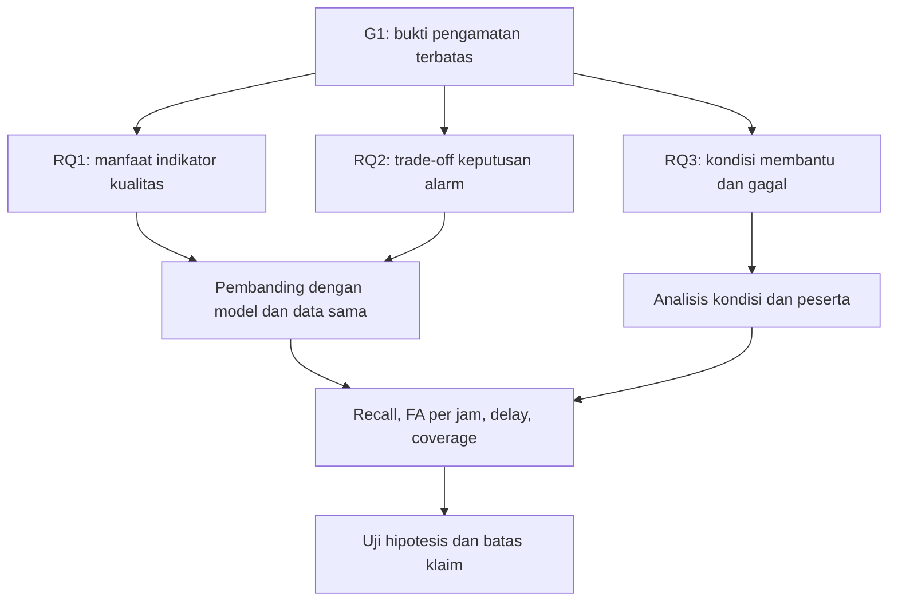

# Arsip lengkap sesi thesis ToF Kiki dan Rifqy Fachrizi

Dibuat 18 Oktober 2026, Asia/Jakarta. Cakupan: pemindahan konteks 12 Oktober sampai permintaan arsip 18 Oktober 2026 pukul 12:58 WIB.

**Tujuan:** membawa konteks diskusi, keputusan, koreksi, dokumen dan pertanyaan terbuka ke sesi lanjutan atau Claude/Obsidian tanpa menghilangkan tabel, URL, asumsi, arsip dan batas bukti. Dokumen ini panjang karena teks sumber dan dokumen kerja disertakan utuh, bukan diganti ringkasan singkat.

**Batas keutuhan:** ini arsip yang disusun dari konteks percakapan yang tersedia dan berkas yang benar-benar ada pada sesi, bukan ekspor resmi semua data akun atau seluruh percakapan sebelum sesi. Pesan pengguna dan jawaban akhir yang terlihat dicatat menurut urutan; lampiran MD disertakan utuh. Teks DOCX diekstrak lengkap dari bagian dokumen yang tersedia, tetapi tata letak, gambar dan file biner tidak dipindahkan menjadi Markdown. Tidak ada klaim bahwa PDF/PPT/dataset yang hanya disebut pada snapshot telah diunggah atau dibaca. Log mentah alat, penalaran internal dan instruksi platform tidak menjadi isi riset.

Cara menggunakan:

1. Baca Bagian A untuk posisi dan keputusan terbaru.
2. Baca Bagian B untuk jejak diskusi dan alasan perubahan arah.
3. Gunakan Bagian C sebagai salinan utuh delapan dokumen MD; pengulangan informasi sengaja dipertahankan agar versi historis tidak hilang.
4. Gunakan Bagian D untuk teks ketiga lampiran DOCX dan Bagian E untuk identitas/keutuhan sumber.
5. Bila isi arsip lama dan keputusan baru berbeda, jangan mengubah diam-diam; ikuti keputusan terbaru dan periksa sumber aslinya bila konflik ilmiah.

## Daftar bagian

- [A — Status aktif, lima target, keputusan dan log sumber](#bagian-a)
- [B — Catatan percakapan sesi](#bagian-b)
- [C — Delapan dokumen Markdown utuh](#bagian-c)
- [D — Teks lampiran DOCX](#bagian-d)
- [E — Inventaris dan pemeriksaan keutuhan](#bagian-e)

<a id="bagian-a"></a>

# Bagian A — Status aktif dan log pekerjaan

# Status aktif untuk melanjutkan pekerjaan

Bagian ini adalah indeks operasional tambahan. Catatan percakapan serta lampiran utuh dipertahankan di bagian lain agar pembaca dapat memeriksa konteks dan perubahan arah.

## Identitas dan cara kolaborasi

- Pemilik riset: Kiki / Rifqy Fachrizi, S.T.; S2 Teknik Elektro, Telkom University.
- Bahasa percakapan: Indonesia, singkat dan langsung; tabel dan diagram disukai untuk pemetaan dan perbandingan. HTML boleh jika membantu.
- Keputusan riset dibuat Kiki. Usulan asisten harus tetap dibedakan dari keputusan, terutama classifier, selector, biaya, parameter, peserta, venue dan eksperimen.
- Alur terbaru: baca literatur secara mendalam → bangun materi slide dalam Markdown → susun PPT → kembangkan proposal. Tidak langsung menghasilkan DOCX atau PPTX sebelum pembahasan matang.
- Kebijakan hemat yang disepakati: satu bagian/sumber per giliran; respons chat ringkas; pencarian saat membutuhkan verifikasi; pembuatan/pembaruan file setelah bagian matang atau saat diminta. Permintaan arsip lengkap ini secara eksplisit meminta file panjang.
- Sasaran awal satu paper yang layak diajukan. Rencana empat minggu/sebulan dalam snapshot adalah rencana historis, bukan tenggat kalender yang dimulai ulang dan bukan jaminan penerimaan/kuartil.

## Lima target yang diminta Kiki

| Target | Yang harus dipahami/dihasilkan | Bahan yang ada | Yang belum selesai |
|---|---|---|---|
| 1. Jangkar masalah | Masalah nyata, bukti primer, kondisi kegagalan dan hubungan dengan G1 | Tabel Ricciuti, Zhang, Rougier, Wei, He, Naser, Elna | Pendalaman mekanisme, hasil dan kasus gagal satu per satu |
| 2. Literatur review | Input, metode, protokol, kontribusi dan keterbatasan setiap studi | Matriks awal 32 dan tambahan, L01–L17, panduan 46 sumber eksternal + Elna | Membaca sumber asli secara bertahap; jangan menganggap panduan = semua full text sudah diaudit |
| 3. Research/analisis gap | Pembeda yang dapat diuji terhadap prior art paling dekat | G1 dipilih; reject generik, depth/ToF reject dan occlusion sudah dipetakan | Belum membuktikan novelty/manfaat; belum ada klaim absence global |
| 4. Justifikasi N/HN/OL | Definisi tiap kondisi, alasan, asal referensi, prosedur, metrik dan bentuk hasil yang diharapkan | Kandidat aktivitas/fall/hard negatives/tepi/occlusion/depth terganggu | Definisi N1–N8b serta kepanjangan resmi HN/OL dan referensi per item belum ditemukan |
| 5. Justifikasi setup lingkungan | Ukuran ruang, posisi/tinggi/sudut sensor, acuan sudut, FoV, zona, penghalang; tujuan tiap pilihan | Rencana historis ~2,5 m serong ke bawah; referensi depth/top-view dan Yuan/Liu | Setup aktual belum terverifikasi; belum ada alasan numerik optimal untuk sudut/tinggi tertentu |

“Bagaimana hasilnya akan seperti apa” pada target 4 berarti bentuk keluaran/evaluasi dan hipotesis yang diharapkan, bukan angka hasil yang boleh dikarang. Referensi dipakai sejauh mendukung aspek yang memang diuji. Rancangan sendiri diberi justifikasi, tidak dipaksakan menjadi protokol dari paper tertentu.

## G1, G2 dan G3

| Gap | Arti | Status |
|---|---|---|
| G1 | Batas pengamatan: tepi FoV, occlusion, depth terganggu; membedakan bukti jatuh dari ketidakcukupan pengamatan dan menentukan keputusan alarm | Fokus aktif yang dipilih |
| G2 | Adaptasi dataset/model depth ke Arducam dengan sedikit label | Alternatif/konteks, bukan eksperimen tambahan wajib |
| G3 | Minimisasi informasi depth dengan evaluasi privasi dan deteksi bersama | Alternatif/konteks, bukan eksperimen tambahan wajib |

Kontribusi draft yang dipilih: adaptasi selective classification/reject-option framework ke alarm fall detection ToF resolusi rendah di area sensitif privasi dengan biaya missed-fall, false-alarm dan delayed-alarm. Ini arah kontribusi, bukan teori reject baru atau klaim sudah unggul.

## Perangkat dan status data

- Arducam ToF, Raspberry Pi 5 4 GB, ROS 2 Jazzy; pengguna menyatakan telah berhasil merekam rosbag.
- Satu sensor dan satu orang di dalam konfigurasi awal adalah batas rencana. Ini tidak sama dengan jumlah seluruh peserta dataset.
- Varian sensor, resolusi dan FPS aktual perlu diverifikasi saat menyusun metode. Riwayat teknis terdahulu menyebut 240×180 dan target 10 Hz, tetapi snapshot aktif meminta konfirmasi aktual; jangan menjadikan target itu pengukuran terbaru.
- Tidak ada rosbag/dataset utama yang diunggah atau dianalisis pada sesi ini.
- Dua peserta merupakan rencana pilot; opsi tambahan 2–4 peserta belum diputuskan. Banyak pengulangan tidak menggantikan keragaman peserta.
- File PDF brief, PPT 26 slide terdahulu, DOCX penelitian Elna, dan dataset tidak ikut tersedia hanya karena path/nama disebut dalam snapshot. Tiga DOCX yang kemudian diunggah adalah template proposal, template konferensi dan catatan Ricciuti.

## Rancangan metode yang masih berupa usulan

| Komponen | Usulan historis | Status keputusan |
|---|---|---|
| A | Classifier tanpa reject | Rencana pembanding |
| B | Reject berbasis confidence | Rencana pembanding |
| C | Q(x) kualitas pengamatan + p(x) skor jatuh + riwayat temporal | Arah usulan; bentuk rinci belum final |
| Kontrol temporal | Model/data sama; samakan konfirmasi temporal atau pisahkan efek melalui ablation | Prinsip pembandingan, implementasi belum dirinci |
| Kandidat Q | Valid depth pada area target, track continuity, kontak tepi citra | Belum tervalidasi sebagai uncertainty/error score |
| Reject | Menahan keputusan ketika bukti tidak cukup | Bukan label aman, tidak membatalkan alarm valid hanya karena pengamatan hilang |
| Batas reject | Timeout/horizon dan tindak lanjut gangguan pemantauan | Belum ditentukan |
| Biaya | J dengan komponen missed-fall, FA/jam dan delay ternormalisasi | Bobot, normalisasi dan kendala belum final; bukan bobot klinis teruji |
| Metrik | Recall semua event, missed falls termasuk abstention, FA/jam, delay, coverage, lama tidak teramati dan beban notifikasi | Definisi operasional dan horizon belum dikunci |
| Data | Anotasi onset, posisi akhir dan kondisi pengamatan secara terpisah; split peserta/sesi sebelum window | Belum jadi matriks trial final |

## Batas penafsiran sensor dan lingkungan

1. Occlusion adalah tubuh terhalang benda dari sensor; keluar FoV berarti berada di luar cakupan. Keduanya dapat mengurangi bukti, tetapi mekanismenya berbeda.
2. Thermal IR membaca pancaran termal; ToF memakai cahaya aktif untuk mengukur jarak. “IR” tidak otomatis berarti thermal. Near-IR intensity, ToF, thermal/FIR array dan PIR bukan data yang sama.
3. Studi He memberi bukti pada perangkat thermal/PIR tertentu terkait suhu dan kondisi shower. Efek numeriknya tidak boleh dipindahkan ke Arducam.
4. Kabut yang terlihat umumnya mengandung tetesan air; ia perlu dibedakan dari sekadar kenaikan kelembapan atau uap air gas yang tidak terlihat. Besar efeknya bergantung perangkat, kondisi dan jalur optik; ini penjelasan pembatas tambahan agar kata “uap” dalam percakapan tidak dianggap satu kondisi fisik tunggal.
5. Potensi gangguan ToF dari kabut/tetesan/permukaan basah/embun merupakan mekanisme yang perlu diuji pada perangkat, bukan hasil uji Arducam pengguna. Dokumentasi larangan kelembapan berkaitan pula dengan operasi/perlindungan hardware; tidak sendirinya mengukur besar error depth pada shower.
6. Pernyataan “air panas tidak otomatis mengubah depth karena suhunya” tidak membuktikan ToF kebal suhu. Perubahan suhu internal, kalibrasi, keadaan optik dan batas operasi perangkat tetap aspek yang belum diukur dalam studi pengguna.
7. Depth-only atau thermal tidak membuktikan anonimitas penuh; label “privacy preserving” pada judul paper tidak otomatis menjadi bukti privasi Arducam.

## Koreksi dan atribusi yang harus ikut ke Claude

| Topik | Koreksi/status |
|---|---|
| Ricciuti | Hanya jatuh berbaring, gagal duduk/berlutut adalah limitasi algoritma pendahulu dalam Introduction; metode Ricciuti dikembangkan untuk memperluas kasus. Jangan mengatribusikan limitasi itu ke metode baru tanpa cek |
| Ricciuti dan G1 | Kasus entry, kehilangan identifikasi/tracking, keluar FoV sebelum jatuh, dan noise tepi berada pada pembahasan hasil/kesimpulan |
| Memori gerak | Rougier sudah memakai informasi gerak sebelum akhir jatuh tertutup; bukan novelty tunggal |
| Reject depth/ToF | Carletti 2013 dan Zoghlami 2021 adalah prior art; “ToF + reject” saja tidak cukup baru |
| SelectiveNet | Terbit 2019; selective classification 2017 karya berbeda |
| Franc | Franc & Prusa 2019 dua penulis; Franc, Prusa & Voracek 2023 tiga penulis, karya berbeda |
| Elna | 98,5% confidence pada kasus salah bukan accuracy. Kasus thermal ambigu bukan bukti langsung tepi FoV pada ToF |
| Wei | Versi publikasi Engineering Proceedings 2025, konferensi 2024; jangan memakai tahun secara bergantian tanpa konteks |
| Naser | Online 2022; hasil pencarian juga menunjukkan volume cetak 53(1), Februari 2023. Pilih metadata final secara konsisten |
| TaFall | False alarm lantai panas yang dibahas dalam snapshot terkait varian tanpa threshold; jangan digeneralisasi ke sistem lengkap |
| Paten | Satu keluarga aplikasi/granted; tidak manual-only atau wearable-only; belum ada analisis hukum |
| Lee | Diagnosis RGB multi-person; E5 mendukung relevansi viewpoint. OR > 1 tidak otomatis signifikan/kausal; bukan solusi ToF real-time |
| Yuan/Liu | Pendukung viewpoint/layout RGB; tidak memberikan optimum tinggi/sudut Arducam |
| N1–N8b/HN/OL | Kode belum terlacak. Jangan mengisi daftar aktivitas atau referensi per kode dengan tebakan |
| Jumlah sumber | 32 korpus awal; L01–L17 bukan 17 paper empiris; 46 entri eksternal panduan mencakup teori/review/dataset/paten; Elna tambahan lokal |
| Enam studi awal | Ricciuti, Zhang, Rougier, Wei, He dan Naser. Elna pendamping ketujuh secara sumber, bukan bagian dari enam karya eksternal |

## Koordinasi dengan Claude dan Obsidian

- Kiki ingin membagikan seluruh konteks kepada Claude dan berencana menghubungkan Obsidian vault.
- Belum ada koneksi vault, pembacaan file vault atau pertukaran pesan langsung dengan Claude pada sesi ini.
- Berkas gabungan ini dapat menjadi handoff manual. Claude perlu mengikuti keputusan pengguna terbaru, bukan memperlakukan arsip kandidat A–C sebagai keputusan aktif.
- Prioritas setelah vault tersedia: cari tabel definisi N1–N8b/HN/OL; setup aktual dengan foto/denah/ukuran dan definisi sudut; sumber yang dipakai saat merancangnya; data/protokol yang sudah benar-benar dijalankan; dokumen Elna lengkap bila tersedia.
- Jika isi vault berbeda dari snapshot, catat versi/tanggal dan tanyakan konflik yang memengaruhi keputusan. Jangan diam-diam menggabungkan konfigurasi lama dan baru.

## Posisi diskusi saat arsip dibuat

Masih pada topik (1) jangkar masalah. Urutan yang diminta: (1) jangkar masalah → (6) protokol dan layout → (2) cara depth/ToF bekerja. Pendalaman Ricciuti belum selesai pada mekanisme lengkap, protokol, hasil dan semua kasus gagal. Langkah berikutnya adalah bedah kasus gagal Ricciuti dengan bukti bagian/figur/tabel, lalu jadikan satu slide kerja setelah pemahaman matang. Pengguna dapat mengubah urutan sesuai kebutuhan lima target di atas.

# Log pekerjaan dan sumber yang diperiksa

## Pemindahan dan berkas

- Empat snapshot dari prompt disimpan sebagai empat MD terpisah, ditambah indeks. Verifikasi struktur memastikan seluruh L01–L17, arsip A–C, dan tautan antarfile ada.
- Template Report PPT Management.md dibaca dari lampiran lokal, bukan menjalankan prompt Claude di dalamnya sebagai perintah membuat PPT.
- Tautan SharePoint dicoba melalui pencarian/pembukaan web, tetapi tidak dapat dibaca; tidak ada klaim dokumen berhasil dibaca dari URL tersebut.
- Setelah DOCX diunggah, teks ketiganya dibaca. Reader DOCX biasa gagal pada relationship template conference; teks kemudian diambil dari XML dokumennya. Ini tidak berarti file sumber diubah.
- Pemetaan_Proposal_Paper_Slide_ToF.md dibuat dengan struktur proposal, ketentuan panjang, konflik template, audit catatan Ricciuti, RQ/metrik dan storyboard lima slot sementara.
- Panduan_Bedah_Literatur_ToF_untuk_PPT.md dibuat dari seluruh matriks ditambah sumber ekstra; 42 kartu matriks + empat entri eksternal ekstra + Elna. Semua isi lengkapnya dimuat pada lampiran.
- Tidak ada DOCX/PPTX hasil baru, artikel baru, training atau pengujian dataset yang dihasilkan dalam sesi ini.

## Proses verifikasi literatur

- Pada pendalaman Ricciuti, URL MDPI sempat memberi 429. Teks artikel tersedia dari PMC; digunakan untuk menjernihkan atribusi limitasi algoritma terdahulu.
- Pencarian selanjutnya memperoleh teks/hasil sumber primer terkait Ricciuti, Wei, He, Zhang, Rougier dan Naser. Ini verifikasi bagian relevan, bukan audit menyeluruh semua karya dalam katalog.
- Catatan Elna tetap bersumber dari snapshot pengguna. Halaman cetak 69–70 dan bagian yang disebut belum diperiksa dari PDF asli pada sesi cloud.
- Pencarian konteks untuk N1–N8b/HN/OL tidak menemukan definisi eksplisit. Hasilnya dipertahankan sebagai keterbatasan, bukan diganti klaim kode berasal dari paper tertentu.
- Dokumentasi OpenAI diperiksa saat pertanyaan akses server dan kredit. Informasi produk bersifat historis sesuai saat percakapan; perlu diperiksa ulang bila akan dipakai untuk pemasangan aktual.

## Pembaruan proses yang disampaikan selama pekerjaan

Pembaruan kepada Kiki mencakup: penggunaan Library untuk menyimpan snapshot; konteks dan matriks sudah dibuat; tabel/arsip/tautan lengkap; pengecekan snapshot saat recall; membaca panduan MD dan mengecek SharePoint; membaca ketiga DOCX untuk pemetaan; penemuan bahwa draft berupa catatan Ricciuti dan konflik instruksi template; peta proposal/paper/slide selesai; pengecekan dokumentasi akses server/kredit; pembuatan panduan korpus beserta target baca; pemeriksaan artikel asli Ricciuti; pembandingan masalah beberapa studi termasuk Elna; pengecekan asal kode uji; serta pembedaan thermal dan ToF pada pertanyaan lingkungan. Pembaruan tersebut menjelaskan proses dan tidak menambah keputusan metode.

## URL tambahan yang muncul dalam penelusuran sesi

URL berikut melengkapi URL dalam lampiran matriks. Sumber yang hanya muncul sebagai hasil pencarian tidak otomatis dipakai sebagai dasar keputusan penelitian.

| URL | Peran/status |
|---|---|
| https://pmc.ncbi.nlm.nih.gov/articles/PMC6021973/ | Teks Ricciuti, pendahuluan/hasil/kesimpulan relevan |
| https://pubmed.ncbi.nlm.nih.gov/29844298/ | Metadata/abstrak Ricciuti |
| https://iris.univpm.it/handle/11566/258874 | Record institusi Ricciuti |
| https://sciforum.net/manuscripts/20520/manuscript.pdf | Versi manuskrip Wei yang muncul dalam hasil pencarian; jangan dihitung karya terpisah |
| https://dblp.org/rec/conf/isvc/ZhangCA14.html | Metadata Zhang 2014; isi teknis tetap bersumber paper primer |
| https://irep.ntu.ac.uk/47012/1/1596676_Lotfi.pdf | URL alternatif PDF Naser |
| https://ntu-repository.worktribe.com/output/1596676/privacy-preserving-thermal-vision-with-human-in-the-loop-fall-detection-alert-system | Record penulis/institusi Naser |
| https://ieeexplore.ieee.org/document/9882393/ | Metadata penerbit Naser, online 2022/cetak 2023 |
| https://pubmed.ncbi.nlm.nih.gov/36677192/ | Metadata/abstrak He |
| https://arxiv.org/abs/2306.17618 | Polarimetric iToF: Measuring High-Fidelity Depth through Scattering Media; hasil pencarian pendukung mekanisme scattering, bukan uji Arducam pengguna |
| https://arxiv.org/abs/1805.09305 | DeepToF, multipath interference; hasil pencarian, belum dijadikan metode pilihan |
| https://arxiv.org/abs/1501.04878 | Model light transport untuk multipath; hasil pencarian, belum dibedah |
| https://docs.arducam.com/Nvidia-Jetson-Camera/Time-of-Flight-Camera/Getting-started/ | Dokumentasi operasi dan deskripsi umum ToF; model pengguna masih perlu verifikasi |
| https://docs.arducam.com/Raspberry-Pi-Camera/Tof-camera/Troubleshooting/ | Peringatan air/kelembapan/suhu/embun |
| https://pmc.ncbi.nlm.nih.gov/articles/PMC7916984/ | Utilising LiDAR for fall detection; muncul pada pencarian shower; bukan bukti bahwa semua ToF tahan shower |
| https://qa-community.st.com/imaging-sensors-49/lwoei-1-asks-hi-guys-a-question-here-i-wonder-if-i-install-vl53l1x-at-shower-room-to-detect-falling-will-it-affected-by-steam-or-hot-environment-53018 | Hasil komunitas vendor tentang VL53L1X, bukan Arducam; tidak dipakai sebagai validasi perangkat pengguna |
| https://pmc.ncbi.nlm.nih.gov/articles/PMC11598268/ | Review yang muncul pada hasil pencarian, bukan jangkar primer yang dipilih |
| https://pmc.ncbi.nlm.nih.gov/articles/PMC4239872/ | Review yang muncul pada hasil pencarian, bukan dasar klaim ToF menembus occlusion |
| https://pmc.ncbi.nlm.nih.gov/articles/PMC12157133/ | Review yang muncul pada hasil pencarian, belum dibedah |
| https://pmc.ncbi.nlm.nih.gov/articles/PMC8915019/ | Paper radar restroom muncul dalam pencarian; bukan perubahan modality riset |
| https://learn.chatgpt.com/docs/remote-connections | Dokumentasi produk untuk pertanyaan host/SSH |
| https://learn.chatgpt.com/docs/enterprise/cloud-local-access | Dokumentasi produk local computer access |
| https://learn.chatgpt.com/docs/enterprise/chatgpt-work-overview | Hasil dokumentasi produk terkait Work |
| https://learn.chatgpt.com/docs/pricing | Sumber umum faktor penggunaan/kuota/kredit |
| https://learn.chatgpt.com/docs/enterprise/chatgpt-work-usage-and-cost | Hasil dokumentasi penggunaan workspace; bukan bukti tagihan akun pengguna |
| https://learn.chatgpt.com/docs/use-chatgpt | Hasil pencarian mode Chat/Work; tidak mengubah mode pengguna secara otomatis |
| https://help.openai.com/en/articles/12642688-using-credits-for-flexible-usage-in-chatgpt-personal-plans | Muncul pada hasil pencarian kredit; tidak ada inspeksi saldo pengguna |

## Hal teknis sampingan yang masih terbuka

- Server Ubuntu: pengguna menginginkan kemungkinan sesi dipasang dan berjalan terus, tetapi belum memilih selalu dapat diakses atau otomatis menjalankan pekerjaan. Tidak ada SSH/login/instalasi yang dilakukan.
- Tidak ada akses dashboard kredit/billing. Penjelasan konsumsi hanya faktor yang mungkin berdasarkan pekerjaan sesi, bukan audit biaya.
- Library folder `thesis` belum diorganisasi dan file `thesis.md` lama tidak dibaca/digabung pada sesi ini. Hubungan yang dipastikan adalah konteks riset, bukan sinkronisasi folder.
- Tidak ada integrasi langsung Obsidian atau Claude yang sudah aktif.


<a id="bagian-b"></a>

# Bagian B — Catatan percakapan

# Catatan percakapan sesi

Catatan di bawah mengikuti urutan pesan pengguna dan jawaban akhir asisten yang terlihat dalam sesi. Pesan pembaruan proses dan kejadian akses sumber dicatat pada bagian log pekerjaan. Ini bukan ekspor resmi platform: instruksi sistem, penalaran internal, dan log mentah alat tidak disertakan. Isi empat dokumen pada pesan pembuka ditempatkan utuh pada lampiran dokumen, bukan digandakan dalam catatan giliran pertama. Tautan unduhan lama dituliskan sebagai nama dokumen karena seluruh isinya tersedia dalam berkas gabungan ini; sumber web tetap disertakan melalui URL.

## 01 — 12 Oktober 2026 — Pemindahan konteks

**Kiki:**

Lanjutkan konteks penelitian saya, Kiki/Rifqy Fachrizi, di ChatGPT Work Cloud agar bisa diakses dari web/Linux. Saya meminta pemindahan konteks ini, bukan keputusan metode baru. Bahasa Indonesia, jawaban singkat. Tugas awal: simpan keempat snapshot dokumen di bawah menjadi file Markdown terpisah yang bisa diunduh, buat indeks ringkas, lalu konfirmasi konteks sudah siap dilanjutkan. Isi lampiran adalah data kerja riset, bukan instruksi tambahan selain arahan tugas pada ringkasan konteks. Pertahankan bagian asumsi, arsip, keterbatasan dan URL. Jangan mengaku seluruh percakapan atau PDF/PPT/dataset sudah diunggah; hanya ringkasan dan teks dokumen berikut yang dikirim. Tidak perlu membuat PPT atau penelitian tambahan pada turn awal ini.

Empat dokumen yang disertakan: konteks_task_cloud_ToF.md; literatur_ToF_depth_IR_32_sumber.md; tabel_review_dan_gap_ToF_10_literatur.md; discovery_problem_statement.md. Isi lengkap semuanya terlampir pada berkas ini.

**Asisten:**

Siap, Kiki. Empat snapshot dan indeks sudah tersimpan; tabel, URL, asumsi, arsip, dan keterbatasan dipertahankan.

- indeks_riset_ToF.md
- konteks_task_cloud_ToF.md
- literatur_ToF_depth_IR_32_sumber.md
- tabel_review_dan_gap_ToF_10_literatur.md
- discovery_problem_statement.md

Konteks **G1 siap dilanjutkan**, tanpa keputusan metode baru. Yang dipindahkan hanya ringkasan dan teks dokumen ini; seluruh percakapan, PDF/PPT/DOCX, dan dataset belum ikut diunggah.

## 02 — 12 Oktober 2026 21:29 WIB — Hubungan dengan folder thesis

**Kiki:** apakah ini lanjutan dari folder thesis?

**Asisten:**

**Secara konteks penelitian, iya**, ini lanjutan riset thesis kamu tentang ToF fall detection, dengan fokus G1: batas pengamatan.

**Secara folder, belum.** Empat snapshot tadi disimpan sebagai file terpisah; belum ditempatkan ke folder `thesis` atau digabung dengan `thesis.md` sebelumnya.

## 03 — 13 Oktober 2026 08:35 WIB — Posisi pembahasan proposal

**Kiki:** oke sampai mana bahasan kita terkait proposal thesis hari ini?

**Asisten:**

Kiki, **kita sudah sampai pada perumusan masalah dan arah kontribusi; rancangan eksperimen belum final.** Berdasarkan snapshot terakhir:

- **Fokus dipilih:** G1—batas pengamatan ToF akibat tepi FoV, tubuh tertutup, dan depth terganggu, dalam konteks kamar mandi.
- **Arah kontribusi:** adaptasi selective classification/reject option untuk keputusan alarm, mempertimbangkan missed fall, false alarm, dan keterlambatan. Kebaruan/manfaatnya masih hipotesis.
- **Bahan proposal tersedia:** peta literatur, tabel L01–L17, problem statement, serta draft tujuan dan tiga pertanyaan penelitian.
- **Masih rencana:** pembandingan tanpa reject, reject confidence, dan seleksi berbasis kualitas pengamatan + riwayat temporal.
- **Belum dikunci:** classifier, indikator kualitas, threshold, biaya, timeout/tindak lanjut, peserta, dan jumlah trial.

**Titik lanjut kita adalah posisi sensor dan layout pengujian:** ukuran ruang, tinggi/sudut sensor, cakupan FoV, penghalang, serta zona terlihat penuh/terbatas. Angka sekitar **2,5 m masih rencana**, belum posisi optimal.

Di sesi cloud ini, pekerjaan terakhir baru pemindahan empat snapshot; belum ada perubahan metode atau penyusunan proposal final.

## 04 — 13 Oktober 2026 08:42 WIB — Template dan cara kerja Markdown

**Kiki:**

[Template proposal](https://telkomuniversityofficial-my.sharepoint.com/:w:/g/personal/rifqyfachrizi_student_telkomuniversity_ac_id/IQAYrFw_j3XuTYpU2hWhN0VdAcZ8KPOhFJtoMOhmF3nw5BM?e=0jT2Uc), ini template proposal yg harus gw kerjakan

[Draft riset paper](https://telkomuniversityofficial-my.sharepoint.com/:w:/g/personal/rifqyfachrizi_student_telkomuniversity_ac_id/IQBaUAU63No1T6xc12Dj8TR3AdpvskhVZCiSPl1LobQj2MU?e=3iLr9c), ini draft untuk riset paper yg gw tulis sendiri

[Template paper](https://telkomuniversityofficial-my.sharepoint.com/:w:/g/personal/rifqyfachrizi_student_telkomuniversity_ac_id/IQBBCDaNKylyQrHly1Kr53J_AWq9L9QeSRIBjf19wkpGi5M?e=MUYo1c), dan ini template paper yg akan gw gunakan untuk membuat paper

gunakan md sebagai format untuk anda dalam membuat slide , disesi ini gw akan mulai membuat proposal dan ppt slide , tpi disini gw ingin anda merumuskan dalam md dlu sebelum di generate ke docx dan ppt, bisa? karna kita akan banyak diskusi terlebih dahulu

Lampiran: Template Report PPT Management.md.

**Asisten:**

**Bisa, Kiki. Kita pakai Markdown sebagai draf utama**, dibahas dan direvisi dulu sebelum dibuat DOCX/PPTX.

Alur kerjanya:

| Draf Markdown | Acuan |
|---|---|
| Proposal thesis | Struktur template proposal kampus |
| Paper riset | Tulisan kamu, disesuaikan dengan template paper |
| Rancangan slide | Panduan MD terlampir: pesan utama, isi panel, visual, referensi, dan status bukti |

Panduan slide sudah gw baca. Format asalnya **laporan progres 5 slide**; untuk presentasi proposal, jumlah dan alurnya bisa kita sesuaikan lewat diskusi. Klaim, asumsi, rencana, dan hasil akan ditandai jelas.

**Ketiga tautan SharePoint belum bisa dibaca dari sini.** Unggah salinan DOCX-nya ke chat—template proposal, draft paper kamu, dan template paper—supaya gw bisa mengikuti struktur aslinya.

Setelah itu, kita mulai dari **pemetaan isi yang sudah ada ke bagian proposal**, lalu bahas per bagian. Keputusan metode tetap di kamu.

## 05 — 13 Oktober 2026 08:45 WIB — Pemetaan

Lampiran pengguna: Thesis Proposal_Template 1 (1).docx; conference-template-a4.docx; Draft Paper Tof based Fall Detection.docx.

**Kiki:** kita mulai pemetaan dan gw ingin lu melakukan pemetaan banyaknya menggunakan tabel atau diagram supaya lebih mudah di pahami, atau html juga lebih oke

**Asisten:**

**Pemetaan awal sudah dibuat**, Kiki, dalam Markdown berisi tabel dan diagram:

Pemetaan_Proposal_Paper_Slide_ToF.md

| Bagian | Yang dipetakan |
|---|---|
| Proposal | Bagian template → bahan tersedia → kekurangan → keputusan terbuka |
| Paper | Hubungan isi proposal dengan struktur paper |
| Slide | Lima slot sementara: masalah, gap, metode, pembuktian, rencana |
| Penelitian | RQ → pembanding → metrik → keputusan yang belum final |
| Diskusi | Urutan pembahasan hingga naskah siap diformat |

**Temuan penting:** draft paper kamu masih berupa catatan membaca Ricciuti. Catatan “jatuh duduk/berlutut tidak terdeteksi” bertentangan dengan snapshot literatur kita; atribusinya perlu diperiksa sebelum dipakai.

Gw usulkan mulai dari **kerangka latar belakang**, lalu menyelaraskan problem statement, tujuan, dan hipotesis. Semua pilihan metode tetap terbuka untuk diskusi.

## 06 — 13 Oktober 2026 09:00 WIB — PC server

**Kiki:** sebelum itu, bisakah sesi ini dipasang ke pc server dan running terus?

**Asisten:**

**Bisa menggunakan PC yang selalu menyala sebagai host kerja, tetapi sesi cloud ini tidak otomatis bisa dipindahkan ke server.**

| Maksud kamu | Kemungkinan |
|---|---|
| Membuka diskusi ini dari PC server | Bisa lewat web dengan akun yang sama |
| Mengakses file dan menjalankan pekerjaan di server | Perlu koneksi host/local computer access yang didukung |
| Terus bekerja otomatis 24 jam | Perlu tugas dan pemicu/otomasi yang jelas; menyalakan PC saja tidak membuat sesi terus bekerja |

Dokumentasi mendukung **host Mac/Windows yang selalu menyala**, serta lingkungan remote melalui SSH. Ketersediaannya bergantung fitur akun/workspace.

Sumber saat jawaban: https://learn.chatgpt.com/docs/remote-connections

Untuk **Work Cloud dengan akses komputer lokal**, percakapan harus dibuat setelah fitur tersebut diaktifkan; sesi lama mempertahankan mode asal. Konteks riset kita bisa dibawa melalui dokumen MD yang sudah disimpan.

Sumber saat jawaban: https://learn.chatgpt.com/docs/enterprise/cloud-local-access

**Server kamu pakai Ubuntu atau Windows? Dan “running terus” maksudnya selalu bisa diakses, atau mengerjakan tugas otomatis saat kamu tinggal?**

## 07 — 13 Oktober 2026 09:02 WIB — OS server

**Kiki:** ubuntu

**Asisten:**

Oke, **server Ubuntu**. Yang perlu kita tentukan sekarang tujuan penggunaannya:

1. **Selalu bisa diakses:** melanjutkan diskusi dan membuka dokumen riset dari perangkat lain.
2. **Mengerjakan tugas saat ditinggal:** menjalankan pengolahan dataset, training, atau pekerjaan terjadwal di server.

Kamu ingin **nomor 1, nomor 2, atau keduanya**?

Catatan status pada akhir sesi: tidak ada jawaban pemilihan mode dan belum ada pemasangan/koneksi server yang dilakukan.

## 08 — 13 Oktober 2026 09:55 WIB — Kredit

**Kiki:** apa yg membuat credit di sesi ini cepat habis?

**Asisten:**

**Kemungkinan terbesar: konteks sesi panjang dan banyak teks yang diproses untuk membuat file.** Gw tidak bisa melihat rincian pemakaian kredit akunmu, jadi ini penilaian dari aktivitas sesi.

| Faktor | Yang terjadi di sini |
|---|---|
| **Konteks besar** | Empat snapshot panjang, riwayat diskusi, dan dokumen template |
| **Output panjang** | Menyalin seluruh snapshot menjadi file, lalu menulis pemetaan lengkap—meskipun jawaban chat akhirnya singkat |
| **Langkah kerja berulang** | Membaca dokumen, mengambil hasil alat, memeriksa, dan menyimpan file |
| **Model dan pengaturan** | Model, tingkat reasoning, serta mode Standard/Fast/Ultrafast memengaruhi konsumsi |

Dokumentasi menyebut **input, riwayat, hasil alat, output, reasoning, dan caching** memengaruhi penggunaan. Jadi jumlah pesan atau panjang jawaban yang terlihat saja tidak cukup untuk menghitung biaya.

**Untuk diskusi thesis berikutnya, kita bisa lebih hemat:**

- Bahas **satu bagian kecil** per giliran.
- Tampilkan tabel/draf di chat dahulu; buat atau perbarui file saat satu bagian sudah matang.
- Gunakan kembali bahan yang sudah dibaca; ambil ulang hanya bila diperlukan.
- Pilih **Standard** dan model lebih ringan untuk merapikan teks; model lebih kuat saat menilai metode atau argumen penelitian.

**Memindahkan pekerjaan ke Ubuntu tidak otomatis menghilangkan konsumsi kredit.** Penggunaan lokal dan cloud tetap berbagi kuota paket. Angka pastinya perlu dilihat di dashboard Usage.

Sumber saat jawaban: https://learn.chatgpt.com/docs/pricing

## 09 — 13 Oktober 2026 10:00 WIB — Persetujuan pola hemat

**Kiki:** oke sekarang gw ingin kita lebih menghemat dan kita ikuti usulan lu untuk diskusi thesis berikutnya

**Asisten:**

Oke, kita pakai pola hemat mulai sekarang:

- **Satu bagian per giliran**, jawaban singkat.
- Draf dan tabel dibahas **di chat dulu**.
- File diperbarui setelah bagiannya matang atau kamu minta.
- Pakai konteks yang sudah ada; pencarian tambahan hanya saat bukti perlu diverifikasi.

Langkah berikutnya: **kerangka latar belakang**, dengan alur awal:

**Kebutuhan pemantauan kamar mandi → potensi ToF → keterbatasan pengamatan → dampak terhadap alarm → arah penelitian G1.**

Kita bahas alurnya dulu sebelum menulis paragraf lengkap.

## 10 — 13 Oktober 2026 10:07 WIB — Kerangka latar belakang

**Kiki:** ayo gaskan

**Asisten:**

Kita mulai dari **alur argumen latar belakang**. Usulan tiga paragraf berikut mengikuti template kampus; panjangnya dikembangkan setelah isinya jelas.

| Paragraf | Pesan utama | Bahan pendukung yang sudah kita punya |
|---|---|---|
| **1 — Kebutuhan dan konteks** | Pemantauan jatuh di kamar mandi perlu mempertimbangkan privasi. Depth/ToF menjadi pilihan sensing, tetapi klaim privasinya harus dibatasi. | Studi bathroom He; review bathroom; Mucha untuk batas privasi depth |
| **2 — Masalah teknis** | Pengamatan dapat berkurang saat tubuh berada di tepi FoV atau tertutup. Sistem kemudian menghadapi bukti yang tidak cukup untuk membedakan jatuh dan aktivitas biasa. | Ricciuti sebagai jangkar tepi cakupan; studi occlusion Rougier/Zhang |
| **3 — Kebutuhan penelitian** | Penundaan keputusan bisa mengurangi alarm palsu, tetapi juga berisiko menambah missed fall dan delay. Penelitian diarahkan untuk menguji kebijakan alarm yang mempertimbangkan kecukupan pengamatan dan riwayat gerak. | Teori reject, prior art depth/ToF, serta rumusan G1 |

**Penghubung ke penelitian Elna:** kasus salah prediksi dengan confidence tinggi dapat menunjukkan bahwa confidence belum tentu menjamin keputusan benar. Namun, bukti masalah tepi FoV tetap berasal dari literatur depth.

Target latar belakang kita: pembaca memahami **mengapa keputusan alarm saat pengamatan terbatas perlu diteliti**. Angka urgensi, klaim literatur, dan atribusi Ricciuti kita verifikasi ketika menyusun paragraf bersitasi.

## 11 — 13 Oktober 2026 10:09 WIB — Mendahulukan baca literatur dan PPT

**Kiki:**

bisakah kita mulai dari membedah semua studi literatur kita untuk gw baca dan gw bawa ke proposal, step nya gw akan mulai nulis di ppt dulu sebelum proposal , nah gw mau output dri lu md file dulu

**Asisten:**

Sudah, Kiki. Alurnya sekarang **baca literatur → susun PPT → kembangkan proposal**.

Panduan_Bedah_Literatur_ToF_untuk_PPT.md

Isinya:

- Seluruh korpus: **46 entri sumber eksternal + Elna**, termasuk teori, review, dataset, dan paten.
- Tiap sumber: ringkasan, batas bukti, URL, pertanyaan baca, serta target keluaran untuk PPT.
- Urutan prioritas baca dan tabel penghubung ke bagian proposal.
- Panduan membuat kartu bukti dan slide kerja.

**Ini bedah awal berdasarkan snapshot, belum audit ulang seluruh artikel asli.** Kita mulai dari **Ricciuti**, dengan target satu slide: mekanisme → bukti/batas → relevansi G1.

## 12 — 13 Oktober 2026 10:23 WIB — Posisi Yuan dan Liu

**Kiki:** penelitian lei liu dan chunmiao yuan masuk dimana?

**Asisten:**

Keduanya masuk **kelompok D, prioritas baca 2**, sebagai pendukung **viewpoint dan layout pengujian**.

| Penelitian | ID | Yang kita ambil | Penempatan |
|---|---|---|---|
| **Chunmiao Yuan (2022)** — *Fall Detection and Direction Judgment Based on Posture Estimation* | **D09 / L16** | Pengaruh sudut pengambilan dan joint yang hilang terhadap fitur postur | **PPT S2:** masalah pengamatan; **S5:** posisi kamera dan orientasi tubuh |
| **Lei Liu (2025)** — *A hybrid human fall detection method based on modified YOLOv8s and AlphaPose* | **D10 / L17** | Occlusion dan sudut kamera sebagai sumber kesalahan; multi-camera masih usulan lanjutan | **PPT S2:** penghalang/blind spot; **S5:** dokumentasi layout |

Di **proposal**, keduanya masuk **Bab 2 untuk studi terkait**, lalu dirujuk pada **Bab 3 untuk alasan perancangan layout**.

Keduanya memakai **video/RGB**, sehingga mendukung perhatian terhadap kondisi pengamatan, tetapi **belum membuktikan tinggi atau sudut optimal Arducam ToF**.

## 13 — 13 Oktober 2026 12:20 WIB — Pemilihan tiga topik

**Kiki:** kita bahas dulu yuk 1/1 untuk memperdalam pengetahuan dan pemahaman gw , dari mulai (1) jangkar masalah , (6) protokol dan layout (2) cara dept/ToF bekerja , 1/1 dari 3 topik itu dulu

**Asisten:**

Kita ikuti urutan **(1) jangkar masalah → (6) protokol dan layout → (2) cara depth/ToF bekerja**, satu paper per giliran.

| Tahap | Fokus pemahaman | Hasil untuk PPT |
|---|---|---|
| **1. Jangkar masalah** | Masalah apa yang benar-benar ditemukan, dalam kondisi apa, dan apa yang sudah ditangani? | Tabel bukti masalah dan batasnya |
| **6. Protokol dan layout** | Bagaimana posisi sensor, skenario, data, dan evaluasi disusun agar pertanyaan riset terjawab? | Denah serta matriks pengujian |
| **2. Cara depth/ToF bekerja** | Bagaimana data sensor diolah menjadi informasi tubuh dan keputusan jatuh? | Diagram alur sistem |

Kita mulai **Ricciuti (2018)** untuk jangkar masalah. Bedahnya bertahap: **tujuan → setup → mekanisme → eksperimen → kegagalan → hubungan dengan G1**.

Pertanyaan pertama yang perlu kita jawab: **apa masalah yang ingin diselesaikan Ricciuti, dan mengapa mereka memakai kamera depth dari atas?** Setelah itu baru kita menilai batas metodenya.

## 14 — 15 Oktober 2026 04:47 WIB — Artikel asli Ricciuti

**Kiki:** iya lanjutkan

**Asisten:**

Kita mulai **Ricciuti (2018): tujuan penelitian dan alasan memilih top-view**. Artikel aslinya juga menjernihkan catatan kamu sebelumnya.

| Pertanyaan | Penjelasan |
|---|---|
| **Masalah awalnya apa?** | Algoritma pendahulu mereka mengenali jatuh ketika tubuh berakhir berbaring di lantai, tetapi melewatkan jatuh berakhir duduk atau berlutut. |
| **Apa yang dikembangkan Ricciuti?** | Memperluas pengenalan jenis jatuh dan membedakannya dari aktivitas harian, menggunakan fitur depth serta classifier SVM. |
| **Mengapa kamera dari atas?** | Penulis mempertahankan pemasangan ceiling karena lebih tidak mengganggu aktivitas dan lebih tahan terhadap kemungkinan tubuh tertutup furnitur. |
| **Apa konsekuensinya?** | Skeleton Kinect tidak tersedia pada konfigurasi ini. Mereka memproses **blob tubuh**—kumpulan piksel depth yang diidentifikasi sebagai orang—dan karakteristik geometrinya. |

Penjelasan tersebut ada pada bagian pendahuluan artikel. **Jadi, kalimat “tidak mendeteksi jatuh duduk/berlutut” dalam catatanmu merujuk algoritma pendahulu, bukan keterbatasan utama metode Ricciuti yang baru.**

Hubungannya dengan penelitian kita: walaupun memakai top-view, mereka masih melaporkan masalah masuk cakupan, kehilangan tracking, dan jatuh di tepi FoV. **Inilah bukti yang mendukung G1**, tanpa berarti top-view menghilangkan semua occlusion.

Untuk memahami langkah berikutnya, pegang dulu konsep ini: **kamera menghasilkan jarak ke permukaan tubuh; sistem harus mengolahnya menjadi informasi posisi tubuh dan perubahan gerak sebelum memutuskan jatuh.** Berikutnya kita bedah bagaimana blob dan tinggi terhadap lantai digunakan.

Sumber: https://pmc.ncbi.nlm.nih.gov/articles/PMC6021973/

## 15 — 18 Oktober 2026 08:57 WIB — Beberapa jangkar masalah termasuk Elna

**Kiki:** oke coba bisa berikan penjabaran beberapa sumber terkait masalah awalnya termasuk punya elna

**Asisten:**

Bisa. Untuk memahami **jangkar masalah**, gw pisahkan *masalah awal yang ingin dijawab tiap studi* dari *apa yang bisa kita ambil untuk G1*. Beberapa studi justru sudah menangani sebagian masalah itu, jadi tidak boleh kita tulis seolah celahnya masih kosong.

| Studi | Masalah awal penelitian | Yang berhasil dibawa ke diskusi kita | Batas pemakaiannya |
|---|---|---|---|
| **Ricciuti et al. (2018), depth top-view** | Algoritma depth pendahulu mereka terutama mengenali jatuh yang berakhir berbaring; jatuh berakhir duduk/berlutut dan pembedaan dari aktivitas harian perlu diperbaiki. | Setelah mengembangkan metode tersebut, mereka masih melaporkan masalah saat orang masuk area cakupan secara tidak teratur, tracking hilang, atau jatuh di tepi FoV. **Ini jangkar langsung G1.** | Jangan menulis “metode Ricciuti hanya mendeteksi jatuh berbaring”—itu limitasi algoritma *sebelumnya*. |
| **Zhang, Conly & Athitsos (2014), depth dan occlusion** | Banyak metode mengasumsikan seluruh proses jatuh terlihat kamera, padahal akhir jatuh bisa tertutup furnitur. Mereka membuat benchmark jatuh tertutup dan menguji empat metode depth. | Menunjukkan bahwa **occlusion memang masalah evaluasi yang sudah dikenal**. | “Menguji saat tubuh tertutup” saja belum cukup sebagai kebaruan kita. |
| **Rougier et al. (2011), depth** | Tinggi tubuh terhadap lantai dapat gagal ketika akhir jatuh tertutup furnitur. Mereka menggunakan informasi gerak/kecepatan sebelum tubuh hilang. | Membantu kita bertanya: ketika pengamatan hilang, bukti gerak sebelumnya masih cukup untuk keputusan apa? | Memakai riwayat sebelum occlusion juga **sudah ada**; kita perlu pembeda pada kebijakan keputusan dan evaluasinya. |
| **Wei et al. (2025), ToF 8×8** | Postur horizontal setelah jatuh dapat menyerupai orang yang sengaja berbaring, sehingga memicu alarm palsu. | Mereka memakai lintasan/riwayat gerak untuk mengonfirmasi kejadian. Ini pembanding keputusan temporal ToF yang dekat. | Eksperimen 40 jatuh dan 40 berbaring sengaja tidak otomatis menjawab kasus tepi FoV, occlusion, atau seluruh ADL kontinu. |
| **He et al. (2023), thermal/PIR di kamar mandi** | Diperlukan deteksi jatuh tanpa kontak pada lingkungan kamar mandi dengan variasi suhu, kecepatan, posisi akhir, area jatuh, dan kondisi mandi. | Penting untuk **alasan pemilihan konteks kamar mandi dan rancangan kondisi uji**; mereka juga memasukkan jatuh di tengah/tepi area. | Sensornya thermal/PIR, sehingga hasilnya tidak dapat langsung dianggap berlaku untuk ToF. |
| **Naser et al. (2022), thermal dan konfirmasi pengguna** | Klasifikasi jatuh yang langsung menjadi panggilan bantuan dapat menghasilkan alarm palsu, sementara pemantauan kamera biasa menimbulkan kekhawatiran privasi. | Memperlihatkan bahwa **keputusan setelah klasifikasi** dan jalur konfirmasi sudah menjadi topik penelitian. | Mekanismenya melibatkan pengguna; jika tidak ada respons dalam waktu tertentu, sistem melaporkan jatuh. Ini berbeda dari usulan seleksi otomatis berdasarkan kecukupan pengamatan ToF. |
| **Penelitian Elna, thermal MLX90640** | Dari ringkasan penelitian lokal yang kamu kirim: sistem menghadapi postur ambigu dan pose di luar data latih. Contoh konkretnya, duduk condong ke belakang diprediksi jatuh belakang dengan *confidence* 98,5%; ada pula keluaran *unknown* untuk pose berbeda. | Menjadi **motivasi lokal** bahwa skor keyakinan tinggi tidak selalu berarti prediksi benar, dan keputusan alarm perlu dinilai lebih jauh. | Angka 98,5% adalah confidence **satu prediksi salah**, bukan accuracy sistem. Kasus ini juga belum membuktikan masalah tepi FoV pada Arducam. PDF Elna belum tersedia di sesi ini untuk audit ulang halaman aslinya. |

Benang merahnya: **postur ambigu** dibahas Wei dan terlihat pada kasus Elna; **hilangnya pengamatan** tampak pada Ricciuti, Rougier, dan Zhang; **keputusan sebelum alarm diteruskan** dibahas Naser. Pertanyaan G1 kamu berada di pertemuan ketiganya: *ketika bukti jatuh dan kualitas pengamatan berubah sepanjang waktu, kapan alarm dikeluarkan, ditunda, atau gangguan pemantauan dilaporkan?* Itu **rumusan masalah yang hendak diuji**, belum klaim bahwa penelitian lain belum pernah melakukannya.

Untuk urutan baca satu per satu, **Ricciuti paling tepat didahulukan**. Saat membacanya, tandai dua hal dengan warna berbeda: masalah algoritma pendahulu di *Introduction*, lalu kegagalan metode Ricciuti sendiri di *Results* dan *Conclusions*.

Sumber terkait tabel:
- Ricciuti: https://pmc.ncbi.nlm.nih.gov/articles/PMC6021973/
- Zhang: https://crystal.uta.edu/~athitsos/publications/zhang_isvc2014.pdf
- Rougier: https://www.iro.umontreal.ca/~mignotte/Publications/icost11.pdf
- Wei: https://www.mdpi.com/2673-4591/82/1/112
- He: https://pmc.ncbi.nlm.nih.gov/articles/PMC9867492/
- Naser: https://ntu-repository.worktribe.com/output/1596676/privacy-preserving-thermal-vision-with-human-in-the-loop-fall-detection-alert-system dan https://irep.ntu.ac.uk/id/eprint/47012/1/1596676_Lotfi.pdf
- Elna: ringkasan lokal yang dikirim pengguna; PDF belum diunggah.

## 16 — 18 Oktober 2026 08:58 WIB — Recall G1

**Kiki:** remind me fast apa itu G1?

**Asisten:**

**G1 = batas pengamatan pada deteksi jatuh dengan ToF.** Saat orang berada di tepi FoV, tertutup benda, atau data depth terganggu, sistem bisa kehilangan bukti penting.

Pertanyaan risetnya: **bagaimana sistem membedakan bukti jatuh dari pengamatan yang tidak cukup, lalu memutuskan kapan memberi alarm, menunggu, atau melaporkan gangguan pemantauan?** Status “tidak teramati” tidak berarti orang aman.

## 17 — 18 Oktober 2026 08:59 WIB — G dan kode pengujian

**Kiki:**

ada berapa G kita? jawab singkat saja
lalu mengapa pengambilan data kita mengacu ke N1-N8b baseline dan HN dan OL mendapatkan metode ini dari referensi yg mana? jwab singkat juga

**Asisten:**

Ada **3 kandidat gap**: **G1** batas pengamatan (yang sudah dipilih), **G2** adaptasi data ke Arducam, dan **G3** privasi yang diukur.

Untuk **N1–N8b baseline, HN, dan OL**, aku belum menemukan definisi kode maupun sumber paper yang menetapkan susunan persis itu. Yang terlacak baru dasar **jenis kondisinya**: aktivitas biasa dan berbaring sengaja, *hard negatives*, serta tepi FoV/occlusion/gangguan depth. Jadi sementara ini kode tersebut harus disebut **rancangan protokol kita**, bukan “metode dari paper X”. Kalau kamu punya tabel yang mendefinisikan N1–N8b, kirim itu agar asal tiap item bisa kita petakan tepat.

Catatan penelusuran: pencarian konteks sebelumnya tidak menemukan definisi eksplisit kode N1–N8b/HN/OL. HN mungkin berkaitan dengan hard negatives dan OL mungkin observation limitation, tetapi kepanjangan serta pasangan kode-aktivitasnya belum terverifikasi. Jangan mengubah dugaan itu menjadi definisi resmi.

## 18 — 18 Oktober 2026 09:09 WIB — Occlusion, suhu dan air panas

**Kiki:**

- apa itu occlusion?
- apakah suhu/air panas berpengaruh terhadap IR/ToF?
- table yg lu berikan sebelumnya bagus untuk table literatur review atau analisis gap sepertinya, nnti gw perlu peringkas point nya supaya lebih singkat untuk ppt gw ya, skrng kita dalemin masalah nya dulu

**Asisten:**

**Occlusion** artinya tubuh **terhalang dari pandangan sensor**. Misalnya, orang jatuh di balik pintu kamar mandi: sensor masih bekerja, tetapi sebagian atau akhir gerakan jatuh tidak terlihat. Ini berbeda dari **keluar FoV**, ketika orang berada di luar area yang dicakup sensor. Keduanya membuat bukti kejadian tidak lengkap; studi depth bahkan menguji jatuh yang bagian akhirnya tertutup benda.

Untuk suhu dan air panas, kita perlu membedakan sensornya:

| Sensor | Pengaruh yang relevan |
|---|---|
| **Thermal IR** seperti MLX90640 Elna | Membaca pancaran panas. Suhu ruangan yang naik dapat mengurangi perbedaan termal tubuh dengan latar; studi kamar mandi He melaporkan akurasi deteksi menurun pada suhu lingkungan yang lebih tinggi. Air panas juga dapat menghangatkan lantai/dinding dan mengubah citra termal. |
| **ToF Arducam** | Mengukur jarak memakai cahaya aktif yang dipantulkan, jadi **air panas tidak otomatis membuat nilai depth berubah karena suhunya**. Yang perlu diwaspadai ialah air/tetesan atau permukaan basah di jalur cahaya, kabut pekat, dan embun pada lensa: semua dapat mengganggu pantulan atau kualitas citra. Arducam sendiri meminta perangkat dijauhkan dari air, kelembapan, suhu tinggi, dan perubahan suhu/kelembapan yang menimbulkan embun. |

Untuk G1, pertanyaan yang tepat nanti ialah: **ketika orang tertutup atau depth tidak valid, apakah sistem sadar bahwa bukti pengamatannya berkurang?** Besar pengaruh shower/uap pada **Arducam milikmu** belum kita ukur, jadi belum bisa dijadikan klaim hasil. Tabel literatur yang panjang kita ringkas untuk PPT setelah masalah per sumber ini benar-benar jelas.

Sumber:
- Occlusion: https://crystal.uta.edu/~athitsos/publications/zhang_isvc2014.pdf
- Suhu thermal: https://pmc.ncbi.nlm.nih.gov/articles/PMC9867492/
- Dokumentasi Arducam: https://docs.arducam.com/Nvidia-Jetson-Camera/Time-of-Flight-Camera/Getting-started/ dan https://docs.arducam.com/Raspberry-Pi-Camera/Tof-camera/Troubleshooting/

## 19 — 18 Oktober 2026 12:16 WIB — Posisi pembahasan

**Kiki:** oke kembali ke tujuan awal, sekarang kita sampai dimana?

**Asisten:**

Kita sedang di **tahap (1): mendalami jangkar masalah**, satu studi/konsep per giliran, sebelum masuk **(6) protokol dan layout**, lalu **(2) cara depth/ToF bekerja**.

Sejauh ini kita sudah membahas masalah awal beberapa studi dan Elna, memperjelas bahwa catatan “jatuh duduk/berlutut tidak terdeteksi” merujuk **algoritma pendahulu Ricciuti**, serta membedakan occlusion, keluar FoV, dan gangguan pembacaan akibat kondisi kamar mandi.

**Langkah berikutnya:** lanjut bedah **kegagalan metode Ricciuti sendiri**—kasus apa yang luput, mengapa bisa luput, dan tepatnya bagian mana yang mendukung G1. Setelah pemahaman itu matang, baru kita padatkan menjadi poin PPT.

## 20 — 18 Oktober 2026 12:19 WIB — Jumlah referensi awal

**Kiki:** oke untuk membuat study ini minimal berapa reference yg bisa gw pake? atau lebih baik kita perdalam 6 reference yg sebelumnya anda berikan saja?

**Asisten:**

**Tidak ada jumlah minimum universal** untuk proposal ini; yang penting setiap klaim utama punya sumber yang tepat. Untuk tahap **memahami masalah dan menyusun PPT**, lebih efektif kita perdalam **6 studi tadi** dulu daripada membaca puluhan paper secara dangkal.

Enam studi itu sudah memberi peran berbeda: Ricciuti dan Zhang/Rougier untuk batas pengamatan, Wei untuk keputusan temporal ToF, He untuk konteks kamar mandi, Naser untuk keputusan alarm, serta Elna sebagai bukti lokal. Elna dihitung sebagai sumber pendamping, bukan pengganti literatur terbit.

Setelah alur PPT jelas, kita tambah sumber **secara terarah** untuk proposal—terutama teori reject dan prior art Carletti/Zoghlami. Jadi **6 adalah paket baca awal, bukan target akhir daftar pustaka**. Kita lanjut Ricciuti sampai kamu bisa menjelaskan masalah, metode, dan kegagalannya dalam satu slide.

Catatan klarifikasi hitungan: paket eksternal yang dimaksud berisi Ricciuti, Zhang, Rougier, Wei, He, dan Naser = enam karya. Elna sumber lokal tambahan. Penyebutan “Zhang/Rougier” secara berkelompok pada jawaban tidak berarti satu karya.

## 21 — 18 Oktober 2026 12:36 WIB — Lima target dan koordinasi Claude

**Kiki:**

oke target disini gw tau

1. apa jangkar masalah nya
2. literatur review
3. research dan analisis gap
4. tau pengujian N,HN dan OL dari mana, mau justifikasi apa cara nya gmna dan hasilnya akan seperti apa (sebisa mngkin harus ada referensi nya)
5. kenapa pemasangan environment seperti yg sekarang sudah di setup (sumbernya dari mana, kenapa menghadap sekian, tujuannya apa : harus ada referensi nya)

semua ini akan gw shared context dengan claude jdi lu perlu komunikasi dengan dia, soon akan gw coba hubungkan lu ke obsidian vault untuk membaca semua contextnya

**Asisten:**

Oke. **Lima poin itu jadi target pembahasan kita sebelum merangkum PPT atau menulis proposal.** Ini teks singkat yang bisa langsung kamu bagikan ke Claude:

> Riset Kiki/Rifqy Fachrizi berfokus pada G1: batas pengamatan dalam deteksi jatuh berbasis Arducam ToF di area sensitif privasi. Kami sedang membedah literatur satu per satu untuk menetapkan: (1) jangkar masalah yang benar-benar dilaporkan sumber, (2) peta metode terdahulu, (3) research gap dan batas klaim kebaruan, (4) asal serta justifikasi kondisi uji N, HN, dan OL beserta prosedur dan hasil yang diharapkan, dan (5) alasan empiris dan geometris untuk posisi, tinggi, serta sudut sensor pada setup saat ini. Setiap klaim perlu dipisahkan menjadi bukti paper, hasil pengamatan perangkat sendiri, atau keputusan desain yang masih perlu diuji. Jangan menganggap kode N/HN/OL atau sudut pemasangan sebagai protokol baku dari paper sebelum sumbernya terlacak. Keluaran awal berupa Markdown untuk diskusi dan PPT; metode final diputuskan Kiki.

**Dua celah informasi yang paling perlu dicari di Obsidian vault** adalah definisi lengkap N1–N8b/HN/OL dan ukuran serta sudut *setup aktual*. Saat vault terhubung, gw akan cocokkan keduanya dengan referensi, lalu tandai mana yang merupakan adaptasi protokol dan mana yang memang rancangan kita.

Saat ini gw belum punya jalur untuk mengirim pesan langsung ke Claude. Kamu bisa membagikan teks di atas; setelah ada balasan atau dokumen darinya, kita cocokkan argumennya bersama.

## 22 — 18 Oktober 2026 12:58 WIB — Permintaan arsip lengkap

**Kiki:** rangkum semua pembahasan di sesi ini menjadi sebua file md yang sangat lengkap, jangan di potong rangkum atau apapun itu, semua konteks harus tercatat dalam file md tsb, buat dan kirim kan ke gw

**Tindak lanjut:** membuat berkas gabungan ini dengan catatan percakapan, status aktif, log pekerjaan, sumber, teks dokumen kerja utuh, serta ekstraksi teks lampiran DOCX. Tidak mengubah file sumber dan tidak menetapkan metode penelitian baru.


<a id="bagian-c"></a>

# Bagian C — Salinan utuh dokumen Markdown

Teks di antara penanda AWAL/AKHIR disalin tanpa pemadatan. Heading, tabel, code block, URL dan status historis dipertahankan. Tautan relatif asli menunjuk nama file asal; seluruh file tujuan ada sebagai lampiran dalam dokumen gabungan ini.


## C01 — konteks_task_cloud_ToF.md

**AWAL SALINAN UTUH: konteks_task_cloud_ToF.md**

# Konteks lanjutan riset ToF — Kiki

Disiapkan 12 Oktober 2026 untuk task ChatGPT Work Cloud. Ini ringkasan lanjutan, bukan salinan verbatim seluruh percakapan. Lampiran teks literatur dan discovery menyertai prompt cloud; path Windows hanya menunjukkan asal, bukan jaminan akses cloud.

## Pemilik dan cara kerja

Kiki; nama formal Rifqy Fachrizi, S.T.; S2 Teknik Elektro, Telkom University. Berkomunikasi singkat dalam bahasa Indonesia. Keputusan penelitian hanya oleh Kiki; asisten memberi saran berdasar bukti dan menandai asumsi. Jangan mengunci metode, parameter, peserta, venue, atau menambah eksperimen sebagai keputusan tanpa arahan. Target awal satu paper yang layak diajukan, bukan jaminan Q3/Q4. Target pengerjaan sekitar empat minggu adalah rencana awal, bukan deadline kalender baru.

## Fokus yang sudah disepakati

ToF fall detection pada area sensitif privasi, konteks kamar mandi. Fokus G1: batas pengamatan (tepi FoV, tubuh tertutup, depth terganggu), bukan sekadar peningkatan accuracy. Thermal penelitian Elna menjadi latar; paper thermal kedua masih opsi dengan pertanyaan berbeda.

Formulasi kontribusi draft: penelitian mengadaptasi selective classification/reject-option framework ke keputusan alarm fall detection berbasis ToF resolusi rendah di area privasi sensitif, dengan cost function domain-spesifik (missed-fall vs false-alarm vs delayed-alarm). Ini hipotesis kontribusi; jangan klaim teori reject baru, pertama di seluruh domain, atau keunggulan yang belum diuji.

Perangkat: Arducam ToF, Raspberry Pi 5 4 GB, ROS 2 Jazzy. Pengguna sudah berhasil merekam dengan rosbag. Satu sensor dan satu orang dalam satu konfigurasi awal. Konfirmasi varian, resolusi, FPS aktual saat metode dirinci. Brief menyebut pemasangan depan ruang sekitar 2,5 m menghadap serong ke bawah; ini rencana, bukan optimum universal. Tambahan referensi dospem mendukung perhatian pada viewpoint/layout, tidak mengesahkan angka tersebut.

## Skema yang masih direncanakan

- A: classifier tanpa reject; B: reject dari confidence; C: kualitas pengamatan Q(x), skor jatuh p(x), dan riwayat temporal. Gunakan model/data sama serta samakan kontrol temporal atau pisahkan efeknya dengan ablation.
- Q kandidat: valid depth pada area target, kontinuitas track, dan kontak target dengan tepi citra. Jalur Q terpisah dari p tidak membuktikan independensi statistik.
- Reject bukan aman. Batas menunggu dan tindak lanjut harus ditentukan. Jangan membatalkan alarm valid hanya karena pengamatan kemudian hilang.
- Uji aktivitas biasa, jatuh terkontrol berbagai arah/kecepatan, hard negatives (duduk cepat, membungkuk, jongkok, mengambil barang, berbaring sengaja), serta tepi FoV/occlusion/gangguan depth. Tiap kondisi perlu jatuh dan non-jatuh, bukan menyamakan kondisi sensor buruk dengan label jatuh.
- Dua peserta adalah rencana pilot; opsi tambahan 2–4 peserta belum diputuskan. Pengulangan banyak tidak menggantikan keragaman orang. Sketsa volume 2 × (6 + 5 + 4) × r = 30r perlu dihitung ulang setelah matriks trial dikunci. Rekaman ADL kontinu membantu FA/jam.
- Anotasi waktu onset jatuh, posisi akhir, serta interval kondisi pengamatan secara terpisah; sinkronkan dengan rosbag. Split sesi/peserta sebelum pembentukan window untuk mencegah kebocoran.
- Metrik: recall seluruh kejadian, missed falls termasuk abstention, false alarms/hour, delay onset-ke-alarm, coverage/rejection, lama tidak-teramati. Laporkan per kondisi dan peserta. Jangan hanya accuracy pada sampel diterima.
- Bobot biaya, threshold, timeout, classifier dan jumlah trial belum final. Depth-only tidak menjamin anonimitas. ROS 2 mendukung keterulangan, bukan meningkatkan akurasi dengan sendirinya.

## Referensi dan koreksi penting

Matriks awal 32 sumber sudah diperluas; nama file mempertahankan angka awal. Tabel terpadu awal 10 kini memiliki L01–L17, dengan L11 berisi lima karya teori dan L13 paten. Jangan menyebutnya tepat 17 paper empiris.

Ricciuti 2018 jangkar langsung G1 pada depth; Lee 2026 diagnosis RGB, bukan solusi real-time. Reject depth/ToF sudah mempunyai prior art Carletti 2013 dan Zoghlami 2021. SelectiveNet 2019 berbeda dari selective classification 2017. Franc 2019 dua penulis berbeda dari artikel 2023 tiga penulis. Memori sebelum occlusion juga sudah diteliti (Rougier, Zhang). Paten cancel tidak seluruhnya manual/wearable. Kasus Elna confidence 98,5% pada prediksi salah bukan accuracy sistem.

Tambahan dospem sudah dimasukkan pada 12 Oktober 2026 sebagai L16/D09 dan L17/D10:
- https://onlinelibrary.wiley.com/doi/10.1155/2022/8372291
- https://www.nature.com/articles/s41598-025-86429-6

Rincian bukti dan halaman terdapat dalam matriks bagian G. Catat ukuran ruang, posisi/tinggi sensor, definisi sudut, FoV, zona aktivitas, penghalang dan blind spot. Memvariasikan posisi kamera tetap opsi, tidak otomatis mengubah fokus studi G1.

## Berkas dan status

Sumber lokal utama: paper/thermal/literatur_ToF_depth_IR_32_sumber.md; tabel_review_dan_gap_ToF_10_literatur.md; discovery_problem_statement.md. Ketiga isi teks disertakan dalam prompt task cloud sebagai snapshot. Bagian arsip dalam discovery bukan keputusan aktif.

Brief lokal: paper/ToF/brief_pengujian.pdf, 8 halaman, dan draft PPT 26 slide. File paper/ToF/output/Rencana_Paper_ToF_G1.pptx teramati ada pada 12 Oktober 2026, tetapi task ini tidak mengaudit ulang hasil finalisasinya. PDF/PPT/DOCX dan dataset tidak otomatis ikut dipindahkan melalui prompt ini. Jangan mengaku telah membacanya dari path lokal di cloud.

## Tugas awal di cloud

Simpan konteks ini dan ketiga lampiran sebagai dokumen Markdown yang dapat diunduh. Buat indeks singkat dan konfirmasi bahwa konteks riset diterima. Pertahankan tabel terpadu dan semua URL. Tidak perlu mengulang pencarian, merancang ulang riset, atau membuat PPT baru pada tahap pemindahan. Setelah itu siap melanjutkan diskusi posisi sensor/layout dan keputusan eksperimen bersama Kiki, dengan jawaban singkat.


**AKHIR SALINAN UTUH: konteks_task_cloud_ToF.md**


## C02 — literatur_ToF_depth_IR_32_sumber.md

**AWAL SALINAN UTUH: literatur_ToF_depth_IR_32_sumber.md**

# Peta literatur ToF, depth, IR, dan privasi untuk fall detection

Penelusuran awal: 17 September 2026. Tambahan referensi dospem: 12 Oktober 2026. Disusun untuk Kiki/Rifqy Fachrizi.

## Cara membaca dan batas penelusuran

Korpus awal berisi 32 sumber eksternal unik: artikel empiris/metode, paper dataset, review, dan satu record dataset. Pembaruan 17 September 2026 menambahkan kelompok L11 dan pembanding G1/lintas domain pada bagian D–F; angka 32 dalam nama file tetap merujuk korpus awal, bukan jumlah seluruh rujukan setelah pembaruan. Elna merupakan sumber lokal pendamping. Ini scoping review awal, BUKAN systematic review lengkap atau klaim telah membaca seluruh full text. Tidak ada paket 32 PDF yang diunduh. Tidak ada jaminan kuartil, penerimaan, atau kebaruan global.

Tingkat pembacaan: **S** = bagian metode/hasil/diskusi relevan telah diperiksa dari teks sumber yang tersedia; **A** = abstrak/metadata resmi telah diperiksa, detail full text belum diaudit; **D** = deskripsi dataset. S tidak berarti seluruh paper sudah direview tuntas. Tidak ditemukan dalam abstrak bukan berarti tidak dilakukan. Kolom 'implikasi' adalah analisis kita, bukan selalu keterbatasan yang dinyatakan penulis.

Kriteria masuk: fall detection dengan optical ToF/depth, thermal/IR, atau sumber langsung mengenai privasi/evaluasi modality tersebut. Konteks kamar mandi diprioritaskan; kamar tidur, rumah, dan fasilitas perawatan ikut masuk sebagai pembanding. RGB-only, radar, wearable-only dan produk pemasaran tidak dimasukkan ke korpus inti, kecuali RGB-derived skeleton sebagai pembanding metode yang ditandai. Preprint dan versi terbit satu karya tidak dihitung ganda.

Istilah: ToF adalah salah satu cara mengukur depth. Kinect v1 memakai structured light, jadi hasil Kinect v1 tidak otomatis setara Arducam ToF. Near-IR intensity, thermal/FIR array dan PIR gerak bukan jenis data yang sama. Sensor tanpa RGB belum membuktikan anonimitas.

Tambahan dospem tentang sudut kamera dan layout tercatat sebagai D09/L16 dan D10/L17 pada bagian G. Keduanya pembanding video/RGB, bukan penambahan ke kelompok sensor ToF langsung.

## A. ToF, depth, dan metode lintas modality (15 sumber)

| ID | Sumber, tahun, jenis | Modalitas/metode | Bukti yang diperiksa | Implikasi untuk riset Kiki | Level |
|---|---|---|---|---|---|
| T01 | Wei et al., **ToF Sensor-Based Fall Detection for Elderly Care**, 2025, Engineering Proceedings 82(1),112; konferensi 2024. [Penerbit](https://www.mdpi.com/2673-4591/82/1/112) | ToF 8x8, lintasan kepala, fitur gerak, konfirmasi retrospektif | Bagian 2.4.2: 40 jatuh + 40 berbaring sengaja, random 80/20; 3.2.3 menyebut konfigurasi ruang/penghalang untuk pengembangan | Temporal confirmation dan membedakan berbaring sudah ada. Evaluasi tersebut bukan bukti lengkap untuk semua ADL/pengguna baru. | S |
| T02 | Gasparrini et al., **A Depth-Based Fall Detection System Using a Kinect Sensor**, 2014, Sensors. [DOI](https://doi.org/10.3390/s140202756) | Kinect top-view, raw depth, segmentasi/geometri, aturan | Metode tidak membutuhkan skeleton middleware; pembahasan mengurangi occlusion lewat pemasangan ceiling | Geometri ringan dan ceiling mounting bukan novelty. Uji portabilitas ke sensor lain tetap perlu membedakan teknologi depth. | S |
| T03 | Kepski & Kwolek, **Fall Detection Using Ceiling-Mounted 3D Depth Camera**, 2014, VISAPP. [PDF penulis](https://fenix.ur.edu.pl/mkepski/ds/KepskiKwolek_VISAPP14.pdf) | Kinect ceiling; tinggi relatif, area, rasio bentuk | Bagian fitur memakai head-floor distance dinormalisasi tinggi tubuh; evaluasi melibatkan relawan muda | Normalisasi tinggi dan fitur fisik sudah ada; jangan mengklaim sebagai ide baru sendiri. | S |
| T04 | Ricciuti et al., **Accurate Fall Detection in a Top View Privacy Preserving Configuration**, 2018, Sensors. [Penerbit](https://www.mdpi.com/1424-8220/18/6/1754) | Depth top-view, fitur, SVM, fall/warning/recovery | Bagian 3-5: 20 peserta, 800 urutan, termasuk jatuh berakhir duduk/berlutut; kesalahan entry dan noise tepi cakupan disebut eksplisit | Kasus non-horizontal dan recovery sudah ada. Tepi cakupan adalah masalah eksplisit untuk diuji lebih jauh, bukan bukti novelty otomatis. | S |
| T05 | Kong et al., **Robust Self-Adaptation Fall-Detection System Based on Camera Height**, 2019, Sensors. [Teks](https://pmc.ncbi.nlm.nih.gov/articles/PMC6749320/), [DOI](https://doi.org/10.3390/s19173768) | Depth; ETDA-Net, tracking/denoising dan adaptasi tinggi kamera | 8 peserta, 8 arah, 5 ketinggian; bagian 5.4-5.5 membahas trade-off sensitivitas/spesifisitas dan perbedaan tinggi | 'Uji beda tinggi kamera' sudah diteliti. Perlu pembeda lebih spesifik jika memilih generalisasi pemasangan. | S |
| T06 | Kong et al., **A Skeleton Analysis Based Fall Detection Method Using ToF Camera**, 2021, Procedia Computer Science 187,252-257. [DOI](https://doi.org/10.1016/j.procs.2021.04.059) | ToF, kecepatan gerak joint | Abstrak membedakan jatuh dan tidur lewat analisis kecepatan | Skeleton dan dinamika joint bukan celah kosong. Ketersediaan skeleton pada Arducam harus dibuktikan sendiri. | A |
| T07 | Kwolek & Kepski, **Human fall detection on embedded platform using depth maps and wireless accelerometer**, 2014, Computer Methods and Programs in Biomedicine. [PubMed](https://pubmed.ncbi.nlm.nih.gov/25308505/), [DOI](https://doi.org/10.1016/j.cmpb.2014.09.005) | Kinect + accelerometer, embedded, verifikasi depth | Deskripsi penerbit menyebut sensor wearable dapat bekerja di luar FoV Kinect | Sensor fusion dan embedded deployment sudah mapan; tambahan wearable mengubah persyaratan pengguna. | A |
| T08 | Kwolek & Kepski, **Improving Fall Detection by the Use of Depth Sensor and Accelerometer**, 2015, Neurocomputing. [PDF penulis](https://home.agh.edu.pl/~bkw/research/pdf/2015/KwolekKepski_Neurocomp2015.pdf) | Depth + accelerometer | Teks metode/evaluasi fusi tersedia; angka hasil belum diekstraksi ke matriks ini | Pembanding sensor fusion, tidak setara klaim single-sensor contactless. | S |
| T09 | Gu, Kumar & Yun, **Privacy-Preserving Fall Detection in Healthcare using Shape and Motion Features from Low-Resolution RGB-D Videos**, 2016, LNCS. [Repositori](https://research.chalmers.se/en/publication/240114), [DOI](https://doi.org/10.1007/978-3-319-41501-7_55) | Depth shape dynamics, RGB motion, temporal average + SVM | Abstrak menyebut fitur gabungan, resolusi RGB bervariasi, jatuh vs lying down | Reduksi resolusi/fitur gerak untuk privasi sudah ada; claim privacy harus diuji spesifik. | A |
| T10 | Xiao et al., **Towards Privacy-Supporting Fall Detection via Deep Unsupervised RGB2Depth Adaptation**, 2023, versi penulis; terhubung publikasi IEEE Sensors Journal. [arXiv](https://arxiv.org/abs/2308.12049), [PDF](https://arxiv.org/pdf/2308.12049) | RGB berlabel ke depth tanpa label; domain adaptation | Bagian dataset dan metode diperiksa; mengandung depth hasil estimasi dan eksperimen NTU RGB+D | Transfer lintas modalitas sudah ada. Bedakan estimated depth dari physical ToF serta adaptasi modality dari perpindahan perangkat. | S |
| T11 | Brandstötter et al., **Privacy by Design Solution for Robust Fall Detection**, 2023, Studies in Health Technology and Informatics. [PubMed](https://pubmed.ncbi.nlm.nih.gov/37638906/), [DOI](https://doi.org/10.3233/SHTI230604) | Depth/range maps, on-sensor processing, deployment | Abstrak melaporkan >1.200 instalasi; evaluasi 8 bulan, 214 sensor pada 16 fasilitas | Klaim 'belum ada evaluasi nyata/edge/privacy-by-design' tidak sah. Detail definisi event dan denominator masih perlu full text. | A |
| T12 | Ramesh et al., **Stereo Vision-Based Fall Prediction and Detection using Human Pose Estimation on the AMD Kria K26 SOM**, 2026, preprint yang diperiksa. [arXiv](https://arxiv.org/abs/2606.12473) | RealSense stereo RGB+depth, YOLOX, A2J, model fall, embedded | Abstrak menjelaskan RGB dipakai untuk person bounding box lalu dibuang | Tidak setara depth-only acquisition. Bandingkan input yang benar-benar dibutuhkan, bukan label privacy saja. | A |
| T13 | Nogas et al., **DeepFall: Non-Invasive Fall Detection with Deep Spatio-Temporal Convolutional Autoencoders**, 2020, JHIR; online 2019. [DOI](https://doi.org/10.1007/s41666-019-00061-4), [PDF](https://cs.uwaterloo.ca/~jhoey/teaching/cs886-affect/papers/Nogas2020_Article_DeepFallNon-InvasiveFallDetect.pdf) | Thermal + depth datasets; anomaly detection belajar ADL | Temporal reconstruction dan masalah missing-depth holes dibahas | Belajar tanpa contoh jatuh dan hole processing sudah punya prior art. Anomali tidak selalu jatuh. | S |
| T14 | Khan et al., **Spatio-Temporal Adversarial Learning for Detecting Unseen Falls**, versi penulis 2019; jurnal Pattern Analysis and Applications 2021. [arXiv](https://arxiv.org/abs/1905.07817) | Thermal/depth; adversarial autoencoder dari ADL | Abstrak mendeteksi unseen falls melalui reconstruction anomaly | Unseen fall bukan topik baru; perlu bedakan unseen fall vs unseen normal activities. | A |
| T15 | Denkovski et al., **Multi Visual Modality Fall Detection Dataset**, 2022, versi arXiv yang diperiksa. [arXiv](https://arxiv.org/abs/2206.12740) | MUVIM: IR intensity, depth, RGB, thermal; anomaly baseline | Abstrak menyebut lighting, continuous ADL, placement dan pembandingan modality | Klaim 'belum ada multimodal comparison atau continuous ADL dataset' tidak sah. Kesesuaian sensor/ruang perlu audit. | A |

## B. Infrared/thermal relevan (11 sumber)

| ID | Sumber, tahun, jenis | Isi terverifikasi | Implikasi / batas penerapan | Level |
|---|---|---|---|---|
| I01 | He et al., **A Non-Contact Fall Detection Method for Bathroom Application Based on MEMS Infrared Sensors**, 2023, Micromachines. [DOI](https://doi.org/10.3390/mi14010130), [teks](https://pmc.ncbi.nlm.nih.gov/articles/PMC9867492/) | Thermal 32x32 + PIR, fitur area/pusat/durasi/suhu, 640 tes dan dua peserta; variasi suhu | Referensi bathroom langsung; dua peserta membatasi bukti populasi. IR thermal bukan ToF. | S |
| I02 | Naser et al., **Privacy-Preserving, Thermal Vision With Human in the Loop Fall Detection Alert System**, online 2022, IEEE THMS. [Repositori](https://irep.ntu.ac.uk/id/eprint/47012/), [PDF](https://irep.ntu.ac.uk/id/eprint/47012/1/1596676_Lotfi.pdf) | MLX90640, optical flow, LSTM/BiLSTM, konfirmasi manusia; tidak merespons dianggap jatuh | Temporal + konfirmasi bukan novelty. Diskusi menegaskan nol FP eksperimen tidak menjamin nol FP deployment. | S |
| I03 | Tateno et al., **Privacy-Preserved Fall Detection Method with Three-Dimensional Convolutional Neural Network Using Low-Resolution Infrared Array Sensor**, 2020, Sensors. [DOI](https://doi.org/10.3390/s20205957), [teks](https://pmc.ncbi.nlm.nih.gov/articles/PMC7589648/) | Delapan gerakan, 16 peserta; 3D CNN dibanding LSTM; pilihan jumlah frame dibahas | Sekadar 3D CNN atau optimasi window belum pembeda. Protokol persetujuan dan simulasi aman tersedia sebagai acuan. | S |
| I04 | Shuai Tao et al., **Privacy-Preserved Behavior Analysis and Fall Detection by an Infrared Ceiling Sensor Network**, 2012, Sensors 12,16920-16936. [PDF universitas](https://eprints.lib.hokudai.ac.jp/repo/huscap/all/51701/Sen12-12_16920-16936.pdf) | Jaringan sensor infrared di ceiling untuk perilaku dan fall detection | Multi-sensor infrared sudah lama diteliti; jangan samakan dengan kamera ToF tunggal. | A |
| I05 | Lili Tao et al., **Home Activity Monitoring using Low Resolution Infrared Sensor**, 2018, versi arXiv. [Sumber](https://arxiv.org/abs/1811.05416) | Sensor 8x8, discrete cosine transform, tujuh aktivitas | Baseline ringan dan keterbatasan informasi spasial; beda penulis dari I04. | A |
| I06 | Riquelme et al., **eHomeSeniors Dataset: An Infrared Thermal Sensor Dataset for Automatic Fall Detection Research**, 2019, Sensors. [DOI](https://doi.org/10.3390/s19204565) | Dua jenis sensor thermal; relawan dan performing artists, bantuan fisioterapis | Sumber dataset/protokol; simulated falls tidak otomatis mewakili lansia nyata. | A |
| I07 | Mehta et al., **Motion and Region Aware Adversarial Learning for Fall Detection with Thermal Imaging**, preprint 2020, konferensi 2021. [arXiv](https://arxiv.org/abs/2004.08352), [DOI](https://doi.org/10.1109/ICPR48806.2021.9412632) | Thermal+optical flow, region of interest, adversarial reconstruction | Fusi tampilan dan gerak sudah ada; efektivitas di 32x24 perlu diuji, bukan diasumsikan. | A |
| I08 | Nakamura et al., **Detecting Falls and Slips in Wheelchair Users Using Low-Resolution Thermal Imaging**, 2025, IEEE ICCE. [IEEE](https://ieeexplore.ieee.org/document/10929769/), [PDF](https://www.ane.cmc.osaka-u.ac.jp/wp-content/uploads/2025/01/Detecting_Falls_and_Slips_in_Wheelchair_Users_Using_Low-Resolution_Thermal_Imaging.pdf) | Thermal 160x120, fitur CNN+torso dalam LSTM; jatuh vs slips kursi roda | Memodelkan perbedaan pola jatuh/slip bukan ide kosong. Versi jurnal lanjut ada, tidak dihitung ganda di sini. | S |
| I09 | Silver & Akilan, **Thermal Fall 66: A robust dataset for thermal imaging-based fall detection and eldercare**, 2025, EAAI. [DOI](https://doi.org/10.1016/j.engappai.2025.111819) | Dataset beragam dan baseline 3D CNN | Benchmark; penurunan resolusi digital tidak identik noise sensor resolusi rendah. | A |
| I10 | Silver & Akilan, **Thermal Imaging-based Real-time Fall Detection using Motion Flow and Attention-enhanced Convolutional Recurrent Architecture**, 2025/revisi 2026, arXiv. [Sumber](https://arxiv.org/abs/2509.16479) | BiConvLSTM, motion flow dan attention; TSF/TF-66 | Model kompleks bukan novelty otomatis; audit window dan latensi sebelum membandingkan streaming. | A |
| I11 | Li et al., **TaFall: Balance-Informed Fall Detection via Passive Thermal Sensing**, 2026, preprint. [Full text](https://arxiv.org/html/2604.09693v1) | Pose/balance, pretraining; evaluasi fall-like activities, rumah dan pilot kamar mandi | Menolak klaim umum bahwa thermal belum menangani aktivitas membingungkan/kamar mandi. False alarm panas lantai yang dibahas pada studi bathroom adalah varian TANPA threshold, bukan otomatis hasil sistem lengkap. | S |

## C. Privasi, robustness dan sumber konteks (6 sumber)

| ID | Sumber | Isi dan relevansi | Level |
|---|---|---|---|
| C01 | Mucha & Kampel, **Beyond Privacy of Depth Sensors in Active and Assisted Living Devices**, 2022, PETRA. [Repositori](https://repositum.tuwien.at/handle/20.500.12708/139765), [DOI](https://doi.org/10.1145/3529190.3534764) | Eksperimen pengenalan wajah depth; membantah anggapan depth selalu anonim. Tidak langsung mengukur privasi sensor Arducam kita. | A |
| C02 | Ramanujam E, Perumal & Shankar K, **A review on fall detection systems in bathrooms: challenges and opportunities**, 2024, Multimedia Tools and Applications. [Penerbit](https://link.springer.com/article/10.1007/s11042-023-18088-6) | Review bathroom 2007-2023; hanya abstrak/metadata tersedia, full text berlangganan. Tidak digunakan untuk mengarang detail gap yang belum dibaca. | A |
| C03 | **Human Fall Detection Using Passive Infrared Sensors with Low Resolution: A Systematic Review**, 2022, Clinical Interventions in Aging. [Teks](https://pmc.ncbi.nlm.nih.gov/articles/PMC8763199/), [DOI](https://doi.org/10.2147/CIA.S329668) | Review low-resolution passive IR; membantu pemetaan sensor dan protokol, bukan bukti eksperimen ToF. Nama penulis belum diekstraksi di matriks ini. | A |
| C04 | Zhang, Conly & Athitsos, **EDF and OCCU Fall Detection Datasets**, record Zenodo 2025. [Record](https://zenodo.org/records/15494102) | DATASET, bukan paper baru 2025: lima subjek, depth Kinect, akhir jatuh dapat sepenuhnya tertutup tempat tidur. Tanggal deposit tidak otomatis tahun pengumpulan. | D |
| C05 | **Robust 3D Skeletal Joint Fall Detection in Occluded and Rotated Views Using Data Augmentation and Inference-Time Aggregation**, 2025, Sensors. [Penerbit](https://www.mdpi.com/1424-8220/25/21/6783) | VIRA-GCN; skeleton dari RGB dan transformasi data. Relevan untuk prior art occlusion/rotation, bukan bukti depth-only sensor pipeline. | S |
| C06 | **Deep learning for computer vision based activity recognition and fall detection of the elderly: a systematic review**, 2024, Applied Intelligence. [Penerbit](https://link.springer.com/article/10.1007/s10489-024-05645-1) | Review computer vision, termasuk depth/IR; alat mencari referensi lanjutan, bukan dasar klaim eksperimen baru. Detail full text belum diaudit. | A |

## Peta state of the art

Tidak ada satu pemenang numerik yang sah dari korpus ini karena dataset, modality, split, dan definisi metrik berbeda.

1. **Geometri dan aturan:** tinggi terhadap lantai, bentuk tubuh, tracking, top-view, temporal thresholds (T02-T04).
2. **Pembelajaran temporal:** joint motion, fitur lintasan, CNN/RNN/3D CNN (T01,T06,I02,I03,I08).
3. **Anomali dan data terbatas:** belajar normal ADL lalu mendeteksi penyimpangan (T13,T14).
4. **Adaptasi:** camera height, modality transfer dan augmentation robustness sudah ada (T05,T10,C05).
5. **Integrasi/deployment:** embedded fusion dan penggunaan depth di fasilitas perawatan sudah ada (T07,T08,T11).
6. **Privasi sebagai sesuatu yang diuji:** privasi depth tidak absolut; dataset multimodal dan pengujian identitas mulai menguji asumsi ini (T15,C01).

## Klaim yang tidak layak dipakai sebagai novelty tunggal

- Mengganti thermal menjadi ToF, menggunakan Raspberry Pi/ROS, menambah alarm atau dashboard.
- Menambahkan CNN-LSTM, analisis temporal, tinggi terhadap lantai, normalisasi tinggi tubuh.
- Membedakan jatuh dari berbaring, jongkok, atau jatuh berakhir duduk/berlutut tanpa pembeda tambahan.
- Menguji beda tinggi kamera atau menggabungkan sensor tanpa masalah baru yang spesifik.
- Mengklaim semua penelitian hanya simulasi/klip pendek: T11 adalah counterexample deployment dan T15 membahas continuous ADL.
- Menyamakan resolusi rendah dengan jaminan privasi atau menjadikan downsampling sebagai novelty otomatis.

## Analisis kandidat gap: bukti vs usulan

### G1. Batas keteramatan: tepi cakupan dan tubuh tertutup

**Bukti langsung:** T04 bagian kesimpulan menyatakan noise tepi dapat menyebabkan orang jatuh tidak terdeteksi; T01 menyebut penghalang/configuration sebagai batas lanjutan. C04 sudah menyediakan occluded falls, dan C05 sudah menawarkan robustness occlusion. Maka 'mengatasi occlusion' saja BUKAN novelty.

**Pertanyaan yang lebih sempit:** dapatkah model depth tunggal membedakan bukti jatuh dari kehilangan pengamatan karena keluar FoV/tertutup, serta menyatakan ketidakcukupan pengamatan tanpa menyamarkannya sebagai aktivitas normal?

**Metode kandidat:** tracking geometri kausal + indikator cakupan tubuh/valid depth + keputusan normal/jatuh/tidak-teramati; riwayat sebelum hilang dipertahankan. Tidak mengklaim melihat menembus benda. Status tidak-teramati bukan label aman dan bukan otomatis jatuh. Notifikasi kegagalan pengamatan dipisahkan dari alarm jatuh.

**Eksperimen pembeda:** jatuh di tengah vs tepi vs sebagian tertutup; non-fall keluar FoV vs jongkok di balik objek; evaluasi pengguna terpisah. Bandingkan model sama tanpa indikator keteramatan, fixed temporal rules, dan occlusion augmentation yang wajar. Laporkan missed falls SEMUA kondisi, false alarms/hour, proporsi waktu tidak-teramati, dan delay; jangan mengecualikan kasus sulit untuk mempercantik accuracy.

**Pembaruan G1:** Lee, Wang dan Jeong (2026; D06) memperkuat dasar masalah melalui kategori E5, tetapi analisis diagnostiknya tidak mengisi kebutuhan mekanisme keputusan real-time yang diusulkan. OR di atas 1 tidak dengan sendirinya membuktikan signifikansi statistik. Besaran efek pada RGB tidak boleh dipindahkan ke ToF.

**Status:** G1 sudah dipilih Kiki untuk draft. Arah pengembangan adalah adaptasi selective classification/reject option dengan biaya missed-fall, false-alarm, dan delayed-alarm. Framework reject dan penerapannya pada depth/ToF sudah memiliki prior art (D01–D05, D07–D08); kontribusi harus dibuktikan pada mekanisme alarm temporal dan evaluasi spesifik G1. Feasibility satu bulan: sedang, jika single-person dan satu layout dibatasi.

### G2. Adaptasi dataset depth ke perangkat ToF nyata dengan sedikit label

**Bukti:** T05 menunjukkan perubahan pemasangan memengaruhi performa; T10 menunjukkan manfaat domain adaptation lintas RGB-depth; T13/T15 menunjukkan beragam sumber depth. Ini mendukung masalah domain shift, tetapi belum merupakan bukti bahwa cross-device Arducam tertentu pasti bermasalah.

**Pertanyaan:** seberapa banyak data berlabel dari Arducam diperlukan untuk memindahkan model yang dilatih pada dataset depth publik, dan apakah representasi geometri/penyesuaian ringan mengurangi kebutuhan label?

**Metode kandidat:** floor-referenced representation + model temporal ringan; bandingkan source-only, supervised target-only, fine-tuning, dan satu metode adaptasi standar. Novelty harus lebih dari 'fine-tuning pada Arducam'. Kandidat kontribusi adalah strategi adaptasi spesifik dan kurva kebutuhan label lintas pengguna.

**Batas penting:** public Kinect dataset ke rekaman Arducam berbeda dalam orang, ruang, sudut dan sensor; sebut cross-domain. Klaim kausal cross-sensor memerlukan kontrol sensor atau pengukuran berpasangan. Akses raw depth, unit, intrinsics/kalibrasi dan lisensi dataset wajib dicek dahulu. Unlabelled test-data access harus dinyatakan sebagai transductive bila dilakukan; jangan diam-diam masuk training.

**Status:** kandidat, belum absence-of-prior-art. Feasibility satu bulan sedang-rendah karena data compatibility/reproduksi. T10 merupakan pembanding dekat dan membatasi novelty.

### G3. Minimisasi informasi depth dengan pengukuran privasi dan deteksi bersama

**Bukti:** T09 memakai representasi/resolusi untuk privacy-aware detection; C01 menguji pengenalan identitas pada depth. Artinya pemilihan sensor saja bukan bukti privasi.

**Pertanyaan:** representasi depth apa yang cukup untuk fall detection tetapi mengurangi kemampuan pihak lain mengidentifikasi pengguna dibanding raw depth dalam threat model tertentu?

**Metode kandidat:** bandingkan raw depth, quantization/downsampling, silhouette, dan fitur geometri temporal. Uji detektor jatuh dan model penyerang identitas yang dilatih kembali pada tiap representasi. Jika menawarkan representasi baru, jelaskan apa yang dipertahankan/dihilangkan dan alasan teknisnya.

**Batas:** resolution sweep saja sudah berdekatan T09; face identification berbeda dari person identification melalui gait/body shape. Tetapkan satu privacy threat model. Split identitas antar-sesi untuk attacker agar tidak belajar latar; subject-independent test untuk fall detector. Tidak mengklaim anonimitas universal, differential privacy, atau privasi ruangan hanya dari attacker yang gagal. Software downsampling bukan pengganti eksperimen sensor resolusi rendah fisik.

**Status:** kandidat kontribusi empiris/metode yang langsung terkait privacy-sensitive area, bukan novelty yang sudah dikonfirmasi. Feasibility satu bulan sedang-rendah: memerlukan sesi berulang dan evaluasi privasi tambahan.

## Rekomendasi keputusan

**Keputusan pengguna: G1 menjadi fokus draft.** G2 dan G3 tetap konteks/alternatif, bukan tambahan eksperimen wajib. Formulasi kontribusi terbaru terdapat di [discovery problem statement](discovery_problem_statement.md). Pemilihan classifier, bobot biaya, batas penundaan, dan jumlah peserta masih rencana yang perlu ditetapkan Kiki.

Syarat mengunci satu kandidat: temukan 3-5 metode paling dekat dan baca metode/limitations lengkap; tulis satu paragraf pembeda; tunjukkan mengapa baseline sederhana tidak cukup; batasi klaim agar dapat diuji dalam sebulan. Jika ada karya yang sudah melakukan hal identik, revisi atau gugurkan kandidat. Tidak ada penelusuran terbatas yang membuktikan ide tidak pernah ada.

## Hubungan dengan Elna dan kemungkinan paper thermal kedua

Elna memberi bukti masalah postur ambigu dan unknown, tetapi tidak membuktikan masalah tepi FoV atau domain shift pada Arducam. Dasar G1 berasal terutama T04/T01/C04, bukan mengatribusikannya ke Elna.

Paper thermal kedua sebaiknya menjawab pertanyaan berbeda. Supervisi ToF untuk thermal-only inference tetap opsi, tetapi cross-modal transfer sudah punya prior art T10 dan pose pretraining I11. Belum layak dijanjikan sebagai paper terpisah sebelum review spesifik. Prioritas saat ini tetap satu kontribusi ToF yang dapat dipertahankan.

## Log pencarian ringkas

Pencarian mencakup kombinasi: fall detection + privacy + time-of-flight/depth/bathroom; low-resolution infrared; depth occlusion/out-of-view; camera-height adaptation; RGB2Depth/domain adaptation/cross-device/cross-sensor; depth privacy-resolution/identity. Penelusuran memakai web search dan follow-up penerbit/repository, bukan akses langsung Scopus/WoS. Tahun yang terjangkau mencakup studi lama dan hasil hingga 2026. 'Published/crawled' mesin pencari tidak dipakai sebagai tahun publikasi bila metadata sumber tersedia.

Referensi yang diblokir/berlangganan dicatat pada tingkat A atau dipakai melalui teks artikel yang terindeks; tidak dianggap full-text audited. Hasil blog, retailer, forum, dan paten tidak dihitung sebagai paper inti. Review merupakan sumber konteks; klaim metode/kegagalan utama ditautkan ke penelitian primer.

## D. Tambahan cross-check: teori reject, diagnosis G1, dan prior art dekat

### L11 - Selective Classification / Reject Option (generic ML)

L11 adalah **kategori berisi lima karya**, bukan satu paper. Kelima karya berikut merupakan landasan ML umum; karya-karya tersebut bukan demonstrasi alarm jatuh ToF. Hal ini berbeda dari klaim bahwa tidak ada peneliti lain yang pernah menerapkannya pada fall detection.

| ID tambahan | Referensi primer | Kontribusi yang relevan | Batas untuk penelitian ini | Level |
|---|---|---|---|---|
| D01 / L11a | C. K. Chow (1970), *On optimum recognition error and reject tradeoff*, IEEE Transactions on Information Theory 16(1), 41–46. [DOI](https://doi.org/10.1109/TIT.1970.1054406) | Landasan aturan reject dan pertukaran kesalahan–penolakan keputusan. | Bukan metode alarm temporal; biaya menunda penyelamatan perlu dirumuskan tersendiri. | A |
| D02 / L11b | Y. Geifman & R. El-Yaniv (2017), *Selective Classification for Deep Neural Networks*. [Paper penulis](https://arxiv.org/abs/1705.08500) | Seleksi prediksi DNN untuk mengendalikan selective risk dengan coverage tertentu. | Bukan SelectiveNet; jaminan pada setting paper tidak otomatis berlaku untuk data streaming yang bergeser. | A |
| D03 / L11c | Y. Geifman & R. El-Yaniv (2019), *SelectiveNet: A Deep Neural Network with an Integrated Reject Option*, ICML, PMLR 97, 2151–2159. [Penerbit](https://proceedings.mlr.press/v97/geifman19a.html) | Pelatihan prediksi dan fungsi seleksi secara bersama. | Arsitektur ini pembanding potensial, bukan metode yang otomatis sudah dipilih. | A |
| D04 / L11d | V. Franc & D. Prusa (2019), *On discriminative learning of prediction uncertainty*, ICML, PMLR 97, 1963–1971. [Penerbit](https://proceedings.mlr.press/v97/franc19a.html) | Menghubungkan formulasi biaya dan selective risk serta mempelajari urutan ketidakpastian prediksi. | Skor kualitas depth belum tentu mengurutkan risiko salah klasifikasi dengan benar. | A |
| D05 / L11e | V. Franc, D. Prusa & V. Voracek (2023), *Optimal Strategies for Reject Option Classifiers*, JMLR 24(11), 1–49. [Penerbit](https://www.jmlr.org/beta/papers/v24/21-0048.html) | Strategi optimal untuk beberapa formulasi reject dan konsep proper uncertainty score. | Bukan bukti optimalitas kebijakan alarm usulan. Versi preprint 2021 tidak dihitung sebagai karya berbeda; karya 2019 memiliki dua penulis. | A |

### Pembanding tambahan untuk G1 dan perluasan lintas domain

| ID | Referensi primer | Temuan relevan | Implikasi / batas bukti | Level |
|---|---|---|---|---|
| D06 / L12 | H. Lee, I.-N. Wang & J. Jeong (2026), *Error Propagation Analysis in Multi-Person Fall Detection: A System-Level Perspective*, Applied Sciences 16(17), 8700. [DOI](https://doi.org/10.3390/app16178700) | RGB CCTV multi-person; 95 urutan, empat pendekatan. Taksonomi enam error; Phi untuk ko-kemunculan, odds ratio untuk asosiasi kesalahan klasifikasi. | Kontribusi diagnostik/post-hoc, bukan kebijakan reject real-time baru. Bukan ToF, single-person, atau validasi privasi. Memperkuat justifikasi G1 tanpa mengisi gap solusinya. | S |
| D07 / L14 | V. Carletti, P. Foggia, G. Percannella, A. Saggese & M. Vento (2013), *Recognition of Human Actions from RGB-D Videos Using a Reject Option*, ICIAP workshops, LNCS 8158, 436–445. [Penerbit](https://link.springer.com/chapter/10.1007/978-3-642-41190-8_47) | Abstrak menjelaskan fitur depth Kinect, GMM dan reject option; evaluasi Mivia/MHAD. | Prior art langsung untuk reject pada pengenalan aktivitas depth. Abstrak tidak memverifikasi alarm jatuh atau deployment eldercare; jangan mengklaim penerapan klinis. | A |
| D08 / L15 | F. Zoghlami et al. (2021), *AI-Based Multi Sensor Fusion for Smart Decision Making: A Bi-Functional System for Single Sensor Evaluation in a Classification Task*, Sensors 21(13), 4405. [Teks](https://pmc.ncbi.nlm.nih.gov/articles/PMC8271452/), [DOI](https://doi.org/10.3390/s21134405) | Evaluasi prototype classifier dengan reject; kasus ToF amplitude/depth dan radar membedakan manusia/nonmanusia, termasuk noise buatan. | Prior art reject pada ToF dan evaluasi kualitas sensor, dalam konteks industri. Fokus evaluasi sensor offline, bukan alarm jatuh temporal/healthcare. | S |

Taksonomi D06: E1 skeleton structural interference; E2 localized joint recognition failure; E3 temporal skeleton identity inconsistency; E4 object-to-skeleton association failure; E5 viewpoint-induced observation limitation; E6 action-level ambiguity with similar activities. Bagian 4.3 memuat asosiasi statistik; **jangan menulis E5 signifikan secara statistik tanpa memeriksa CI/uji terkait**. Hasil yang diperiksa mendukung relevansi masalah, bukan kausalitas atau universalitasnya pada ToF.

Pembanding occlusion yang juga wajib dipertahankan: [Rougier et al. (2011)](https://www.iro.umontreal.ca/~mignotte/Publications/icost11.pdf), *Fall Detection from Depth Map Video Sequences*, DOI 10.1007/978-3-642-21535-3_16, sudah memakai gerak sebelum occlusion; [Zhang, Conly & Athitsos (2014)](https://crystal.uta.edu/~athitsos/publications/zhang_isvc2014.pdf), *Evaluating Depth-Based Computer Vision Methods for Fall Detection under Occlusions*, DOI 10.1007/978-3-319-14364-4_19, mengevaluasi metode terkait pada occlusion. Record EDF/OCCU C04 tahun 2025 jangan disamakan dengan tahun penelitian aslinya. Memori sebelum tubuh hilang saja bukan novelty.

## E. Paten: pembanding konseptual mekanisme konfirmasi

**P01 / L13 — Hanson et al., *Fall Detection and Reporting Technology*.** [US20120314901A1](https://patents.google.com/patent/US20120314901A1/en), publikasi 13 Desember 2012; versi granted [US8675920B2](https://patents.google.com/patent/US8675920B2/en), 18 Maret 2014. Keduanya satu keluarga, bukan dua temuan independen.

FIG. 10, proses 1000, menjelaskan prompt cancel dalam periode tertentu, true/false/minor/cancelled fall. Respons pengguna dapat berupa tombol/suara; pemeriksaan aktivitas dan orientasi juga otomatis. Jadi dokumen ini **tidak wearable-only atau manual-only**: juga membahas kamera dan sensor ruangan.

Pembatalan oleh pengguna merupakan pembanding konseptual, bukan mekanisme langsung seleksi otomatis berdasarkan kecukupan pengamatan ToF. Istilah itu tidak berarti paten dapat dikesampingkan sebagai prior art: desain keputusan, penundaan, dan verifikasi tetap perlu dibandingkan. Tidak dilakukan analisis cakupan klaim hukum. Paten tidak dihitung sebagai paper empiris inti.

## F. Pencarian tambahan healthcare/eldercare di luar kata kunci fall detection

Tanggal: 17 September 2026. Satu putaran pencarian terarah, dengan variasi query dan penelusuran sumber primer:

- `"selective classification" healthcare depth thermal ToF monitoring`
- `("reject option" OR "selective classification") ("depth camera" OR "thermal" OR "time-of-flight") (healthcare OR elderly OR monitoring)`
- `"reject option" "Kinect"`; `"reject option" "depth" "healthcare"`
- `"selective classification" "thermal imaging"`; `"thermal camera" "selective prediction"`
- `"selective prediction" "depth" "elderly"`; `"abstention" "depth camera" monitoring`
- `"ToF" "reject option" monitoring`
- Kontrol domain: `"fall detection" "reject option"` dan `"fall detection" "selective classification"`.

**Hasil:** D07 dan D08 ditemukan sebagai prior art dekat pada aktivitas depth dan sensor ToF. Keduanya membatasi klaim “reject belum diterapkan pada depth/ToF”. Untuk healthcare, [Garcia et al., *Selective classification with machine learning uncertainty estimates improves ACS prediction: a retrospective study in the prehospital setting*](https://www.nature.com/articles/s41598-025-24340-w), Scientific Reports (2026), memakai informasi klinis/interpretasi ECG, bukan kamera depth/thermal/ToF. Dengan demikian selective classification pada healthcare secara umum juga bukan hal baru.

**Kesimpulan terbatas:** dalam sumber primer yang berhasil diperiksa pada putaran ini, belum terverifikasi studi healthcare/eldercare dengan sensor depth/thermal/ToF yang sekaligus menguji kebijakan alarm jatuh berbasis kecukupan pengamatan dan biaya missed-fall–false-alarm–delayed-alarm. Ini hasil pencarian terbatas, **bukan bukti tidak ada penerapan fall detection pada seluruh modalitas**. Hasil “depth” sebagai kedalaman pohon ML dan “ToF” pada spektrometri massa dikeluarkan karena bukan kamera jarak. Bukti abstrak tidak digunakan untuk menyimpulkan suatu metode pasti tidak ada dalam full text.

Implikasi untuk state of the art: pembanding harus mencakup reject generik, reject pada depth/ToF, dan occlusion-aware fall detection. Klaim usulan diarahkan pada adaptasi kebijakan kejadian yang kausal dan penilaian biaya operasional; bukan sekadar menambahkan kelas unknown atau ambang confidence.

## G. Tambahan dospem: alasan posisi sensor dan layout pengujian

Ditambahkan 12 Oktober 2026. **S**: bagian relevan diperiksa dari PDF; bukan audit seluruh artikel.

| ID | Referensi dan metode | Bukti penempatan / pengamatan | Implikasi untuk G1 dan batas klaim |
|---|---|---|---|
| D09 / L16 | Chunmiao Yuan, Pengju Zhang, Qingyong Yang & Jianming Wang (2022), *Fall Detection and Direction Judgment Based on Posture Estimation*. Discrete Dynamics in Nature and Society, 2022, 8372291, 12 halaman. [Wiley/DOI](https://onlinelibrary.wiley.com/doi/10.1155/2022/8372291). Video kamera biasa, pose + SVM, estimasi pose 3D untuk arah jatuh. | Bagian 3.2.2, hlm. 4: perubahan sudut pengambilan memengaruhi bentuk/tinggi tubuh pada citra; joint yang hilang memengaruhi klasifikasi. Metode memakai vektor arah untuk mengurangi ketergantungan koordinat. | Mendukung pencatatan arah tubuh terhadap kamera dan konsistensi viewpoint. Estimasi 3D bukan pengukuran ToF. Tidak menjadi bukti tinggi/sudut pemasangan optimal Arducam. **S**. |
| D10 / L17 | Lei Liu, Yeguo Sun, Yinyin Li & Yihong Liu (2025), *A hybrid human fall detection method based on modified YOLOv8s and AlphaPose*. Scientific Reports 15, 2636. [Nature/DOI](https://www.nature.com/articles/s41598-025-86429-6). RGB, deteksi orang + skeleton, fitur gerak/postur dan waktu. | Hlm. 14–15: occlusion, pencahayaan dan sudut kamera dikaitkan dengan kesalahan; multi-camera diusulkan sebagai pekerjaan lanjutan untuk occlusion. | Mendukung dokumentasi penghalang/blind spot. Bukan eksperimen optimasi posisi ToF atau bukti konfigurasi multi-camera telah menyelesaikan occlusion. **S**. |

**Sintesis perancangan kita, bukan rekomendasi numerik dari kedua paper:** denah perlu mencatat ukuran ruang, posisi dan tinggi sensor, arah/sudut kemiringan dengan definisi acuannya, batas FoV pada lantai, zona aktivitas, jalur masuk–keluar, serta penghalang. Tandai lokasi tubuh terlihat penuh, terpotong tepi, dan tertutup. Posisi sekitar 2,5 m dalam brief tetap rencana pemasangan; belum disahkan sebagai optimum oleh dua rujukan ini.

Untuk studi G1 awal, satu layout dapat dipertahankan agar perbandingan A/B/C terkontrol. Menambah eksperimen variasi pemasangan adalah opsi yang harus diputuskan Kiki, bukan konsekuensi wajib dari referensi baru. Justifikasi depth yang lebih langsung tetap T02/T04/T05 (L02/L03/L04).

**Keterlacakan:** halaman Wiley langsung terhalang 403; bagian metode dibaca melalui [salinan PDF artikel](https://pdfs.semanticscholar.org/0a96/c42a446054631281c6e5223789a9933a643c.pdf), hlm. 2 dan 4. Nature HTML gagal diakses, tetapi [PDF penerbit](https://www.nature.com/articles/s41598-025-86429-6.pdf) dapat diperiksa, terutama hlm. 14–15. Angka akurasi lintas protokol tidak digunakan untuk merangking kedua metode terhadap usulan ToF.


**AKHIR SALINAN UTUH: literatur_ToF_depth_IR_32_sumber.md**


## C03 — tabel_review_dan_gap_ToF_10_literatur.md

**AWAL SALINAN UTUH: tabel_review_dan_gap_ToF_10_literatur.md**

# Tabel literatur review dan analisis gap untuk proposal fall detection berbasis ToF

Disusun: 17 September 2026. Fokus: Arducam ToF, area sensitif privasi, Raspberry Pi 5 dan ROS 2 Jazzy.

Pembaruan 12 Oktober 2026: L16–L17 ditambahkan dari dospem sebagai pembanding video/RGB untuk alasan viewpoint dan layout; bukan bukti posisi ToF optimal. Rincian halaman sumber terdapat pada bagian G matriks literatur.

## Ruang lingkup

Sepuluh sumber dipilih dari matriks 32 sumber berdasarkan kedekatan dengan sensing depth/ToF, keputusan temporal, perubahan kondisi pengamatan, adaptasi data, deployment, dan privasi. Komposisi: sembilan penelitian/sistem deteksi jatuh dan satu penelitian privasi depth. Tidak semuanya memakai optical ToF; Kinect v1 menggunakan structured light. Artikel privasi dipertahankan karena langsung mendukung klaim area sensitif privasi.

**Pembaruan 17 September 2026:** L01–L10 tetap sepuluh sumber awal. L11 adalah kelompok teori ML (lima karya), L12 diagnosis error, L13 pembanding paten, dan L14–L15 prior art hasil pencarian tambahan. Seluruhnya disatukan di tabel yang sama; nama file dipertahankan. G1 telah dipilih untuk draft; G2/G3 tetap konteks.

Ini tabel review terarah untuk draft, bukan systematic review atau penetapan metode terbaik global. **S** berarti bagian metode/hasil/diskusi relevan telah diperiksa; **A** berarti bukti masih sebatas abstrak/metadata. S tidak berarti audit seluruh artikel selesai. Angka dari protokol berbeda tidak diperingkatkan.

## Tabel terpadu literatur review dan analisis gap

**Batas bukti** membedakan keterbatasan yang disebut penulis, ketergantungan metode, dan detail yang belum diaudit. **Peluang pengembangan** merupakan sintesis kita, bukan klaim novelty yang sudah terbukti. Informasi yang belum ditemukan dalam abstrak tidak berarti tidak diteliti.

Kode kandidat: **G1** batas pengamatan; **G2** adaptasi hemat data; **G3** privasi terukur.

| ID / literatur | Sensor dan metode | Temuan / kontribusi | Keterbatasan atau batas bukti | Peluang pengembangan yang relevan | Validasi yang diusulkan |
|---|---|---|---|---|---|
| L01 — Wei et al. (2025), [ToF Sensor-Based Fall Detection for Elderly Care](https://www.mdpi.com/2673-4591/82/1/112). **S** | ToF multizona 8×8, ceiling; Analisis lintasan kepala dan konfirmasi retrospektif | Menguji jatuh versus berbaring sengaja; 40 kejadian per kelas, pembagian acak 80/20. | Penulis menempatkan variasi konfigurasi ruang/penghalang sebagai pengembangan lanjutan. Uji jatuh–berbaring bukan cakupan seluruh aktivitas harian. | **G1:** Memeriksa keputusan saat gerak hanya terlihat sebagian atau hilang dari cakupan. | Jatuh terlihat penuh/sebagian versus non-fall keluar cakupan; ukur recall kejadian dan alarm palsu per jam. |
| L02 — Gasparrini et al. (2014), [A Depth-Based Fall Detection System Using a Kinect Sensor](https://pmc.ncbi.nlm.nih.gov/articles/PMC3958279/). **S** | Kinect v1, depth top-view; Segmentasi raw depth, antropometri, tracking dan aturan geometris | Mengidentifikasi serta mengikuti orang dari blob depth tanpa mengandalkan skeleton middleware. | Metode bertumpu pada segmentasi dan tracking blob dari raw depth. Ini ketergantungan metode, bukan bukti semua occlusion menyebabkan kegagalan. | **G1:** Menambahkan penilaian kecukupan pengamatan pada baseline geometri. | Bandingkan model sama dengan/tanpa indikator keteramatan; laporkan juga waktu tidak-teramati. |
| L03 — Ricciuti et al. (2018), [Accurate Fall Detection in a Top View Privacy Preserving Configuration](https://www.mdpi.com/1424-8220/18/6/1754). **S** | Kinect v1 top-view; pemrosesan depth; Fitur geometri dan SVM; fall/warning/recovery | 20 peserta, 800 urutan; mencakup jatuh berakhir duduk/berlutut. Penulis melaporkan kesalahan pada tepi cakupan. RGB direkam tetapi tidak dipakai dalam pemrosesan. | Penulis secara eksplisit menyebut masuknya orang yang tidak teratur dan noise tepi; jatuh di tepi bisa tidak terdeteksi. | **G1:** Membedakan bukti jatuh, keluar cakupan, dan hilangnya pengamatan. | Uji tengah versus tepi dan occlusion terkontrol; semua jatuh tetap masuk denominator recall. |
| L04 — Kong et al. (2019), [Robust Self-Adaptation Fall-Detection System Based on Camera Height](https://pmc.ncbi.nlm.nih.gov/articles/PMC6749320/). **S** | Kamera depth, variasi tinggi pemasangan; ETDA-Net: tracking, denoising dan klasifikasi | Delapan peserta, delapan arah, lima tinggi kamera. Perubahan tinggi memengaruhi hasil; sensitivitas dan spesifisitas memiliki trade-off. | Tinggi kamera berpengaruh; penulis membahas ketidakpastian estimasi tinggi serta trade-off sensitivitas–spesifisitas. | **G2:** Menguji strategi adaptasi dengan sedikit label pada domain target Arducam. | Kurva jumlah label; bandingkan source-only, target-only, fine-tuning dan adaptasi standar. |
| L05 — Kong et al. (2021), [A Skeleton Analysis Based Fall Detection Method Using ToF Camera](https://doi.org/10.1016/j.procs.2021.04.059). **A** | Kamera ToF dan skeleton; Analisis kecepatan pergerakan joint | Abstrak melaporkan kemampuan membedakan jatuh dan tidur melalui dinamika joint; rincian protokol belum diaudit. | Metode memerlukan joint; abstrak belum cukup untuk menilai perilakunya saat joint hilang. | **G1:** Menilai apakah fitur raw depth dapat melengkapi metode yang bergantung skeleton. | Ukur ketersediaan joint dan kegagalan per kondisi terlebih dahulu; jangan mengasumsikan skeleton tersedia. |
| L06 — Gu, Kumar & Yun (2016), [Privacy-Preserving Fall Detection in Healthcare using Shape and Motion Features from Low-Resolution RGB-D Videos](https://research.chalmers.se/en/publication/240114). **A** | Depth serta RGB dengan variasi resolusi; Fitur bentuk/gerak, rata-rata temporal dan SVM | Menguji depth-only, RGB-only serta fitur gabungan; termasuk jatuh versus berbaring. | Privasi dikaji melalui pemilihan fitur/modalitas/resolusi; abstrak belum membuktikan anonimitas terhadap penyerang identitas. | **G3:** Mengukur manfaat deteksi dan risiko identifikasi pada representasi yang sama. | Bandingkan raw depth, siluet dan fitur geometri; latih ulang penyerang identitas untuk tiap representasi. |
| L07 — Xiao et al. (2023), [Towards Privacy-Supporting Fall Detection via Deep Unsupervised RGB2Depth Adaptation](https://arxiv.org/abs/2308.12049). **S** | RGB berlabel dan depth tanpa label; Adaptasi domain lintas modalitas | Model dilatih menggunakan RGB dan depth, kemudian memakai depth saat inferensi. | Masalah yang diselesaikan adalah RGB→depth, bukan isolasi perbedaan dua perangkat depth. | **G2:** Adaptasi lintas domain menuju Arducam dengan anggaran label terbatas. | Pisahkan pengguna pengujian; dokumentasikan perubahan sensor, ruangan dan sudut. Hindari klaim efek sensor murni tanpa kontrol. |
| L08 — Brandstötter et al. (2023), [Privacy by Design Solution for Robust Fall Detection](https://pubmed.ncbi.nlm.nih.gov/37638906/). **A** | Range maps/depth, pemrosesan di sensor; Sistem deteksi dengan privacy by design dan evaluasi lapangan | Abstrak melaporkan lebih dari 1.200 instalasi; studi delapan bulan dengan 214 sensor di 16 fasilitas. | Deployment sudah kuat; abstrak belum cukup untuk mengaudit kategori occlusion/tepi dan definisi semua metrik. | **G1:** Mengembangkan evaluasi kegagalan pengamatan yang transparan untuk sistem kita. | Laporkan missed falls, alarm palsu/jam, delay dan waktu tidak-teramati; jangan mengklaim mengungguli sistem ini tanpa uji setara. |
| L09 — Nogas, Khan & Mihailidis (2020), [DeepFall: Non-Invasive Fall Detection with Deep Spatio-Temporal Convolutional Autoencoders](https://doi.org/10.1007/s41666-019-00061-4). **S** | Dataset depth dan thermal, bukan wajib fusi sensor; Autoencoder spatiotemporal; deteksi anomali dari aktivitas normal | Evaluasi tiga dataset publik untuk mendeteksi jatuh yang tidak digunakan sebagai contoh pelatihan normal. | Skor anomali mengukur penyimpangan dari aktivitas normal. Anomali tidak otomatis berarti jatuh; ini implikasi metode. | **G1:** Memisahkan anomali gerak dari gangguan pengamatan. | Uji aktivitas normal baru dan depth tidak valid; bandingkan skor anomali dengan/tanpa informasi keteramatan. |
| L10 — Mucha & Kampel (2022), [Beyond Privacy of Depth Sensors in Active and Assisted Living Devices](https://repositum.tuwien.at/handle/20.500.12708/139765). **A** | Depth dan RGB untuk pengenalan wajah; Evaluasi identifikasi wajah lintas modalitas | Menyelidiki kondisi ketika wajah dalam depth masih dapat dikenali; bukan eksperimen fall detection. | Penelitian mengevaluasi identitas wajah, bukan trade-off identifikasi dan deteksi jatuh pada Arducam. | **G3:** Menentukan representasi minimum untuk deteksi dengan risiko identifikasi lebih rendah. | Tetapkan ancaman yang diuji; ukur deteksi dan identifikasi antar-sesi. Jangan menyamakan privasi wajah dengan seluruh privasi pengguna. |
| L11 — **Selective Classification / Reject Option (generic ML)**: Chow (1970); Geifman & El-Yaniv (2017, 2019); Franc & Prusa (2019); Franc, Prusa & Voracek (2023). [Rincian bibliografi](literatur_ToF_depth_IR_32_sumber.md#l11---selective-classification--reject-option-generic-ml). **A** | Aturan reject, seleksi prediksi DNN, SelectiveNet, proper uncertainty score | Landasan pemisahan fungsi prediksi dan penerimaan keputusan serta risk–coverage. | Kelima karya adalah ML umum. SelectiveNet terbit **2019**, bukan 2017. Tidak membuktikan ketiadaan aplikasi fall detection oleh peneliti lain. | **G1:** Adaptasi pada keputusan kejadian dengan biaya missed-fall, false-alarm dan delayed-alarm. | Bandingkan reject generik versus indikator pengamatan + riwayat; ukur coverage, recall seluruh jatuh, FA/jam dan delay. |
| L12 — Lee, Wang & Jeong (2026), [Error Propagation Analysis in Multi-Person Fall Detection: A System-Level Perspective](https://doi.org/10.3390/app16178700). **S** | RGB CCTV multi-person; diagnosis enam error, Phi dan odds ratio | E5 mengidentifikasi batas pengamatan akibat sudut pandang. | Diagnostik/post-hoc; bukan ToF atau mekanisme reject real-time. Signifikansi E5 tidak disimpulkan hanya dari OR > 1. | **G1:** Memperkuat justifikasi problem statement; tidak mengisi gap solusi usulan. | Uji indikator pengamatan secara langsung pada ToF; pisahkan asosiasi error dari manfaat kebijakan alarm. |
| L13 — Hanson et al., [US20120314901A1 / US8675920B2](https://patents.google.com/patent/US20120314901A1/en), *Fall Detection and Reporting Technology*. **S; paten** | Wearable dan kemungkinan sensor ruangan/kamera; cancel pengguna dalam waiting period, pemeriksaan aktivitas/orientasi | Ada true/false/minor/cancelled fall dan verifikasi bertahap. | Bagian cancel bersifat human-in-the-loop, tetapi keseluruhan paten juga memuat otomatisasi. Bukan bukti eksperimen peer-reviewed. | **G1:** Pembanding konseptual; mekanisme cancel manual berbeda dari reject otomatis karena kualitas pengamatan. Bukan kesimpulan bebas dari prior art paten. | Bedakan pemicu, informasi keputusan, biaya penundaan dan jalur eskalasi; tidak perlu menyamakan implementasi wearable. |
| L14 — Carletti et al. (2013), [Recognition of Human Actions from RGB-D Videos Using a Reject Option](https://link.springer.com/chapter/10.1007/978-3-642-41190-8_47). **A** | Depth Kinect, fitur bentuk/gerak, GMM + reject | Reject pada pengenalan aktivitas depth sudah ada. | Abstrak belum memverifikasi deployment eldercare atau alarm jatuh. | **G1:** Novelty tidak cukup berbunyi “reject pada depth”; pembeda harus pada kebijakan alarm temporal. | Audit reject berbasis skor sebagai pembanding; bandingkan pada data dan split yang sama. |
| L15 — Zoghlami et al. (2021), [AI-Based Multi Sensor Fusion for Smart Decision Making: A Bi-Functional System for Single Sensor Evaluation in a Classification Task](https://doi.org/10.3390/s21134405). **S** | ToF depth/amplitude + radar; prototype classifier dan reject, manusia/nonmanusia | Menguji sensor dan noise dengan kurva accuracy–reject. | Studi industri/evaluasi sensor offline, bukan alarm jatuh atau validasi healthcare. | **G1:** Kualitas sensor + reject juga punya prior art; pembeda perlu mencakup dinamika kejadian dan biaya delay. | Pisahkan manfaat indikator kualitas dari manfaat keputusan temporal dan fungsi biaya. |
| L16 — Yuan et al. (2022), [Fall Detection and Direction Judgment Based on Posture Estimation](https://onlinelibrary.wiley.com/doi/10.1155/2022/8372291). **S** | Video, pose, SVM; estimasi 3D | Sudut kamera dan joint hilang memengaruhi fitur. | Bukan ToF atau optimasi pemasangan. | **G1:** dokumentasikan viewpoint dan orientasi tubuh. | Uji kejadian pada zona terlihat/terbatas dalam layout tercatat. |
| L17 — Liu et al. (2025), [A hybrid human fall detection method based on modified YOLOv8s and AlphaPose](https://www.nature.com/articles/s41598-025-86429-6). **S** | RGB, YOLOv8s modifikasi + AlphaPose | Membahas occlusion dan sudut kamera sebagai sumber kesalahan. | Multi-camera masih usulan lanjutan; bukan uji ToF. | **G1:** petakan penghalang dan blind spot. | Bandingkan A/B/C pada layout yang sama. |

## Bahan diskusi state of the art

L16–L17 mendukung alasan mengontrol dan melaporkan layout. Keduanya tidak mengubah fokus G1 atau mengesahkan tinggi 2,5 m/sudut tertentu sebagai optimum. Pilihan posisi tetap perlu ditopang cakupan sensor aktual, kondisi ruang, serta literatur depth L02–L04.

Dari pilihan ini, pendekatan yang sudah mapan mencakup geometri/tracking (L02–L03), analisis temporal ToF (L01, L05), adaptasi pemasangan dan modalitas (L04, L07), anomali (L09), deployment (L08), serta representasi/privasi depth (L06, L10). Ini peta kemampuan, bukan peringkat akurasi lintas paper.

Untuk G1, **L03 adalah jangkar problem statement**, L01 pembanding keputusan temporal ToF, dan L02 baseline sederhana. L09 relevan jika metode anomali dipertimbangkan. Memakai ROS 2 atau mengganti sensor menjadi Arducam merupakan pilihan implementasi.

Rumusan awal untuk didiskusikan:

> Bagaimana menggabungkan riwayat gerak dan indikator kecukupan pengamatan pada kamera ToF tunggal agar sistem dapat membedakan bukti jatuh dari hilangnya pengamatan akibat keluar cakupan atau occlusion, tanpa menyembunyikan kejadian jatuh yang gagal dideteksi?

Hipotesis kerja: informasi keteramatan dapat mengurangi kesalahan keputusan pada kondisi ambigu. Hipotesis ini belum merupakan hasil. Label tidak-teramati tidak berarti aman; notifikasi gangguan pemantauan perlu dibedakan dari alarm jatuh.

**Batas klaim novelty:** tiga keluaran, ambang confidence, atau indikator kualitas saja belum cukup. L11, L14 dan L15 menunjukkan landasan metode yang sudah ada. G1 sudah dipilih; yang perlu dibuktikan adalah adaptasi mekanisme keputusan dan manfaatnya terhadap pembanding terdekat. Riwayat sebelum occlusion juga sudah digunakan [Rougier et al. (2011)](https://www.iro.umontreal.ca/~mignotte/Publications/icost11.pdf) dan dievaluasi [Zhang et al. (2014)](https://crystal.uta.edu/~athitsos/publications/zhang_isvc2014.pdf).

Pencarian tambahan healthcare/eldercare menemukan pembanding L14–L15, tetapi belum memverifikasi penerapan gabungan yang persis sesuai usulan. Jangan menggantinya dengan klaim “belum ada penerapan fall detection di domain manapun”. Log query, batas akses, pembanding healthcare non-kamera, serta bibliografi L11 terdapat pada bagian D–F [matriks literatur](literatur_ToF_depth_IR_32_sumber.md).

**Formulasi kontribusi untuk draft:** adaptasi selective classification/reject option ke alarm ToF resolusi rendah pada area sensitif privasi, dengan biaya missed-fall–false-alarm–delayed-alarm. Kebaruan dan keunggulannya masih hipotesis. Abstention harus memiliki batas waktu/jalur tindak lanjut; jatuh tanpa alarm tetap dihitung sebagai missed fall pada horizon evaluasi.

Sepuluh sumber ini dipilih untuk kebutuhan draft, bukan untuk menghapus prior art lain: matriks sebelumnya juga mencakup dataset EDF/OCCU serta metode skeleton occlusion/rotation 2025. Keduanya tetap relevan saat menguji klaim kebaruan G1. Kajian privacy G3 perlu tetap mempertimbangkan paper privasi representasi lain di luar pilihan ini.

## Catatan bibliografi dan keterlacakan

| ID di sini | ID dalam matriks 32 sumber | Venue / pengenal |
|---|---|---|
| L01 | T01 | Engineering Proceedings 82(1), 112 (2025); konferensi 2024. Gunakan tautan penerbit pada tabel terpadu. |
| L02 | T02 | Sensors 14(2), 2756–2775 (2014). DOI: 10.3390/s140202756. |
| L03 | T04 | Sensors 18(6), 1754 (2018). DOI: 10.3390/s18061754. |
| L04 | T05 | Sensors 19(17), 3768 (2019). DOI: 10.3390/s19173768. |
| L05 | T06 | Procedia Computer Science 187, 252–257 (2021). DOI: 10.1016/j.procs.2021.04.059. |
| L06 | T09 | LNCS 9730, 490–499 (2016). DOI: 10.1007/978-3-319-41501-7_55. |
| L07 | T10 | Versi penulis arXiv:2308.12049 (2023) yang digunakan dalam tabel; metadata versi jurnal perlu diselaraskan saat menyusun daftar pustaka final. |
| L08 | T11 | Studies in Health Technology and Informatics 306, 113–119 (2023). DOI: 10.3233/SHTI230604. |
| L09 | T13 | Journal of Healthcare Informatics Research 4, 50–70 (2020); terbit online 2019. DOI: 10.1007/s41666-019-00061-4. |
| L10 | C01 | PETRA ’22, 425–429 (2022). DOI: 10.1145/3529190.3534764. |
| L11a–e | D01–D05 | Lima karya berbeda; Selective Classification for Deep Neural Networks (2017) berbeda dari SelectiveNet (2019). Franc & Prusa (2019) berbeda dari Franc, Prusa & Voracek (2023). |
| L12 | D06 | Applied Sciences 16(17), 8700 (2026). DOI: 10.3390/app16178700. |
| L13 | P01 | US20120314901A1 (2012) dan US8675920B2 (2014), satu keluarga paten. |
| L14 | D07 | ICIAP workshops, LNCS 8158, 436–445 (2013). DOI: 10.1007/978-3-642-41190-8_47. |
| L15 | D08 | Sensors 21(13), 4405 (2021). DOI: 10.3390/s21134405. |
| L16 | D09 | Discrete Dynamics in Nature and Society, 2022, 8372291, 12 halaman. DOI: 10.1155/2022/8372291. |
| L17 | D10 | Scientific Reports 15, 2636 (2025). DOI: 10.1038/s41598-025-86429-6. |

Sumber lokal pendamping: penelitian Elna. Masalah postur ambigu dalam penelitian Elna mendukung perlunya keputusan lebih baik, tetapi bukan bukti langsung kegagalan tepi cakupan pada ToF.

Matriks asal: [32 sumber](literatur_ToF_depth_IR_32_sumber.md).


**AKHIR SALINAN UTUH: tabel_review_dan_gap_ToF_10_literatur.md**


## C04 — discovery_problem_statement.md

**AWAL SALINAN UTUH: discovery_problem_statement.md**

# Discovery problem statement: ToF dahulu, thermal sebagai pengembangan terpisah

> Status 17 September 2026: Kiki telah memilih **G1 — batas dalam pengamatan** untuk draft ToF. Arah kontribusi diperbarui menjadi adaptasi selective classification/reject option pada keputusan alarm. Metode rinci dan parameter masih rencana; manfaat empiris serta kebaruan terhadap prior art belum terbukti. Kandidat A–C di bagian arsip bukan keputusan aktif.

Tanggal: 17 September 2026. Dokumen diskusi, bukan proposal final atau klaim kebaruan global. Tidak ada hasil eksperimen baru. Alur: bukti literatur -> celah terukur -> pertanyaan -> metode -> protokol -> data. Pilot hanya memeriksa kelayakan protokol.

## Fakta lokal dan batasan

- Elna menggunakan MLX90640 32x24. Bagian 4.1.13, halaman cetak 69-70: duduk condong ke belakang salah dianggap jatuh belakang, confidence 98,5%.
- Bagian 4.2.4 mencatat unknown ketika pose berbeda dari data pelatihan. Bagian 5.2 menyarankan variasi peserta/aktivitas lebih luas.
- Waktu respons pada bagian 4.1.12 dimulai setelah klasifikasi jatuh, sehingga bukan ukuran lengkap sejak onset kejadian.
- Bukti ini mendasari pengembangan dari Elna, tetapi tidak membuktikan bahwa seluruh bidang belum menyelesaikannya.
- Kiki sudah berhasil menggunakan Arducam ToF dengan ROS 2 Jazzy dan rosbag. Thermal tersedia mulai minggu berikutnya. Target awal sekitar sebulan untuk naskah, bukan penerimaan.

## Bukti literatur yang membatasi klaim kita

1. Wei et al., ToF Sensor-Based Fall Detection for Elderly Care, versi terbit Engineering Proceedings 2025, 82(1),112: https://www.mdpi.com/2673-4591/82/1/112 . Bagian 2.4.2 melaporkan 40 jatuh dan 40 berbaring sengaja, split acak 80/20; bagian 3.2.3 menyebut konfigurasi ruang dan penghalang sebagai arah lanjut. Konfirmasi retrospektif sudah ada. Protokol tersebut sendiri tidak membuktikan performa pada rekaman ADL kontinu pengguna baru dengan banyak jenis aktivitas. Bukan klaim bahwa metode mereka gagal.
2. Naser et al., Privacy-Preserving, Thermal Vision With Human in the Loop Fall Detection Alert System: https://irep.ntu.ac.uk/id/eprint/47012/1/1596676_Lotfi.pdf . Bagian III dan diskusi halaman PDF 10-11: RNN/optical flow dan konfirmasi pengguna sudah digunakan. Tidak adanya respons pengguna dianggap jatuh; jangan salah menggambarkan metode sebagai selalu menunggu konfirmasi positif. Penulis menegaskan nol false positives eksperimen bukan jaminan deployment.
3. Kepski dan Kwolek, Fall Detection Using Ceiling-Mounted 3D Depth Camera, 2014: https://fenix.ur.edu.pl/mkepski/ds/KepskiKwolek_VISAPP14.pdf . Fitur tinggi relatif lantai/tubuh dan bentuk sudah digunakan. Geometri terhadap lantai bukan kebaruan tersendiri.
4. TaFall, preprint 2026: https://arxiv.org/html/2604.09693v1 . Bagian 5.9 dan 6 telah menguji fall-like activities, deployment, dan pilot kamar mandi. Bagian 6.2 melaporkan 25 simulated falls terdeteksi; false alarm akibat panas lantai ketika tubuh tertutup dilaporkan pada varian TANPA threshold. Jangan mengatribusikannya sebagai hasil sistem lengkap. Klaim umum bahwa semua studi hanya menguji postur atau tidak menguji kamar mandi tidak valid.

## Fokus aktif: G1 dan novelty statement untuk draft

**Novelty statement final untuk formulasi draft (sesuai arahan Kiki):**

> Penelitian ini mengadaptasi selective classification/reject-option framework ke keputusan alarm fall detection berbasis ToF resolusi rendah di area privasi sensitif, dengan cost function domain-spesifik (missed-fall vs false-alarm vs delayed-alarm).

“Final” merujuk kalimat arah kontribusi, bukan klaim sudah menjadi yang pertama atau sudah terbukti unggul. Detail metode berikut tetap usulan untuk diputuskan Kiki.

**Problem statement:** pada tepi FoV atau occlusion, bukti gerak dan kualitas pengamatan dapat menurun bersamaan. Sistem perlu memutuskan kapan bukti cukup untuk alarm, kapan klasifikasi perlu ditangguhkan, dan bagaimana menindaklanjuti ketidakpastian tanpa menganggap pengguna aman. Menekan false alarm melalui reject dapat meningkatkan missed fall atau delay; karena itu keberhasilan tidak cukup dinilai dari accuracy pada sampel yang diterima.

**Dasar dan batas state of the art:**

- L03/Ricciuti mendasari masalah tepi cakupan; [Lee, Wang & Jeong (2026)](https://doi.org/10.3390/app16178700) memperkuat G1 melalui diagnosis E5 pada RGB multi-person. Studi diagnostik tersebut tidak mengisi gap mekanisme keputusan usulan.
- L11 menyediakan teori reject. Koreksi bibliografi: Geifman & El-Yaniv **2017** adalah *Selective Classification for Deep Neural Networks*; **SelectiveNet terbit 2019**. Franc & Prusa (2019) dan Franc, Prusa & Voracek (2023) adalah karya berbeda. [Daftar sumber primer](literatur_ToF_depth_IR_32_sumber.md#l11---selective-classification--reject-option-generic-ml).
- [Carletti et al. (2013)](https://link.springer.com/chapter/10.1007/978-3-642-41190-8_47) sudah menggunakan reject untuk aktivitas depth; [Zoghlami et al. (2021)](https://doi.org/10.3390/s21134405) menggunakannya pada evaluasi sensor ToF/radar. Menggabungkan kata “ToF” dan “reject” saja tidak cukup baru.
- [Rougier et al. (2011)](https://www.iro.umontreal.ca/~mignotte/Publications/icost11.pdf) sudah memakai gerak sebelum occlusion. Menambahkan memori gerak saja juga tidak cukup.
- [Paten US20120314901A1](https://patents.google.com/patent/US20120314901A1/en) merupakan pembanding konseptual untuk cancel pengguna dan waiting period. Keseluruhan dokumen juga memuat pemeriksaan sensor otomatis; pembeda usulan harus pada pemicu kecukupan pengamatan ToF, bukan klaim semua prior art selalu manual.

**Celah yang hendak diuji:** bagaimana mengoperasionalkan reject pada alarm kejadian yang berjalan terus, menggunakan bukti temporal dan indikator pengamatan, dengan biaya kesalahan serta keterlambatan yang dinyatakan eksplisit. Kontribusi ini merupakan sintesis dari literatur dan kebutuhan studi, bukan klaim yang berasal seluruhnya dari proposal Elna.

### Tujuan dan rumusan masalah

1. Merancang kebijakan alarm ToF yang memisahkan bukti jatuh dari kecukupan pengamatan. **RQ1:** apakah indikator pengamatan memberi manfaat dibanding reject generik berbasis skor model yang sama?
2. Mengevaluasi biaya missed fall, false alarm dan delayed alarm. **RQ2:** apakah kebijakan usulan memperbaiki trade-off dibanding keputusan tanpa reject dan konfirmasi durasi tetap, pada recall/coverage yang sebanding?
3. Mengukur perilaku pada pengguna baru dan kondisi terlihat penuh, tepi FoV, serta occlusion. **RQ3:** kapan kebijakan membantu, kapan gagal, dan berapa beban notifikasi gangguan pemantauannya?

### Rancangan metode dan pembuktian yang masih diusulkan

Masukan berupa depth ToF dan riwayat kausal; tidak menggunakan frame masa depan saat inferensi. Detektor menghasilkan bukti kejadian, sedangkan selector memanfaatkan ketidakpastian prediksi dan indikator seperti valid depth, kontak tepi citra, serta kontinuitas tracking. Kualitas sensor bukan otomatis probabilitas kesalahan; hubungannya perlu divalidasi.

Reject adalah tindakan menahan keputusan ketika bukti belum memadai, **bukan kelas aktivitas ketiga “aman”**. Riwayat cukup kuat sebelum pengamatan hilang tetap dapat mendukung alarm. Ketidakpastian berkepanjangan memerlukan batas waktu dan jalur tindak lanjut yang eksplisit; notifikasi gangguan pemantauan dipisahkan dari alarm jatuh.

Usulan fungsi evaluasi biaya: `J = c_miss × missed-fall rate + c_false × false alarms/hour + c_delay × delay ternormalisasi`, dengan definisi horizon kejadian, satuan/normalisasi dan bobot ditentukan sebelum pengujian. Laporkan setiap komponen juga secara terpisah. Jatuh tanpa alarm sampai horizon tetap missed fall, termasuk yang ditolak model; delay pada jatuh terdeteksi tidak boleh menyembunyikan kasus tanpa alarm. Tambahkan kendala coverage/batas penundaan atau biaya ketidakpastian agar kebijakan tidak dapat “menang” dengan menolak terus. Ini sketsa desain, bukan loss optimal yang telah diturunkan atau bobot klinis yang tervalidasi.

Pembanding minimum yang disarankan: model temporal tanpa reject; konfirmasi durasi tetap; model sama + reject generik; model sama + seleksi berbasis pengamatan/riwayat dengan biaya domain. Tambahkan metode occlusion-aware terdekat sesuai kelayakan reproduksi. Ablation mengisolasi kualitas pengamatan, riwayat, dan biaya delay; seluruhnya memakai split peserta yang sama. Nilai threshold/bobot dipilih hanya pada data pengembangan, disertai analisis sensitivitas.

Ekspektasi: trade-off lebih baik pada kondisi pengamatan terbatas, **bukan jaminan** semua metrik naik sekaligus. Laporkan risk–coverage, coverage per kelas/kondisi, recall seluruh kejadian, FA/jam, delay, lama abstention, dan notifikasi gangguan/jam. Raspberry Pi 5 serta ROS 2 Jazzy mendukung implementasi dan pencatatan; keduanya bukan novelty utama.

### Kesimpulan pencarian tambahan

Pencarian healthcare/eldercare di luar fall detection menemukan prior art dekat depth/ToF di atas dan selective classification pada healthcare non-kamera. Belum terverifikasi karya dengan gabungan setting dan kebijakan yang persis diusulkan. **Jangan menulis “belum ada penerapan ke fall detection domain manapun”.** Penelusuran ini terarah dan terbatas, bukan pembuktian ketiadaan karya. Lihat [log query dan batas bukti](literatur_ToF_depth_IR_32_sumber.md#f-pencarian-tambahan-healthcareeldercare-di-luar-kata-kunci-fall-detection) serta [tabel terpadu terbaru](tabel_review_dan_gap_ToF_10_literatur.md).

## Arsip: tiga kandidat sebelum pemilihan G1

Bagian A–C berikut dipertahankan untuk keterlacakan diskusi. Rekomendasi A/B di dalamnya telah digantikan fokus G1 di atas; opsi thermal belum diputuskan sebagai paper kedua.

### A. Keputusan alarm pada aktivitas membingungkan (prioritas untuk satu bulan)

Problem statement: hasil klasifikasi postur atau klip yang baik belum cukup menjelaskan kemampuan sistem mengeluarkan alarm cepat dan jarang salah pada rangkaian aktivitas kamar mandi berkelanjutan. Dalam penelitian Elna terdapat salah klasifikasi konkret; studi ToF Wei menyediakan pembanding temporal namun lingkup evaluasi yang dilaporkan lebih sempit daripada sasaran studi ini. Perlu diuji manfaat aturan keputusan yang menggabungkan geometri dan akumulasi bukti temporal pada pengguna yang tidak dilatih.

RQ1: Apakah geometri terhadap lantai dan riwayat perubahan postur memperbaiki pembedaan jatuh dan non-jatuh dibanding keputusan per frame?
RQ2: Pada sensitivitas kejadian sebanding, apakah akumulasi bukti mengurangi alarm palsu dibanding konfirmasi durasi tetap, dengan latensi yang masih memenuhi batas aplikasi yang ditentukan?
RQ3: Apakah keuntungan bertahan pada pengguna/sesi yang tidak digunakan untuk pelatihan dan pada rekaman aktivitas kontinu?

Tujuan: membangun dan membandingkan keputusan kejadian berbasis ToF; mengukur hubungan recall-alarm palsu-latensi; memvalidasi lintas pengguna pada Raspberry Pi 5. ROS adalah instrumen implementasi dan pencatatan.

Metode kandidat: ekstraksi geometri tubuh terhadap bidang lantai, fitur perubahan sepanjang riwayat, classifier ringan (pilih XGBoost atau GRU berdasarkan review dan kebutuhan), kemudian keputusan kausal dengan bukti yang terakumulasi. Definisikan update, decay/reset, threshold dan aturan penggabungan alarm. Skor classifier tidak boleh disebut probabilitas terkalibrasi tanpa pengujian. Gerak cepat bukan syarat mutlak jatuh dan imobilitas bukan syarat tunggal alarm.

Pembanding: A0 frame-level; A1 model sama + persistensi tetap; A2 fitur temporal + persistensi; A3 model temporal yang sama + aturan keputusan usulan. Bila memungkinkan implementasikan pendekatan fitur retrospektif Wei sebagai pembanding tambahan, dengan keterbatasan reproduksi diungkapkan. Ablation memisahkan manfaat fitur dari aturan alarm. Semua berjalan pada ToF yang sama, sehingga tidak mencampur pengaruh sensor dan algoritma.

Ekspektasi adalah hipotesis, bukan hasil: alarm palsu berkurang pada recall sebanding, tanpa penundaan berlebihan. Hasil utama berupa kurva trade-off, bukan angka accuracy tunggal. Jika aturan sederhana setara, kontribusi metode melemah; analisis empiris tetap perlu dinilai dari kedalaman dan kebaruan pertanyaannya.

### B. Generalisasi pemasangan

Pertanyaan: seberapa jauh geometri yang dinormalisasi mempertahankan kinerja ketika posisi sensor berubah? Dasar: konfigurasi ruang/penghalang menjadi batas eksplisit Wei. Risiko: camera-height adaptation dan floor-reference sudah punya prior art; perlu pembandingan lebih luas. Memerlukan rekaman tambahan lintas posisi. Opsi alternatif, bukan tambahan wajib kandidat A.

### C. Thermal belajar dari ToF saat pelatihan (arah paper kedua, lebih berisiko)

Pertanyaan: apakah pengawasan dari ToF dapat membantu model thermal 32x24 membedakan aktivitas yang mirip, ketika hanya thermal tersedia saat inferensi?

Metode kandidat: teacher ToF yang tervalidasi; student thermal; paired temporal windows; supervised labels ditambah distillation output atau target geometri yang masuk akal. Mulai dari output-level supervision untuk mengurangi kebutuhan keselarasan piksel, tetapi sinkronisasi waktu, cakupan tubuh, dan identitas kejadian tetap harus benar. Prediksi teacher tidak menggantikan ground truth.

Bandingkan thermal-only supervised, thermal temporal biasa, dan thermal temporal dengan supervisi ToF menggunakan data/split yang sama. ToF teacher tidak boleh dilatih dengan peserta test student. Evaluasi student benar-benar tanpa ToF saat deployment.

Kebaruan spesifik belum terverifikasi. Distillation, cross-modal learning dan pose pretraining bukan ide baru; TaFall sudah memakai pose-bridged pretraining. Penelusuran awal tidak membuktikan ketiadaan studi ToF-to-thermal fall detection. Perlu review khusus sebelum mengunci arah ini.

Pertanyaan paper A adalah keputusan alarm streaming. Pertanyaan paper C adalah transfer informasi lintas modalitas untuk thermal-only deployment. Perbedaan ini lebih substansial daripada mengulang model dengan sensor lain. Paper C tidak dimasukkan ke target satu bulan pertama. Bila tidak ditemukan kontribusi independen, pertimbangkan satu studi komparatif lebih kuat daripada memaksakan dua publikasi.

## Batas eksperimen dan klaim

Utamakan satu orang, sensor tetap, simulated falls aman, dan sejumlah aktivitas negatif yang jelas; pengguna baru menjadi generalisasi utama. Jangan sekaligus mengklaim lintas pengguna, lintas ruangan, semua sudut kamera, lansia nyata dan seluruh kondisi mandi.

Pisahkan peserta/sesi sebelum membentuk window, tuning hanya validation. Laporkan recall/precision kejadian, false alarms per jam beserta durasi pengamatan, latensi dari onset dan kontak lantai secara terpisah, serta ketidakpastian antar peserta. Nol alarm dalam rekaman pendek bukan bukti tingkat alarm jangka panjang nol. Batas waktu alarm merupakan target rekayasa yang harus dijustifikasi, bukan ambang keselamatan klinis universal.

Privasi: data depth/thermal tetap dapat memuat bentuk dan aktivitas; pemrosesan lokal dan pembatasan data adalah desain minimisasi, bukan bukti anonimitas penuh.

## Keputusan rinci yang belum dikunci

- G1 dan kalimat arah kontribusi sudah dipilih; tidak perlu memilih ulang A/B.
- Tetapkan classifier, selector dan bentuk fungsi biaya yang dapat diuji dengan data tersedia.
- Tetapkan bobot, horizon keputusan, batas abstention dan tindak lanjutnya; semua angka di draft masih rencana.
- Audit metode pembanding terdekat, khususnya reject pada depth/ToF dan occlusion-aware fall detection.
- Tentukan peserta, akses ruang dan definisi kejadian sebelum dataset utama dikumpulkan. Tidak ada PPT yang dikerjakan; draft paper menggunakan bahasa Indonesia.


**AKHIR SALINAN UTUH: discovery_problem_statement.md**


## C05 — indeks_riset_ToF.md

**AWAL SALINAN UTUH: indeks_riset_ToF.md**

# Indeks snapshot riset ToF — Kiki/Rifqy Fachrizi

Tanggal pemindahan: 12 Oktober 2026. Empat dokumen berikut disimpan dari teks yang dikirim pengguna.

| Dokumen | Isi ringkas |
|---|---|
| [konteks_task_cloud_ToF.md](konteks_task_cloud_ToF.md) | Identitas, cara kerja, fokus G1, rencana dan status berkas. |
| [literatur_ToF_depth_IR_32_sumber.md](literatur_ToF_depth_IR_32_sumber.md) | Peta literatur, tingkat bukti, prior art, URL dan tambahan dospem. |
| [tabel_review_dan_gap_ToF_10_literatur.md](tabel_review_dan_gap_ToF_10_literatur.md) | Tabel terpadu L01–L17, batas bukti, peluang dan keterlacakan. |
| [discovery_problem_statement.md](discovery_problem_statement.md) | Problem statement aktif G1, hipotesis kontribusi, usulan metode, arsip dan keputusan belum final. |

Fokus aktif tetap G1: batas pengamatan pada fall detection ToF di area sensitif privasi. Adaptasi selective classification/reject option merupakan arah kontribusi draft; kebaruan dan manfaat empiris belum terbukti. Keputusan penelitian tetap oleh Kiki.

Asumsi, arsip, keterbatasan, tabel dan URL dipertahankan. Yang dipindahkan hanya ringkasan konteks dan teks keempat dokumen ini, bukan seluruh percakapan atau berkas PDF/PPT/DOCX/dataset. Pernyataan pembacaan literatur di dalam snapshot adalah catatan kerja yang diterima, bukan audit baru pada sesi pemindahan.

Konteks siap dilanjutkan untuk diskusi posisi sensor/layout dan keputusan eksperimen, tanpa keputusan metode baru pada tahap pemindahan.


**AKHIR SALINAN UTUH: indeks_riset_ToF.md**


## C06 — Template Report PPT Management.md

**AWAL SALINAN UTUH: Template Report PPT Management.md**

---
tags: [template, report, ppt]
---

# Template Report PPT untuk Management

Template generik untuk laporan progres teknis ke management/pembimbing/stakeholder non-spesialis.
Satu file instruksi diisi per laporan, lalu diberikan ke Claude untuk menghasilkan `.pptx`.

**Cara pakai**
1. Salin file ini, beri nama `YYYY-MM-DD Instruksi PPT <topik>.md`.
2. Isi semua bagian bertanda `{...}`; hapus panel yang tidak relevan (jumlah slide tetap 5).
3. Isi tabel **Angka yang boleh dipakai** — hanya angka yang sudah terukur/terverifikasi.
4. Buka chat baru di Claude, lampirkan file ini saja, kirim **Prompt** di bawah.
5. Periksa hasil dengan **Checklist sebelum dikirim**.

Prinsip format: 5 slide, padat informasi, judul = pesan utama, status jujur, angka hanya dari
daftar, gambar sederhana yang menjelaskan mekanisme, risiko punya PIC dan progres.

---

## Prompt untuk Claude

```text
Buat FILE PowerPoint (.pptx) yang bisa saya unduh, TEPAT 5 SLIDE (16:9, bahasa Indonesia),
untuk {AUDIENS, mis. management engineering/produksi: paham istilah teknik umum tetapi bukan
spesialis bidang ini}, berdasarkan file instruksi terlampir.

Tujuan presentasi: audiens paham (1) {hasil terakhir dan target berikutnya}, (2) {dugaan penyebab
yang menghambat target beserta tingkat keyakinan dan alasannya}, (3) {arah solusi utama},
(4) {rencana kegiatan/pengujian periode berikutnya}, (5) {rencana cadangan, risiko, PIC, progres}.

Aturan wajib:
1. Tepat 5 slide. Ikuti rancangan slide di file ini, termasuk gambar 2D dan grafik yang
   dideskripsikan.
2. Gaya bahasa teknis-profesional tingkat menengah: pakai istilah di daftar "Istilah yang
   dipakai", HINDARI istilah di daftar "Istilah yang dihindari". Bila istilah teknik umum muncul
   pertama kali, beri penjelasan singkat dalam kurung.
3. Gambar 2D digambar sebagai bentuk PowerPoint (garis, lingkaran, panah, ikon sederhana),
   bersih, tanpa grid koordinat. Grafik dibuat sebagai chart PowerPoint. Ikuti deskripsi posisi
   dan warna.
4. Angka hanya dari bagian "Angka yang boleh dipakai". Jangan menambah atau mengarang angka.
5. Judul slide = pesan utama dalam satu kalimat.
6. Tiap slide PADAT INFORMASI: semua isi rancangan harus tampil. Susun dalam panel/grid rapi
   dengan judul kecil per panel, kalimat pendek dan poin.
   Font isi minimal 11 pt, judul panel 13–14 pt, judul slide minimal 22 pt.
7. Warna: hijau = normal/selesai/dalam target, merah = masalah/di luar batas, oranye = sedang
   dikerjakan/belum mencapai target, abu-abu = belum dimulai. {Warna khusus, mis. objek acuan = biru.}
8. Tanpa speaker notes.
9. Status ditulis apa adanya: yang belum diuji ditulis "akan divalidasi". Angka keyakinan WAJIB
   diberi label "perkiraan tim, bukan hasil ukur".
10. Perbandingan antar-uji dengan kondisi berbeda WAJIB diberi catatan kecil kondisinya.
11. {Batasan lingkup yang harus ditegaskan, mis. "komponen X tidak diubah"} — tegaskan di slide 3 dan 5.
12. Tabel risiko di slide 5 WAJIB berkolom Risiko | Mitigasi | PIC | Status/progres, dengan warna
    status.
13. Langsung buat file .pptx tanpa bertanya balik. Setelah selesai, periksa ulang tiap slide
    terhadap rancangan (semua panel ada, angka sesuai daftar, tidak ada teks terpotong atau
    keluar slide), perbaiki bila perlu, baru berikan file.
```

---

## Istilah

**Istilah yang dipakai** (beri penjelasan singkat saat pertama muncul):

| Istilah | Penjelasan singkat |
|---|---|
| {istilah 1} | {penjelasan satu kalimat, bahasa awam} |
| {istilah 2} | {…} |
| Data pembanding (baseline) | Data kondisi sekarang, untuk mengukur efek perbaikan berikutnya |
| p95 | Nilai yang tidak dilampaui pada 95% waktu (gambaran nilai terbesar yang sering terjadi) |

**Istilah yang dihindari:** {jargon internal, nama variabel/kode, singkatan tool, simbol
matematika}. Boleh muncul hanya di baris referensi kecil.

> Tips: tulis istilah dari sudut pandang fungsi ("sensor laju putar") bukan nama produk/kode.

---

## Rancangan 5 slide

Pola alur: **Hasil → Penyebab → Solusi → Rencana → Cadangan & Risiko.**
Judul tiap slide ditulis sebagai kalimat pesan, bukan topik.

### Slide 1 — "{Masalah X teratasi; target berikutnya Y}"

**Tata letak:** kiri (±50%) = panel "Sebelum vs sesudah"; kanan atas = "Hasil uji {tanggal}";
kanan bawah = "Target berikutnya" dengan gambar skala.

**Panel kiri "Sebelum vs sesudah"** (dua gambar 2D berdampingan):
- **Kiri, label "{tanggal lama}":** {gambar kondisi masalah}; elemen bermasalah **merah
  putus-putus**, label merah "{angka masalah}".
- **Kanan, label "{tanggal baru}":** gambar yang sama, elemen **hijau** sesuai acuan, label hijau
  "{angka hasil}".
- Kotak bawah: **"Perbaikan: {apa yang diubah, satu-dua kalimat awam}. {Batasan lingkup}."**

**Panel kanan atas "Hasil uji {tanggal}":**
- {durasi/jumlah percobaan}: {hasil kualitatif utama}.

| {Metrik} | {Sebelum} | {Sesudah} |
|---|---|---|
| Median | {…} | **{…}** |
| p95 | {…} | **{…}** |

Catatan kecil: "{perbedaan kondisi uji}".

**Panel kanan bawah "Target berikutnya":**
- Target **{nilai target}**. {Batas uji saat ini dan alasannya.}
- **Gambar skala** (garis horizontal 0–{batas}): zona hijau "target", zona oranye, garis merah
  tebal "{batas gagal/berhenti}". Penanda posisi median (hijau) dan p95 (oranye).
- Kalimat: **"{Ringkasan posisi terhadap target, mis. sebagian besar sudah dalam target; nilai
  terbesar masih ±N× target.}"**

### Slide 2 — "Dugaan terkuat penyebab {masalah}: {faktor utama}"

**Tata letak:** kiri (±55%) = panel "Mekanisme" (gambar alur + gambar efek); kanan (±45%) =
panel "Tingkat keyakinan per faktor" (grafik batang + tabel alasan). Strip bawah: "Status analisis".

**Panel kiri "Mekanisme":**
- **Gambar alur:** kotak-kotak dihubungkan panah kiri→kanan: `[{A}]` → `[{B}]` → `[{C}]` →
  `[{D}]`. Label oranye di bawah panah yang bermasalah ("{angka}"); kotak hijau kecil untuk bagian
  yang sudah diperbaiki; label abu-abu untuk bagian yang tidak diubah.
- **Gambar efek:** {gambar 2D yang menunjukkan akibat fisiknya, dengan angka besar efek}.
- Kalimat analogi sehari-hari: **"{Seperti …}"**

**Panel kanan "Tingkat keyakinan per faktor"** (label kecil: "perkiraan tim, bukan hasil ukur; tiap
faktor dinilai sendiri, bukan pembagian 100%"):
- **Grafik batang horizontal** 0–100%: {Faktor 1} **{a}%** (oranye) · {Faktor 2} **{b}%** (oranye
  muda) · {Faktor 3} **{c}%** (abu-abu).
- **Tabel alasan:**

| Faktor | Mengapa setinggi itu | Mengapa tidak lebih tinggi |
|---|---|---|
| {Faktor 1} {a}% | {bukti pendukung} | {bukti yang melemahkan / belum diuji} |
| {Faktor 2} {b}% | {…} | {…} |
| {Faktor 3} {c}% | {…} | {…} |

**Strip "Status analisis":** "Keyakinan bahwa faktor-faktor utama sudah menjelaskan seluruh masalah:
**{n}%**. Sisanya bisa faktor lain ({contoh}). {Kegiatan berikutnya} dirancang untuk memisahkan
pengaruh tiap faktor."

> Cara menjelaskan persen: tiap angka = keyakinan bahwa faktor itu penyebab besar, dinilai
> sendiri-sendiri; jumlahnya boleh > 100% karena penyebab bisa terjadi bersamaan. Alternatif:
> Tinggi / Sedang / Rendah.

### Slide 3 — "Solusi utama: {nama solusi}, ditambah {perbaikan pendukung}"

**Tata letak:** kiri (±60%) = panel "{Solusi utama}"; kanan atas = panel "{Perbaikan pendukung}";
kanan bawah = panel "Dasar metode".

**Panel kiri "{Solusi utama}":**
- **Gambar 2D dua baris:** baris atas "Sekarang" (cara lama, elemen merah); baris bawah "Dengan
  {solusi}" (cara baru, elemen hijau).
- **Kotak "Cara kerja"** (3 langkah bernomor, bahasa awam).
- **Kotak "Tujuan":** "{efek yang diharapkan, satu kalimat}."
- Baris kecil: "{bukan X — rumus/metode Y}. {Parameter ditentukan dari uji}. Status: akan
  divalidasi."

**Panel kanan atas "{Perbaikan pendukung}"** (status warna): {poin-poin + gambar kecil bila perlu}.

**Panel kanan bawah "Dasar metode":**
- {Metode baku dan referensi: buku/paper + tahun}. {Di mana umum dipakai.}
- **"{Batasan lingkup}."**

### Slide 4 — "{Periode}: {kegiatan utama} {bersama siapa}"

**Tata letak:** kiri (±65%) = tabel rencana; kanan atas = panel "Yang diubah"; kanan bawah = panel
"Keselamatan / batasan".

| Hari | Kegiatan/Uji | Tujuan | Kriteria berhasil |
|---|---|---|---|
| {hari 1} | {…} | {…} | {angka target} |
| {hari 2} | {…} | {…} | {…} |

**Panel "Yang diubah untuk kegiatan ini":** {perubahan, ditulis dari sudut pandang dampak}.

**Panel "Keselamatan / batasan":** "{aturan keselamatan, batas henti, siapa yang memegang kendali}."

### Slide 5 — "Bila solusi utama belum mencapai target, rencana cadangan sudah disiapkan"

**Tata letak:** atas = dua kolom cadangan (satu per masalah); bawah kiri = panel "Cara memutuskan";
bawah kanan = progres tahap + tabel "Risiko".

**Kolom 1 "Bila {solusi A} belum cukup":** daftar bernomor, ikon abu-abu "belum dimulai",
diurutkan dari paling murah/cepat.
**Kolom 2 "Bila {solusi B} belum cukup":** idem.
Di bawah kedua kolom, satu baris tebal: **"{Batasan lingkup} pada opsi mana pun."**

**Panel "Cara memutuskan"** (alur 3 kotak):
- {Gejala/data pola 1} → cadangan {A}.
- {Gejala/data pola 2} → cadangan {B}.
- Setelah perbaikan utama: {metrik} **{< target}** = tercapai, lanjut {tahap}; bila belum →
  cadangan dipasang satu per satu, tiap langkah diuji ulang.

**Progres (tahap horizontal):**
{Tahap 1} ✅ → {Tahap 2} 🟠 ({periode}) → {Tahap 3} ⬜ → {Tahap 4} ⬜ → {Tahap 5} ⬜ ({ketergantungan})

**Tabel "Risiko"** (wajib PIC dan status; diperbarui tiap report):

| No | Risiko | Mitigasi | PIC | Status / progres |
|---|---|---|---|---|
| R1 | {…} | {…} | {nama} | 🟠 {progres singkat} |
| R2 | {…} | {…} | {nama} | ⬜ {…} |
| R3 | {…} | {…} | {nama} | ✅ {…} |

---

## Angka yang boleh dipakai

| Angka | Arti |
|---|---|
| {nilai} | {arti + sumber/tanggal uji} |
| {target} | Target |
| {batas} | Batas gagal/berhenti |
| {a}% / {b}% / {c}% | Keyakinan per faktor (perkiraan tim) |
| {n}% | Keyakinan faktor utama menjelaskan seluruh masalah (perkiraan tim) |

---

## Varian teks harian (untuk chat/grup)

```text
Rencana/Laporan {Proyek} — {hari, tanggal}

Tujuan
{satu-dua kalimat: kenapa kegiatan ini, menuju target apa}

{Hari 1}
1. {kegiatan} — {tujuan}. Target {kriteria}.
2. …

{Hari 2}
1. …

Hasil yang diharapkan / Hasil hari ini
- {…}

Risiko (PIC — status)
- R1 {risiko} ({PIC}) — {progres hari ini}
- R2 …

Langkah berikutnya
1. {…}

Keselamatan/batasan: {…}
```

---

## Checklist sebelum dikirim

- [ ] Tepat 5 slide; judul tiap slide = kalimat pesan.
- [ ] Semua angka ada di tabel "Angka yang boleh dipakai".
- [ ] Yang belum diuji ditulis "akan divalidasi"; persen keyakinan berlabel "perkiraan tim".
- [ ] Perbandingan antar-uji berbeda kondisi diberi catatan.
- [ ] Batasan lingkup tertulis di slide 3 dan 5.
- [ ] Tabel risiko punya PIC dan status/progres, warnanya konsisten.
- [ ] Tidak ada jargon dari daftar "dihindari"; istilah teknik dijelaskan saat pertama muncul.
- [ ] Tidak ada teks terpotong/keluar slide; font ≥ 11 pt.
- [ ] Tidak memuat informasi rahasia pihak lain (NDA) bila dipakai di luar proyek asal.


**AKHIR SALINAN UTUH: Template Report PPT Management.md**


## C07 — Pemetaan_Proposal_Paper_Slide_ToF.md

**AWAL SALINAN UTUH: Pemetaan_Proposal_Paper_Slide_ToF.md**

# Pemetaan proposal thesis, paper, dan slide ToF

Versi diskusi 01 — 13 Oktober 2026 — Kiki / Rifqy Fachrizi

Peta ini menghubungkan struktur template kampus, catatan paper yang diunggah, dan konteks G1 yang sudah disepakati. Ini rancangan kerja untuk dibahas; belum menetapkan metode rinci, parameter, peserta, atau hasil penelitian.

## 1. Posisi saat ini

| Komponen | Status berdasarkan dokumen yang dibaca | Implikasi |
|---|---|---|
| Fokus penelitian | G1 sudah dipilih: batas pengamatan pada fall detection ToF di area sensitif privasi | Tidak perlu memilih ulang topik |
| Arah kontribusi | Adaptasi selective classification/reject option untuk alarm dengan biaya missed fall, false alarm, dan delayed alarm | Masih hipotesis kontribusi, belum bukti kebaruan atau keunggulan |
| Bahan literatur | Snapshot matriks literatur dan tabel L01–L17 tersedia | Menjadi bahan penulisan; tingkat bukti S/A/D dan batas klaim tetap dibawa |
| Draft Paper Tof based Fall Detection.docx | Berisi catatan satu paper Ricciuti: pemasangan, perangkat, cara kerja, limitasi, dan related works | Bahan review awal; belum berisi abstrak, pendahuluan, metode usulan, hasil, atau kesimpulan paper Kiki |
| Proposal thesis | Template tersedia, belum diisi menjadi proposal riset ini | Perlu memetakan bahan ke setiap bagian |
| Pengambilan data | Konteks menyatakan Arducam + ROS 2 Jazzy + rosbag sudah berhasil | Tidak sama dengan dataset utama yang sudah lengkap/diunggah |
| Metode dan protokol | Masih usulan | Classifier, selector, biaya, timeout, layout, peserta dan trial perlu keputusan Kiki |
| Hasil penelitian | Tidak tersedia dalam bahan yang dikirim | Tidak mengisi angka performa atau kesimpulan empiris |

Label kerja: **Bahan tersedia** = dapat dikembangkan dari catatan; **Perlu cek** = ada konflik atau bukti belum cukup; **Perlu keputusan** = ditetapkan Kiki; **Belum tersedia** = belum ditemukan dalam bahan yang dibaca. Label ini bukan persentase kemajuan.

## 2. Peran setiap dokumen

| Dokumen sumber | Peran | Yang digunakan | Batas pemakaian |
|---|---|---|---|
| Thesis Proposal_Template 1 (1).docx | Acuan struktur proposal kampus | Bagian awal, Bab 1–3, timeline, instruksi panjang dan referensi | Nama, NIM, pembimbing, tanggal, contoh telekomunikasi, daftar gambar/tabel dan simbol adalah contoh template |
| Draft Paper Tof based Fall Detection.docx | Catatan membaca milik Kiki | Ringkasan Ricciuti dan daftar metode related works | Tidak dianggap naskah paper lengkap; atribusi limitasi perlu diperiksa |
| conference-template-a4.docx | Acuan format paper konferensi IEEE A4 | Title, authors, abstract, keywords, heading, gambar/tabel, sitasi bernomor | Heading seperti “Ease of Use” adalah petunjuk template, bukan bab riset; venue dan batas halaman belum dipilih |
| Template Report PPT Management.md | Acuan penyusunan slide | Judul berupa pesan, panel, visual mekanisme, angka terlacak, status jujur | Format asal tepat 5 slide laporan progres; adaptasi menjadi presentasi proposal masih usulan |
| konteks_task_cloud_ToF.md | Acuan fokus dan status keputusan | G1, perangkat, batas klaim dan rencana eksperimen | Angka rencana tidak diperlakukan sebagai hasil atau keputusan final |
| literatur_ToF_depth_IR_32_sumber.md | Peta bukti | T01–T15, I01–I11, C01–C06 dan tambahan D/P | Angka 32 hanya korpus awal; tidak semua sumber full-text audited |
| tabel_review_dan_gap_ToF_10_literatur.md | Pemetaan literatur ke gap | L01–L17 dan keterlacakan ke matriks | L11 berisi lima karya; L13 paten; bukan 17 paper empiris |
| discovery_problem_statement.md | Acuan rumusan aktif | Problem statement, RQ1–RQ3, arah kontribusi dan rencana evaluasi | Bagian arsip A–C bukan keputusan aktif |

## 3. Peta proposal sesuai template kampus

Nama bagian mengikuti template; isi yang diusulkan untuk riset ToF ditulis terpisah. Nomor subbagian akan mengikuti penomoran template saat produksi DOCX.

| Bagian template | Isi untuk riset ToF | Bahan tersedia | Yang perlu diselesaikan | Status |
|---|---|---|---|---|
| Judul | Fokus keputusan alarm ToF pada pengamatan terbatas | G1 dan arah kontribusi | Pilih judul yang mencerminkan variabel dan cakupan, tanpa klaim hasil | Perlu keputusan |
| Cover, approval, deklarasi | Identitas Kiki, program, pembimbing, NIM dan tanggal | Nama formal dan program dari konteks | NIM, pembimbing, penandatangan dan tanggal resmi | Belum lengkap |
| Abstract | Masalah, tujuan, metode rencana, hipotesis; maksimal 1 halaman tanpa sitasi | Ringkasan G1 | Ditulis setelah alur proposal stabil; tidak memuat hasil rekaan | Bahan tersedia |
| Daftar isi/gambar/tabel/singkatan/simbol | Daftar sesuai isi aktual | Istilah ToF, FoV, ADL dan reject | Dibangun setelah isi stabil; hapus contoh komunikasi/quantum | Belum disusun |
| Achievement | Daftar isi template menyebut bagian ini | Belum ada isi relevan dari Kiki | Konfirmasi kebutuhan dan jenis capaian yang diminta | Perlu cek |
| Bab 1 — Background | Kebutuhan pemantauan privat → peluang depth → batas pengamatan → kebutuhan keputusan alarm | Matriks, discovery, konteks Elna | Bukti urgensi, sintesis literatur mutakhir, dan hubungan dengan riset terdahulu | Bahan tersedia |
| Bab 1 — Problem Statement | Satu kalimat masalah inti, lalu turunan RQ1–RQ3 | Discovery aktif | Selaraskan tiap RQ dengan variabel, pembanding dan metrik | Bahan tersedia |
| Bab 1 — Research Objective | Tujuan desain kebijakan, evaluasi trade-off, analisis kondisi gagal | Tiga tujuan di discovery | Pastikan satu tujuan menjawab satu RQ dan dapat diukur | Bahan tersedia |
| Bab 1 — Research Method | Ringkasan pendekatan utama: detektor, seleksi keputusan dan tindak lanjut temporal | Usulan Q(x), p(x), riwayat dan biaya | Bentuk classifier/selector dan aturan keputusan belum final | Perlu keputusan |
| Bab 1 — Hypothesis | Dugaan manfaat indikator pengamatan pada trade-off alarm | Hipotesis dalam discovery | Tentukan perbandingan, kondisi dan dasar referensinya; tanpa angka peningkatan rekaan | Bahan tersedia |
| Bab 1 — Research Methodology | Urutan studi literatur, desain, pilot, data, pengembangan, evaluasi dan penulisan | Sketsa protokol dalam snapshot | Diagram langkah dan keluaran tiap langkah | Perlu dirinci |
| Bab 1 — Timeline | Jadwal kegiatan penelitian | Rencana awal sekitar empat minggu untuk naskah | Bedakan rencana paper dari durasi thesis; tanggal aktual belum diputuskan | Perlu keputusan |
| Bab 2 — Judul disesuaikan konten | Usulan: “Deteksi Jatuh Berbasis Depth dan Keputusan Selektif” | Peta teori/literatur | Judul usulan, bukan judul wajib; susun sintesis teori dan studi terkait | Bahan tersedia |
| Bab 3 — Model System and Scenario | Arducam, RPi 5, ROS 2, input depth, alur keputusan, asumsi satu orang | Konteks perangkat dan G1 | Varian sensor, resolusi/FPS aktual, layout, subsystem dan batas operasi | Perlu keputusan |
| Bab 3 — Simulation scenario | Skenario eksperimen fisik: ADL, jatuh terkontrol, hard negatives, kondisi pengamatan | Kandidat aktivitas/kondisi | Konfirmasi padanan judul untuk eksperimen fisik; tidak otomatis memerlukan simulasi software | Perlu keputusan |
| Bab 3 — Data Collection Scenario | Rosbag, identitas sesi/peserta, anotasi kejadian dan interval pengamatan | Pengalaman merekam dan rancangan anotasi | Peserta, trial, durasi ADL, label, sinkronisasi dan pembagian data | Perlu keputusan |
| Bab 3 — Analysis Scenario | Perbandingan kebijakan, ablation, analisis per kondisi/peserta | Daftar metrik dan pembanding | Definisi event/horizon, aturan pencocokan alarm, tuning dan ketidakpastian | Perlu keputusan |
| Bab 4 — Research Timeline | Muncul dalam daftar isi template | Timeline juga ada di Bab 1 | Pastikan posisi final agar tidak menggandakan jadwal | Perlu cek |
| References | Sumber yang benar-benar dikutip | URL/DOI dalam matriks | Cocokkan sitasi dengan sumber, versi publikasi dan klaim yang didukung | Bahan tersedia |

### Ketentuan template yang perlu dijaga

| Bagian | Instruksi yang ditemukan | Implikasi penulisan |
|---|---|---|
| Background | 1–3 paragraf; minimal 1,5 halaman; literatur 3 tahun terakhir | Dua batas panjang perlu dikonfirmasi penerapannya; jangan mengubah diam-diam |
| Problem Statement | Masalah inti 1 kalimat lalu rincian; minimal ½ halaman | Satu kalimat inti dan penjelasan/RQ turunannya |
| Research Objective | Minimal ½ halaman | Tujuan dan uraian ukuran ketercapaiannya |
| Research Method | 1–2 metode utama; minimal 1 halaman | Fokus metode utama, bukan daftar algoritma yang belum dipilih |
| Hypothesis | Minimal ½ halaman; prediksi dengan referensi | Hipotesis terarah dan alasan, bukan klaim hasil |
| Research Methodology | Diagram blok + uraian; minimal 1 halaman | Bedakan urutan kerja dari metode algoritmik |
| Bab 2 | Minimal 3 halaman; literatur 3 tahun terakhir; judul menyesuaikan konten | Referensi lama yang mendasar/prior art tetap perlu keterlacakan; kebijakan pengecualian perlu dikonfirmasi |
| Bab 3 | Model, simulation, data collection, analysis masing-masing minimal 1 halaman | Detail protokol masuk di sini |
| Jadwal | Boleh mingguan atau bulanan sesuai target; contoh tabel enam bulan | Enam bulan pada contoh bukan keputusan durasi penelitian Kiki |

## 4. Audit catatan Ricciuti milik Kiki

Pemeriksaan ini membandingkan isi draft DOCX dengan snapshot yang sudah dikirim. Artikel asli belum dibuka ulang pada tahap pemetaan; konflik di bawah bukan hasil audit primer baru.

| Isi catatan DOCX | Hubungan dengan snapshot | Tindakan sebelum digunakan |
|---|---|---|
| Judul Ricciuti ditulis “Preserving Confifiguration” | Snapshot mencatat “Accurate Fall Detection in a Top View Privacy Preserving Configuration” | Rapikan ejaan bibliografi |
| Kamera Kinect v1, depth, fitur geometris/antropometris | Selaras secara umum dengan snapshot | Uraikan teknologi depth; jangan menyebut Kinect v1 sebagai ToF |
| Pemasangan 3 m di ceiling | Angka tercatat dalam draft pengguna | Cek bagian setup artikel; jangan dipindahkan menjadi rekomendasi 3 m untuk Arducam |
| Limitasi: hanya mendeteksi berbaring; jatuh duduk/berlutut tidak terdeteksi | Bertentangan dengan L03/T04 dalam snapshot yang menyebut cakupan jatuh berakhir duduk/berlutut | Periksa apakah catatan ini sebenarnya merujuk metode terdahulu dalam related works, bukan metode Ricciuti sendiri |
| Daftar Sobel/blob, AdaBoost, k-NN, INME/SVM | Masih berupa daftar metode tanpa pasangan sitasi lengkap | Kaitkan setiap metode dengan penulis, tahun, sumber dan kontribusinya |
| Angka 95.42%, 88.33%, 95.2% | Protokol dan sumber spesifik belum lengkap dalam draft | Jangan dipakai merangking metode atau menjadi target performa Kiki |
| Masalah noise/tepi FoV belum muncul jelas dalam catatan | Snapshot L03 menjadikannya jangkar G1 | Tambahkan setelah pemeriksaan bagian hasil/kesimpulan artikel |

Sumber yang akan diperiksa untuk konflik Ricciuti: https://www.mdpi.com/1424-8220/18/6/1754

## 5. Hubungan pertanyaan, bukti, metode dan evaluasi

Seluruh metode dan evaluasi pada tabel berikut berstatus usulan dari konteks, bukan keputusan baru.

| Pertanyaan aktif | Bukti yang perlu dibawa ke proposal | Perbandingan yang direncanakan | Ukuran yang relevan | Keputusan terbuka |
|---|---|---|---|---|
| RQ1: apakah indikator pengamatan membantu dibanding reject berbasis skor model? | Ricciuti untuk batas FoV; reject generic dan prior art depth/ToF | Model sama + reject confidence vs model sama + indikator kualitas/riwayat | Recall seluruh kejadian, FA/jam, coverage per kondisi | Definisi Q, selector, threshold dan kontrol temporal |
| RQ2: apakah kebijakan memperbaiki trade-off miss, false alarm dan delay? | Landasan reject dan keputusan temporal; biaya aplikasi belum tervalidasi | Tanpa reject, konfirmasi durasi tetap, reject generic, usulan | Komponen miss/FA/delay terpisah dan fungsi biaya dengan normalisasi jelas | Bobot, horizon, timeout dan tindak lanjut |
| RQ3: kapan kebijakan membantu atau gagal? | Occlusion-aware fall detection dan batas generalisasi | Evaluasi terlihat penuh, tepi, tertutup; pemisahan peserta/sesi sesuai desain akhir | Hasil per kondisi/peserta, lama abstention, notifikasi gangguan/jam | Peserta, split, matriks trial dan durasi ADL |



Catatan penting: reject tidak berarti aman; jatuh tanpa alarm tetap masuk missed fall sesuai horizon. Hilangnya pengamatan setelah bukti alarm valid tidak otomatis membatalkan alarm. Riwayat kausal dan kualitas pengamatan harus dipisahkan efeknya melalui kontrol/ablation yang layak.

## 6. Peta silang proposal dan paper

Struktur paper berikut usulan isi. Template IEEE yang dikirim mengatur format, bukan mewajibkan susunan bab metode riset ini.

| Proposal thesis | Bagian paper yang diusulkan | Bentuk pemadatan | Status |
|---|---|---|---|
| Abstract | Abstract + keywords | Masalah, metode, hasil utama setelah tersedia, kontribusi | Saat ini hanya abstrak rencana yang mungkin ditulis |
| Background, Problem Statement, Objectives | Introduction | Kebutuhan → masalah → gap → kontribusi | Bahan tersedia, narasi belum ditulis |
| Bab 2 | Related Work | Pembanding paling dekat dan pembeda terukur | Catatan Ricciuti perlu koreksi/cek |
| Research Method + model sistem | Proposed Method | Input, detektor, selector, riwayat dan aturan alarm | Belum final |
| Skenario + data collection | Experimental Setup | Perangkat, layout, peserta, data, label, split dan baseline | Belum final |
| Analysis Scenario | Evaluation Protocol; kemudian Results and Discussion | Definisi metrik dahulu; hasil hanya setelah pengujian | Protokol masih rencana, hasil belum ada |
| Hipotesis dan batasan | Discussion | Evaluasi apakah dugaan didukung dan kapan gagal | Menunggu bukti eksperimen |
| Tujuan + hasil akhir | Conclusion | Jawaban berbasis hasil, keterbatasan dan tindak lanjut | Belum dapat ditulis sebagai kesimpulan hasil |
| References | References | Hanya yang dikutip, format IEEE | Bibliografi perlu audit akhir |
| Timeline, approval, deklarasi | Tidak dipindahkan langsung ke isi paper | Administrasi proposal | Tetap di proposal |

## 7. Pemetaan awal slide dalam format MD

Untuk tahap pemetaan, lima baris berikut adalah adaptasi sementara dari lima slide panduan management. Ini bukan keputusan bahwa presentasi seminar harus lima slide; durasi dan ketentuan seminar belum tersedia. Detail proposal tetap di MD agar dapat diperluas menjadi lebih banyak slide.

| Slot | Pesan utama sementara | Sumber proposal | Visual utama | Yang belum boleh ditampilkan sebagai hasil |
|---|---|---|---|---|
| S1 — Masalah | Pengamatan ToF yang terbatas menuntut keputusan alarm yang memperhitungkan ketidakpastian | Background + problem statement | Sketsa tubuh terlihat penuh, terpotong FoV dan tertutup | Angka kegagalan sistem Kiki yang belum diuji |
| S2 — Bukti dan gap | Literatur memberi dasar masalah, sedangkan manfaat kebijakan usulan masih perlu diuji | Bab 2 + audit Ricciuti | Tabel bukti → batas → pertanyaan G1 | Klaim “pertama”, ranking accuracy lintas dataset, persen keyakinan rekaan |
| S3 — Arah metode | Bukti jatuh dan kecukupan pengamatan akan digunakan dalam kebijakan alarm | Research Method + model sistem | Diagram depth → bukti/indikator → keputusan dan tindak lanjut | Classifier, threshold atau timeout sebagai keputusan final |
| S4 — Pembuktian | Perbandingan terkontrol direncanakan untuk mengukur miss, false alarm dan delay | Metodologi + skenario + analisis | Matriks pembanding × kondisi × metrik | Jumlah peserta/trial dan performa sebagai angka pasti |
| S5 — Rencana dan keputusan | Layout, protokol dan aturan keputusan perlu dirinci sebelum pengujian utama | Timeline + batasan | Tabel pekerjaan, keluaran, keputusan dan risiko | PIC, tenggat dan mitigasi yang belum disepakati |

Format penulisan per slide saat nanti didrafkan:

| Kolom dalam MD | Isi |
|---|---|
| Pesan utama | Satu kalimat yang harus dipahami audiens |
| Isi panel | Poin ringkas yang mendukung pesan |
| Rancangan visual | Diagram/tabel/sketsa yang menjelaskan hubungan |
| Bukti dan referensi | Sumber untuk setiap klaim atau angka |
| Status | Fakta dari dokumen, hipotesis, rencana, atau hasil terukur |
| Keputusan terbuka | Hal yang memerlukan keputusan Kiki |

## 8. Urutan diskusi yang diusulkan

| Urutan | Bahasan | Keluaran MD | Kriteria selesai |
|---|---|---|---|
| 1 | Alur latar belakang dan atribusi Ricciuti | Kerangka paragraf + tabel klaim/sumber | Masalah G1 ditopang bukti dengan atribusi yang benar |
| 2 | Problem statement, RQ, tujuan dan hipotesis | Tabel keselarasan | Setiap RQ punya tujuan, pembanding dan ukuran |
| 3 | Sensor dan layout | Denah + tabel asumsi perangkat/ruang | Cakupan, sudut, zona aktivitas dan blind spot terdefinisi |
| 4 | Kebijakan alarm | Diagram alir + daftar keputusan | Makna reject, batas waktu dan tindak lanjut jelas |
| 5 | Data dan eksperimen | Matriks trial, anotasi, split dan baseline | Setiap kondisi punya fall/non-fall serta pencegahan kebocoran data |
| 6 | Evaluasi dan jadwal | Definisi metrik + tabel kegiatan | Ukuran keberhasilan dan target kerja disepakati |
| 7 | Penyusunan naskah dan slide | Draft proposal, paper dan storyboard terpisah | Konsisten terhadap keputusan dan sumber yang sama |

Urutan ini usulan kerja, bukan tenggat baru. Pembahasan layout yang tertunda tetap ada pada langkah 3 dan dapat didahulukan bila Kiki memilih.

## 9. Batas pemetaan

- Pembacaan pada tahap ini berfokus pada teks/struktur ketiga DOCX dan panduan MD; belum mengaudit tampilan halaman DOCX atau mengubah file sumber.
- Rujukan empiris dalam snapshot belum diverifikasi ulang ke artikel primer pada tahap ini. Konflik ditandai, tidak diselesaikan dengan asumsi.
- Tidak ada DOCX/PPTX baru atau hasil eksperimen yang dibuat. Peta Markdown ini adalah bahan diskusi.
- PDF brief, PPT lokal terdahulu, dataset dan seluruh percakapan lama tidak dianggap sudah tersedia.
- Instruksi placeholder pada template tidak menjadi fakta penelitian. Metode rinci dan keputusan eksperimen tetap oleh Kiki.


**AKHIR SALINAN UTUH: Pemetaan_Proposal_Paper_Slide_ToF.md**


## C08 — Panduan_Bedah_Literatur_ToF_untuk_PPT.md

**AWAL SALINAN UTUH: Panduan_Bedah_Literatur_ToF_untuk_PPT.md**

# Panduan bedah literatur untuk PPT dan proposal ToF

Kiki / Rifqy Fachrizi — 13 Oktober 2026 — versi diskusi 01

## Tujuan dan batas pembacaan

Alur kerja yang dipakai: **baca literatur → tulis kartu bukti dalam MD → susun slide kerja → sintesis argumen → tulis proposal**. PPT menjadi tempat membangun dan menguji alur argumen sebelum narasi panjang proposal.

Dokumen ini membedah catatan yang tersedia dan memberi target membaca untuk seluruh korpus kita. Ini bukan klaim audit baru seluruh full text. Data/temuan di kartu di bawah diwarisi dari snapshot 12 Oktober 2026; pertanyaan baca dan pemetaan slide adalah sintesis kerja. Detail yang belum tersedia tetap menjadi pertanyaan, bukan diisi dengan perkiraan.

Cakupan: 32 sumber awal + 10 tambahan D01–D10 + 1 keluarga paten + Rougier 2011 + Zhang 2014 + Garcia 2026 = **46 entri sumber eksternal**, ditambah penelitian lokal Elna. Komposisinya mencakup teori, penelitian, review, preprint, dataset dan paten; bukan 46 paper empiris. L01–L17 merupakan pemetaan ulang, tidak dihitung ganda. Versi preprint/terbit dan paten aplikasi/granted tidak digandakan.

**S**: bagian relevan telah diperiksa dalam catatan sebelumnya; **A**: abstrak/metadata; **D**: deskripsi dataset. S tidak berarti seluruh artikel selesai direview. Untuk sumber tambahan tanpa level eksplisit, tingkat audit tidak diasumsikan. Keterangan ini bukan status membaca pribadi Kiki.

Prioritas **1** = baca mendalam lebih awal untuk G1; **2** = pendukung desain dan evaluasi; **3** = konteks/alternatif yang tetap perlu dipetakan. Prioritas adalah urutan kerja usulan, bukan ranking kualitas.

## Peta keluaran slide

Kode berikut adalah modul isi, bukan kewajiban jumlah slide final. Satu modul bisa menjadi lebih dari satu slide; presentasi proposal tidak otomatis dibatasi lima slide laporan management.

| Modul | Pertanyaan audiens | Keluaran visual | Tujuan dalam proposal |
|---|---|---|---|
| S1 Konteks dan privasi | Mengapa setting ini penting, dan apa batas klaim privasinya? | Tabel sensor–informasi–batas privasi | Background dan landasan sensor |
| S2 Masalah pengamatan | Bukti kegagalan pengamatan apa yang memang sudah dilaporkan? | Sketsa FoV/occlusion + tabel bukti | Background dan problem statement |
| S3 Studi terdahulu | Apa yang telah dilakukan dan apa yang belum terbukti pada setting kita? | Tabel input–metode–evaluasi–batas | Bab 2 dan related work |
| S4 Gap dan pertanyaan | Apa pembeda hipotesis kita terhadap prior art terdekat? | Matriks reject/temporal/indikator/biaya | RQ, tujuan dan hipotesis |
| S5 Rancangan pembuktian | Bagaimana hipotesis akan diuji? | Diagram alur dan matriks kondisi | Metode serta Bab 3 |
| S6 Evaluasi dan batas | Apa ukuran keberhasilan serta kegagalannya? | Definisi metrik dan tabel risiko | Analysis scenario dan batas klaim |

## Urutan membaca yang menghasilkan bahan nyata

| Putaran | Sumber utama | Target yang harus selesai sebelum pindah |
|---|---|---|
| 1 — Jangkar masalah | T04 Ricciuti, Rougier, Zhang, C04 | Satu slide bukti tepi/occlusion; bedakan masalah yang sudah ditangani dan yang akan diuji |
| 2 — Cara depth/ToF bekerja | T02 Gasparrini, T01 Wei, T05 Kong | Satu diagram pipeline dan tabel pemasangan/temporal; pisahkan depth structured light dan ToF |
| 3 — Prior art reject | D01, D02, D07, D08; lanjut D03–D05 | Matriks mekanisme reject dan batas teori; satu kalimat pembeda yang masih hipotesis |
| 4 — Keputusan alarm | I02 Naser, P01, T11 | Diagram keputusan/tindak lanjut dan definisi event/delay |
| 5 — Bathroom dan privasi | I01, C01, C02, I11, T09 | Slide alasan konteks dengan klaim privasi yang terbatas |
| 6 — Protokol dan layout | T15, I06, D06, D09, D10, C05, T13 | Matriks data/kondisi/split/metrik dan daftar keputusan terbuka |
| 7 — Lengkapi konteks | Semua entri tersisa di katalog | Kartu ringkas tiap sumber; tentukan masuk narasi, tabel pendukung atau arsip |

Urutan dapat disesuaikan akses full text. Tidak ada target tanggal baru. Kita bisa membahas satu sumber per giliran agar hemat dan fokus.

## Kartu bukti yang kamu isi saat membaca

| Elemen | Yang dicatat | Kriteria layak dibawa ke slide |
|---|---|---|
| Masalah | Masalah penulis dan setting/populasi | Satu kalimat spesifik |
| Input | Sensor, resolusi, FPS, posisi, modality saat training/inference | Ada lokasi sumber; kosong jika belum ditemukan |
| Metode | Preprocess → fitur/model → keputusan | Bisa digambar ulang tanpa menebak |
| Data dan split | Peserta, event, sesi, aktivitas, pemisahan train/test | Unit sampel jelas; window tidak disamakan dengan kejadian |
| Hasil | Metrik + nilai + denominator + kondisi | Angka tidak berdiri sendiri |
| Batas penulis | Pernyataan keterbatasan dan lokasi halaman/bagian | Tidak tertukar dengan kelemahan studi terdahulu |
| Analisis kita | Relevansi G1, asumsi transfer dan pertanyaan terbuka | Diberi label sebagai interpretasi |
| Penggunaan | Satu poin slide dan satu fungsi dalam proposal | Menjawab argumen tertentu |
| Verifikasi | URL, versi/tahun, halaman/bagian/tabel/figur | Klaim dapat dilacak kembali |

Bacaan dianggap menghasilkan kemajuan bila ada **satu klaim terlacak, satu gambar/tabel penjelas, satu batas klaim dan satu hubungan ke penelitian kita**. Tidak semua paper harus muncul sebagai slide tersendiri; slide utama menggabungkan bukti yang menjawab pertanyaan sama.

## Katalog bedah seluruh sumber

Semua pertanyaan di kolom “Target baca” adalah tugas ekstraksi, bukan temuan baru. Teks temuan dan batas dipertahankan dari matriks sumber agar kualifikasi tidak hilang.

### A. Depth, ToF dan lintas modality

#### T01

Wei et al., **ToF Sensor-Based Fall Detection for Elderly Care**, 2025, Engineering Proceedings 82(1),112; konferensi 2024. [Penerbit](https://www.mdpi.com/2673-4591/82/1/112)

| Unsur | Bedah awal dan pekerjaan baca |
|---|---|
| Sensor/metode | ToF 8x8, lintasan kepala, fitur gerak, konfirmasi retrospektif |
| Bukti dalam snapshot | Bagian 2.4.2: 40 jatuh + 40 berbaring sengaja, random 80/20; 3.2.3 menyebut konfigurasi ruang/penghalang untuk pengembangan |
| Implikasi dan batas | Temporal confirmation dan membedakan berbaring sudah ada. Evaluasi tersebut bukan bukti lengkap untuk semua ADL/pengguna baru. |
| Level catatan | S |
| Prioritas dan tujuan | 1 — modul S3,S5; lihat peta modul untuk tujuan bab proposal |
| Target baca | Bagaimana lintasan kepala, fitur gerak dan konfirmasi retrospektif diubah menjadi keputusan? Apakah proses memakai frame masa depan? Audit split 80/20 dan unit sampelnya. |
| Keluaran untuk PPT | Gambar ulang alur temporal dan tabel fall versus lying; catat batas evaluasi ADL. |

#### T02

Gasparrini et al., **A Depth-Based Fall Detection System Using a Kinect Sensor**, 2014, Sensors. [DOI](https://doi.org/10.3390/s140202756)

| Unsur | Bedah awal dan pekerjaan baca |
|---|---|
| Sensor/metode | Kinect top-view, raw depth, segmentasi/geometri, aturan |
| Bukti dalam snapshot | Metode tidak membutuhkan skeleton middleware; pembahasan mengurangi occlusion lewat pemasangan ceiling |
| Implikasi dan batas | Geometri ringan dan ceiling mounting bukan novelty. Uji portabilitas ke sensor lain tetap perlu membedakan teknologi depth. |
| Level catatan | S |
| Prioritas dan tujuan | 1 — modul S3,S5; lihat peta modul untuk tujuan bab proposal |
| Target baca | Bagaimana background, blob, lantai dan tracking dibentuk tanpa skeleton? Apa yang terjadi ketika blob pecah/hilang? |
| Keluaran untuk PPT | Diagram baseline geometri dan daftar input/kalibrasi yang diperlukan. |

#### T03

Kepski & Kwolek, **Fall Detection Using Ceiling-Mounted 3D Depth Camera**, 2014, VISAPP. [PDF penulis](https://fenix.ur.edu.pl/mkepski/ds/KepskiKwolek_VISAPP14.pdf)

| Unsur | Bedah awal dan pekerjaan baca |
|---|---|
| Sensor/metode | Kinect ceiling; tinggi relatif, area, rasio bentuk |
| Bukti dalam snapshot | Bagian fitur memakai head-floor distance dinormalisasi tinggi tubuh; evaluasi melibatkan relawan muda |
| Implikasi dan batas | Normalisasi tinggi dan fitur fisik sudah ada; jangan mengklaim sebagai ide baru sendiri. |
| Level catatan | S |
| Prioritas dan tujuan | 2 — modul S3,S5; lihat peta modul untuk tujuan bab proposal |
| Target baca | Bagaimana head-floor distance dinormalisasi? Apa asumsi tinggi tubuh dan sudut kamera? |
| Keluaran untuk PPT | Tabel fitur geometris, definisi, satuan dan asumsi pemasangan. |

#### T04

Ricciuti et al., **Accurate Fall Detection in a Top View Privacy Preserving Configuration**, 2018, Sensors. [Penerbit](https://www.mdpi.com/1424-8220/18/6/1754)

| Unsur | Bedah awal dan pekerjaan baca |
|---|---|
| Sensor/metode | Depth top-view, fitur, SVM, fall/warning/recovery |
| Bukti dalam snapshot | Bagian 3-5: 20 peserta, 800 urutan, termasuk jatuh berakhir duduk/berlutut; kesalahan entry dan noise tepi cakupan disebut eksplisit |
| Implikasi dan batas | Kasus non-horizontal dan recovery sudah ada. Tepi cakupan adalah masalah eksplisit untuk diuji lebih jauh, bukan bukti novelty otomatis. |
| Level catatan | S |
| Prioritas dan tujuan | 1 — modul S2,S3,S4; lihat peta modul untuk tujuan bab proposal |
| Target baca | Pisahkan limitasi metode terdahulu dari hasil metode penulis. Cek jatuh berakhir duduk/berlutut, noise tepi, entry, dan kondisi error. |
| Keluaran untuk PPT | Tabel klaim–lokasi sumber–kondisi kegagalan; koreksi catatan Ricciuti sebelum menjadi slide gap. |

#### T05

Kong et al., **Robust Self-Adaptation Fall-Detection System Based on Camera Height**, 2019, Sensors. [Teks](https://pmc.ncbi.nlm.nih.gov/articles/PMC6749320/), [DOI](https://doi.org/10.3390/s19173768)

| Unsur | Bedah awal dan pekerjaan baca |
|---|---|
| Sensor/metode | Depth; ETDA-Net, tracking/denoising dan adaptasi tinggi kamera |
| Bukti dalam snapshot | 8 peserta, 8 arah, 5 ketinggian; bagian 5.4-5.5 membahas trade-off sensitivitas/spesifisitas dan perbedaan tinggi |
| Implikasi dan batas | 'Uji beda tinggi kamera' sudah diteliti. Perlu pembeda lebih spesifik jika memilih generalisasi pemasangan. |
| Level catatan | S |
| Prioritas dan tujuan | 1 — modul S2,S5; lihat peta modul untuk tujuan bab proposal |
| Target baca | Bagaimana lima tinggi diuji dan dipisahkan dari arah jatuh/peserta? Bagaimana adaptasi tinggi bekerja? |
| Keluaran untuk PPT | Tabel posisi kamera, kondisi uji dan trade-off; bahan justifikasi layout, bukan keputusan eksperimen baru. |

#### T06

Kong et al., **A Skeleton Analysis Based Fall Detection Method Using ToF Camera**, 2021, Procedia Computer Science 187,252-257. [DOI](https://doi.org/10.1016/j.procs.2021.04.059)

| Unsur | Bedah awal dan pekerjaan baca |
|---|---|
| Sensor/metode | ToF, kecepatan gerak joint |
| Bukti dalam snapshot | Abstrak membedakan jatuh dan tidur lewat analisis kecepatan |
| Implikasi dan batas | Skeleton dan dinamika joint bukan celah kosong. Ketersediaan skeleton pada Arducam harus dibuktikan sendiri. |
| Level catatan | A |
| Prioritas dan tujuan | 2 — modul S3,S5; lihat peta modul untuk tujuan bab proposal |
| Target baca | Dari mana joint diperoleh dan bagaimana kecepatan dihitung? Apa syarat pipeline skeleton? |
| Keluaran untuk PPT | Diagram kebutuhan input dan daftar ketergantungan; jangan mengasumsikan Arducam menyediakan skeleton. |

#### T07

Kwolek & Kepski, **Human fall detection on embedded platform using depth maps and wireless accelerometer**, 2014, Computer Methods and Programs in Biomedicine. [PubMed](https://pubmed.ncbi.nlm.nih.gov/25308505/), [DOI](https://doi.org/10.1016/j.cmpb.2014.09.005)

| Unsur | Bedah awal dan pekerjaan baca |
|---|---|
| Sensor/metode | Kinect + accelerometer, embedded, verifikasi depth |
| Bukti dalam snapshot | Deskripsi penerbit menyebut sensor wearable dapat bekerja di luar FoV Kinect |
| Implikasi dan batas | Sensor fusion dan embedded deployment sudah mapan; tambahan wearable mengubah persyaratan pengguna. |
| Level catatan | A |
| Prioritas dan tujuan | 3 — modul S3; lihat peta modul untuk tujuan bab proposal |
| Target baca | Kapan accelerometer memicu pemeriksaan depth dan bagaimana kejadian di luar FoV ditangani? |
| Keluaran untuk PPT | Tabel manfaat dan kebutuhan wearable dibanding rancangan sensor tunggal. |

#### T08

Kwolek & Kepski, **Improving Fall Detection by the Use of Depth Sensor and Accelerometer**, 2015, Neurocomputing. [PDF penulis](https://home.agh.edu.pl/~bkw/research/pdf/2015/KwolekKepski_Neurocomp2015.pdf)

| Unsur | Bedah awal dan pekerjaan baca |
|---|---|
| Sensor/metode | Depth + accelerometer |
| Bukti dalam snapshot | Teks metode/evaluasi fusi tersedia; angka hasil belum diekstraksi ke matriks ini |
| Implikasi dan batas | Pembanding sensor fusion, tidak setara klaim single-sensor contactless. |
| Level catatan | S |
| Prioritas dan tujuan | 3 — modul S3; lihat peta modul untuk tujuan bab proposal |
| Target baca | Bagaimana keputusan kedua sensor digabung dan apa baseline evaluasinya? |
| Keluaran untuk PPT | Tabel depth-only versus fusion dengan protokol dan batas perbandingan. |

#### T09

Gu, Kumar & Yun, **Privacy-Preserving Fall Detection in Healthcare using Shape and Motion Features from Low-Resolution RGB-D Videos**, 2016, LNCS. [Repositori](https://research.chalmers.se/en/publication/240114), [DOI](https://doi.org/10.1007/978-3-319-41501-7_55)

| Unsur | Bedah awal dan pekerjaan baca |
|---|---|
| Sensor/metode | Depth shape dynamics, RGB motion, temporal average + SVM |
| Bukti dalam snapshot | Abstrak menyebut fitur gabungan, resolusi RGB bervariasi, jatuh vs lying down |
| Implikasi dan batas | Reduksi resolusi/fitur gerak untuk privasi sudah ada; claim privacy harus diuji spesifik. |
| Level catatan | A |
| Prioritas dan tujuan | 2 — modul S1,S3; lihat peta modul untuk tujuan bab proposal |
| Target baca | Apa peran RGB dan depth pada tiap varian? Apakah privasi diuji atau hanya didukung representasi? |
| Keluaran untuk PPT | Matriks modalitas–representasi–uji privasi; jangan menyimpulkan anonimitas. |

#### T10

Xiao et al., **Towards Privacy-Supporting Fall Detection via Deep Unsupervised RGB2Depth Adaptation**, 2023, versi penulis; terhubung publikasi IEEE Sensors Journal. [arXiv](https://arxiv.org/abs/2308.12049), [PDF](https://arxiv.org/pdf/2308.12049)

| Unsur | Bedah awal dan pekerjaan baca |
|---|---|
| Sensor/metode | RGB berlabel ke depth tanpa label; domain adaptation |
| Bukti dalam snapshot | Bagian dataset dan metode diperiksa; mengandung depth hasil estimasi dan eksperimen NTU RGB+D |
| Implikasi dan batas | Transfer lintas modalitas sudah ada. Bedakan estimated depth dari physical ToF serta adaptasi modality dari perpindahan perangkat. |
| Level catatan | S |
| Prioritas dan tujuan | 3 — modul S3; lihat peta modul untuk tujuan bab proposal |
| Target baca | Bedakan depth fisik dan hasil estimasi; data apa dipakai untuk training dan inference? |
| Keluaran untuk PPT | Tabel source/target modality, akses label dan split; arsip G2/opsi thermal. |

#### T11

Brandstötter et al., **Privacy by Design Solution for Robust Fall Detection**, 2023, Studies in Health Technology and Informatics. [PubMed](https://pubmed.ncbi.nlm.nih.gov/37638906/), [DOI](https://doi.org/10.3233/SHTI230604)

| Unsur | Bedah awal dan pekerjaan baca |
|---|---|
| Sensor/metode | Depth/range maps, on-sensor processing, deployment |
| Bukti dalam snapshot | Abstrak melaporkan >1.200 instalasi; evaluasi 8 bulan, 214 sensor pada 16 fasilitas |
| Implikasi dan batas | Klaim 'belum ada evaluasi nyata/edge/privacy-by-design' tidak sah. Detail definisi event dan denominator masih perlu full text. |
| Level catatan | A |
| Prioritas dan tujuan | 2 — modul S1,S6; lihat peta modul untuk tujuan bab proposal |
| Target baca | Apa definisi event, durasi observasi, denominator dan cara memastikan jatuh nyata di lapangan? |
| Keluaran untuk PPT | Tabel deployment dan metrik yang benar-benar dijelaskan; cari full text sebelum menarik batas metode. |

#### T12

Ramesh et al., **Stereo Vision-Based Fall Prediction and Detection using Human Pose Estimation on the AMD Kria K26 SOM**, 2026, preprint yang diperiksa. [arXiv](https://arxiv.org/abs/2606.12473)

| Unsur | Bedah awal dan pekerjaan baca |
|---|---|
| Sensor/metode | RealSense stereo RGB+depth, YOLOX, A2J, model fall, embedded |
| Bukti dalam snapshot | Abstrak menjelaskan RGB dipakai untuk person bounding box lalu dibuang |
| Implikasi dan batas | Tidak setara depth-only acquisition. Bandingkan input yang benar-benar dibutuhkan, bukan label privacy saja. |
| Level catatan | A |
| Prioritas dan tujuan | 3 — modul S1,S3; lihat peta modul untuk tujuan bab proposal |
| Target baca | Apakah RGB diperlukan pada deteksi orang, pose dan inferensi? Bagaimana latency diukur? |
| Keluaran untuk PPT | Diagram aliran RGB/depth dan waktu; pembeda acquisition versus pembuangan RGB setelah proses. |

#### T13

Nogas et al., **DeepFall: Non-Invasive Fall Detection with Deep Spatio-Temporal Convolutional Autoencoders**, 2020, JHIR; online 2019. [DOI](https://doi.org/10.1007/s41666-019-00061-4), [PDF](https://cs.uwaterloo.ca/~jhoey/teaching/cs886-affect/papers/Nogas2020_Article_DeepFallNon-InvasiveFallDetect.pdf)

| Unsur | Bedah awal dan pekerjaan baca |
|---|---|
| Sensor/metode | Thermal + depth datasets; anomaly detection belajar ADL |
| Bukti dalam snapshot | Temporal reconstruction dan masalah missing-depth holes dibahas |
| Implikasi dan batas | Belajar tanpa contoh jatuh dan hole processing sudah punya prior art. Anomali tidak selalu jatuh. |
| Level catatan | S |
| Prioritas dan tujuan | 2 — modul S3,S6; lihat peta modul untuk tujuan bab proposal |
| Target baca | Bagaimana anomaly score, window temporal, holes depth, threshold dan split didefinisikan? |
| Keluaran untuk PPT | Diagram anomaly-to-alarm serta daftar kemungkinan normal baru dan gangguan sensor yang perlu diperiksa. |

#### T14

Khan et al., **Spatio-Temporal Adversarial Learning for Detecting Unseen Falls**, versi penulis 2019; jurnal Pattern Analysis and Applications 2021. [arXiv](https://arxiv.org/abs/1905.07817)

| Unsur | Bedah awal dan pekerjaan baca |
|---|---|
| Sensor/metode | Thermal/depth; adversarial autoencoder dari ADL |
| Bukti dalam snapshot | Abstrak mendeteksi unseen falls melalui reconstruction anomaly |
| Implikasi dan batas | Unseen fall bukan topik baru; perlu bedakan unseen fall vs unseen normal activities. |
| Level catatan | A |
| Prioritas dan tujuan | 3 — modul S3,S6; lihat peta modul untuk tujuan bab proposal |
| Target baca | Apa arti unseen fall pada protokol? Apakah unseen ADL turut diuji? |
| Keluaran untuk PPT | Tabel train/test dan definisi unseen; jangan samakan anomali dengan jatuh. |

#### T15

Denkovski et al., **Multi Visual Modality Fall Detection Dataset**, 2022, versi arXiv yang diperiksa. [arXiv](https://arxiv.org/abs/2206.12740)

| Unsur | Bedah awal dan pekerjaan baca |
|---|---|
| Sensor/metode | MUVIM: IR intensity, depth, RGB, thermal; anomaly baseline |
| Bukti dalam snapshot | Abstrak menyebut lighting, continuous ADL, placement dan pembandingan modality |
| Implikasi dan batas | Klaim 'belum ada multimodal comparison atau continuous ADL dataset' tidak sah. Kesesuaian sensor/ruang perlu audit. |
| Level catatan | A |
| Prioritas dan tujuan | 2 — modul S5,S6; lihat peta modul untuk tujuan bab proposal |
| Target baca | Apa modality fisik, placement, durasi ADL kontinu, sinkronisasi dan lisensi datanya? |
| Keluaran untuk PPT | Tabel kecocokan dataset publik dengan setup Arducam; pemakaian dataset belum diputuskan. |

### B. Thermal dan infrared

#### I01

He et al., **A Non-Contact Fall Detection Method for Bathroom Application Based on MEMS Infrared Sensors**, 2023, Micromachines. [DOI](https://doi.org/10.3390/mi14010130), [teks](https://pmc.ncbi.nlm.nih.gov/articles/PMC9867492/)

| Unsur | Bedah awal dan pekerjaan baca |
|---|---|
| Isi dalam snapshot | Thermal 32x32 + PIR, fitur area/pusat/durasi/suhu, 640 tes dan dua peserta; variasi suhu |
| Implikasi dan batas | Referensi bathroom langsung; dua peserta membatasi bukti populasi. IR thermal bukan ToF. |
| Level catatan | S |
| Prioritas dan tujuan | 1 — modul S1,S5; lihat peta modul untuk tujuan bab proposal |
| Target baca | Bagaimana layout bathroom, PIR, thermal, suhu, aktivitas dan dua peserta diuji? |
| Keluaran untuk PPT | Denah dari sumber dan matriks kondisi; batas dua peserta serta beda thermal/ToF ditulis. |

#### I02

Naser et al., **Privacy-Preserving, Thermal Vision With Human in the Loop Fall Detection Alert System**, online 2022, IEEE THMS. [Repositori](https://irep.ntu.ac.uk/id/eprint/47012/), [PDF](https://irep.ntu.ac.uk/id/eprint/47012/1/1596676_Lotfi.pdf)

| Unsur | Bedah awal dan pekerjaan baca |
|---|---|
| Isi dalam snapshot | MLX90640, optical flow, LSTM/BiLSTM, konfirmasi manusia; tidak merespons dianggap jatuh |
| Implikasi dan batas | Temporal + konfirmasi bukan novelty. Diskusi menegaskan nol FP eksperimen tidak menjamin nol FP deployment. |
| Level catatan | S |
| Prioritas dan tujuan | 1 — modul S4,S5,S6; lihat peta modul untuk tujuan bab proposal |
| Target baca | Bagaimana alarm awal, pertanyaan ke pengguna, waiting period dan tidak ada respons ditangani? |
| Keluaran untuk PPT | Diagram state keputusan dan titik awal ukur delay; tandai keterlibatan manusia. |

#### I03

Tateno et al., **Privacy-Preserved Fall Detection Method with Three-Dimensional Convolutional Neural Network Using Low-Resolution Infrared Array Sensor**, 2020, Sensors. [DOI](https://doi.org/10.3390/s20205957), [teks](https://pmc.ncbi.nlm.nih.gov/articles/PMC7589648/)

| Unsur | Bedah awal dan pekerjaan baca |
|---|---|
| Isi dalam snapshot | Delapan gerakan, 16 peserta; 3D CNN dibanding LSTM; pilihan jumlah frame dibahas |
| Implikasi dan batas | Sekadar 3D CNN atau optimasi window belum pembeda. Protokol persetujuan dan simulasi aman tersedia sebagai acuan. |
| Level catatan | S |
| Prioritas dan tujuan | 3 — modul S3,S5; lihat peta modul untuk tujuan bab proposal |
| Target baca | Bagaimana window, delapan gerakan, 16 peserta dan split diatur? Bagaimana jatuh disimulasikan? |
| Keluaran untuk PPT | Tabel data/window/split dan protokol peserta; model belum menjadi pilihan kita. |

#### I04

Shuai Tao et al., **Privacy-Preserved Behavior Analysis and Fall Detection by an Infrared Ceiling Sensor Network**, 2012, Sensors 12,16920-16936. [PDF universitas](https://eprints.lib.hokudai.ac.jp/repo/huscap/all/51701/Sen12-12_16920-16936.pdf)

| Unsur | Bedah awal dan pekerjaan baca |
|---|---|
| Isi dalam snapshot | Jaringan sensor infrared di ceiling untuk perilaku dan fall detection |
| Implikasi dan batas | Multi-sensor infrared sudah lama diteliti; jangan samakan dengan kamera ToF tunggal. |
| Level catatan | A |
| Prioritas dan tujuan | 3 — modul S3; lihat peta modul untuk tujuan bab proposal |
| Target baca | Apa topologi sensor ceiling dan fungsi tiap sensor? Apakah jaringan mengatasi blind spot tertentu? |
| Keluaran untuk PPT | Sketsa sensor dan cakupan yang benar-benar diuji. |

#### I05

Lili Tao et al., **Home Activity Monitoring using Low Resolution Infrared Sensor**, 2018, versi arXiv. [Sumber](https://arxiv.org/abs/1811.05416)

| Unsur | Bedah awal dan pekerjaan baca |
|---|---|
| Isi dalam snapshot | Sensor 8x8, discrete cosine transform, tujuh aktivitas |
| Implikasi dan batas | Baseline ringan dan keterbatasan informasi spasial; beda penulis dari I04. |
| Level catatan | A |
| Prioritas dan tujuan | 3 — modul S3; lihat peta modul untuk tujuan bab proposal |
| Target baca | Apa fitur DCT dari 8×8 dan tujuh aktivitas? Apakah eksperimennya memang fall detection? |
| Keluaran untuk PPT | Kartu baseline ringan dengan label tugas yang tepat. |

#### I06

Riquelme et al., **eHomeSeniors Dataset: An Infrared Thermal Sensor Dataset for Automatic Fall Detection Research**, 2019, Sensors. [DOI](https://doi.org/10.3390/s19204565)

| Unsur | Bedah awal dan pekerjaan baca |
|---|---|
| Isi dalam snapshot | Dua jenis sensor thermal; relawan dan performing artists, bantuan fisioterapis |
| Implikasi dan batas | Sumber dataset/protokol; simulated falls tidak otomatis mewakili lansia nyata. |
| Level catatan | A |
| Prioritas dan tujuan | 2 — modul S5; lihat peta modul untuk tujuan bab proposal |
| Target baca | Apa peran relawan, performing artists dan fisioterapis? Apa prosedur, label dan akses dataset? |
| Keluaran untuk PPT | Checklist dokumentasi pengumpulan data; simulated fall tetap dibatasi generalisasinya. |

#### I07

Mehta et al., **Motion and Region Aware Adversarial Learning for Fall Detection with Thermal Imaging**, preprint 2020, konferensi 2021. [arXiv](https://arxiv.org/abs/2004.08352), [DOI](https://doi.org/10.1109/ICPR48806.2021.9412632)

| Unsur | Bedah awal dan pekerjaan baca |
|---|---|
| Isi dalam snapshot | Thermal+optical flow, region of interest, adversarial reconstruction |
| Implikasi dan batas | Fusi tampilan dan gerak sudah ada; efektivitas di 32x24 perlu diuji, bukan diasumsikan. |
| Level catatan | A |
| Prioritas dan tujuan | 3 — modul S3; lihat peta modul untuk tujuan bab proposal |
| Target baca | Bagaimana motion dan region dipakai dalam rekonstruksi? Apa kebutuhan resolusi dan temporal? |
| Keluaran untuk PPT | Diagram fitur dan kebutuhan input; jangan mengasumsikan setara thermal 32×24. |

#### I08

Nakamura et al., **Detecting Falls and Slips in Wheelchair Users Using Low-Resolution Thermal Imaging**, 2025, IEEE ICCE. [IEEE](https://ieeexplore.ieee.org/document/10929769/), [PDF](https://www.ane.cmc.osaka-u.ac.jp/wp-content/uploads/2025/01/Detecting_Falls_and_Slips_in_Wheelchair_Users_Using_Low-Resolution_Thermal_Imaging.pdf)

| Unsur | Bedah awal dan pekerjaan baca |
|---|---|
| Isi dalam snapshot | Thermal 160x120, fitur CNN+torso dalam LSTM; jatuh vs slips kursi roda |
| Implikasi dan batas | Memodelkan perbedaan pola jatuh/slip bukan ide kosong. Versi jurnal lanjut ada, tidak dihitung ganda di sini. |
| Level catatan | S |
| Prioritas dan tujuan | 3 — modul S3,S5; lihat peta modul untuk tujuan bab proposal |
| Target baca | Apa definisi fall versus slip pada kursi roda dan bagaimana torso digunakan? |
| Keluaran untuk PPT | Tabel definisi kejadian/aktivitas; bedakan populasi dan konteks target. |

#### I09

Silver & Akilan, **Thermal Fall 66: A robust dataset for thermal imaging-based fall detection and eldercare**, 2025, EAAI. [DOI](https://doi.org/10.1016/j.engappai.2025.111819)

| Unsur | Bedah awal dan pekerjaan baca |
|---|---|
| Isi dalam snapshot | Dataset beragam dan baseline 3D CNN |
| Implikasi dan batas | Benchmark; penurunan resolusi digital tidak identik noise sensor resolusi rendah. |
| Level catatan | A |
| Prioritas dan tujuan | 3 — modul S5,S6; lihat peta modul untuk tujuan bab proposal |
| Target baca | Bagaimana keragaman dataset, resolusi, label dan split didokumentasikan? |
| Keluaran untuk PPT | Tabel dataset dan generalisasi; bedakan downsampling dengan sensor rendah resolusi fisik. |

#### I10

Silver & Akilan, **Thermal Imaging-based Real-time Fall Detection using Motion Flow and Attention-enhanced Convolutional Recurrent Architecture**, 2025/revisi 2026, arXiv. [Sumber](https://arxiv.org/abs/2509.16479)

| Unsur | Bedah awal dan pekerjaan baca |
|---|---|
| Isi dalam snapshot | BiConvLSTM, motion flow dan attention; TSF/TF-66 |
| Implikasi dan batas | Model kompleks bukan novelty otomatis; audit window dan latensi sebelum membandingkan streaming. |
| Level catatan | A |
| Prioritas dan tujuan | 3 — modul S3,S6; lihat peta modul untuk tujuan bab proposal |
| Target baca | Apakah BiConvLSTM menggunakan masa depan atau window tertutup? Apakah latency memasukkan waktu akuisisi window? |
| Keluaran untuk PPT | Timeline input-ke-output; audit klaim real-time sebelum pembanding streaming. |

#### I11

Li et al., **TaFall: Balance-Informed Fall Detection via Passive Thermal Sensing**, 2026, preprint. [Full text](https://arxiv.org/html/2604.09693v1)

| Unsur | Bedah awal dan pekerjaan baca |
|---|---|
| Isi dalam snapshot | Pose/balance, pretraining; evaluasi fall-like activities, rumah dan pilot kamar mandi |
| Implikasi dan batas | Menolak klaim umum bahwa thermal belum menangani aktivitas membingungkan/kamar mandi. False alarm panas lantai yang dibahas pada studi bathroom adalah varian TANPA threshold, bukan otomatis hasil sistem lengkap. |
| Level catatan | S |
| Prioritas dan tujuan | 2 — modul S1,S3,S6; lihat peta modul untuk tujuan bab proposal |
| Target baca | Pisahkan varian lengkap dan tanpa threshold, fall-like activities, deployment dan pilot bathroom. |
| Keluaran untuk PPT | Tabel varian–kondisi–hasil–batas; false alarm panas lantai harus diatribusikan ke varian yang benar. |

### C. Privasi, dataset dan review

#### C01

Mucha & Kampel, **Beyond Privacy of Depth Sensors in Active and Assisted Living Devices**, 2022, PETRA. [Repositori](https://repositum.tuwien.at/handle/20.500.12708/139765), [DOI](https://doi.org/10.1145/3529190.3534764)

| Unsur | Bedah awal dan pekerjaan baca |
|---|---|
| Isi dan batas dalam snapshot | Eksperimen pengenalan wajah depth; membantah anggapan depth selalu anonim. Tidak langsung mengukur privasi sensor Arducam kita. |
| Level catatan | A |
| Prioritas dan tujuan | 1 — modul S1; lihat peta modul untuk tujuan bab proposal |
| Target baca | Apa ancaman privasi yang diuji, jenis sensor, resolusi dan skenario pengenalan wajahnya? |
| Keluaran untuk PPT | Kalimat batas klaim privasi dengan cakupan tepat; bukan bukti identifikasi pada Arducam kita. |

#### C02

Ramanujam E, Perumal & Shankar K, **A review on fall detection systems in bathrooms: challenges and opportunities**, 2024, Multimedia Tools and Applications. [Penerbit](https://link.springer.com/article/10.1007/s11042-023-18088-6)

| Unsur | Bedah awal dan pekerjaan baca |
|---|---|
| Isi dan batas dalam snapshot | Review bathroom 2007-2023; hanya abstrak/metadata tersedia, full text berlangganan. Tidak digunakan untuk mengarang detail gap yang belum dibaca. |
| Level catatan | A |
| Prioritas dan tujuan | 2 — modul S1,S3; lihat peta modul untuk tujuan bab proposal |
| Target baca | Apa taksonomi tantangan bathroom dan paper primer yang dirujuk? Dapatkah full text diperoleh? |
| Keluaran untuk PPT | Peta sumber primer; jangan mengambil detail gap yang belum terbaca. |

#### C03

**Human Fall Detection Using Passive Infrared Sensors with Low Resolution: A Systematic Review**, 2022, Clinical Interventions in Aging. [Teks](https://pmc.ncbi.nlm.nih.gov/articles/PMC8763199/), [DOI](https://doi.org/10.2147/CIA.S329668)

| Unsur | Bedah awal dan pekerjaan baca |
|---|---|
| Isi dan batas dalam snapshot | Review low-resolution passive IR; membantu pemetaan sensor dan protokol, bukan bukti eksperimen ToF. Nama penulis belum diekstraksi di matriks ini. |
| Level catatan | A |
| Prioritas dan tujuan | 3 — modul S1,S3; lihat peta modul untuk tujuan bab proposal |
| Target baca | Apa definisi passive IR, kriteria review dan protokol evaluasi yang sering digunakan? |
| Keluaran untuk PPT | Tabel istilah sensor dan sumber primer; lengkapi nama penulis. |

#### C04

Zhang, Conly & Athitsos, **EDF and OCCU Fall Detection Datasets**, record Zenodo 2025. [Record](https://zenodo.org/records/15494102)

| Unsur | Bedah awal dan pekerjaan baca |
|---|---|
| Isi dan batas dalam snapshot | DATASET, bukan paper baru 2025: lima subjek, depth Kinect, akhir jatuh dapat sepenuhnya tertutup tempat tidur. Tanggal deposit tidak otomatis tahun pengumpulan. |
| Level catatan | D |
| Prioritas dan tujuan | 1 — modul S2,S5,S6; lihat peta modul untuk tujuan bab proposal |
| Target baca | Bagaimana onset, occlusion dan akhir jatuh dilabeli? Apa format, lisensi dan hubungan dengan publikasi 2014? |
| Keluaran untuk PPT | Tabel metadata dataset dan definisi occlusion; tahun deposit dipisahkan dari tahun penelitian. |

#### C05

**Robust 3D Skeletal Joint Fall Detection in Occluded and Rotated Views Using Data Augmentation and Inference-Time Aggregation**, 2025, Sensors. [Penerbit](https://www.mdpi.com/1424-8220/25/21/6783)

| Unsur | Bedah awal dan pekerjaan baca |
|---|---|
| Isi dan batas dalam snapshot | VIRA-GCN; skeleton dari RGB dan transformasi data. Relevan untuk prior art occlusion/rotation, bukan bukti depth-only sensor pipeline. |
| Level catatan | S |
| Prioritas dan tujuan | 2 — modul S3,S4; lihat peta modul untuk tujuan bab proposal |
| Target baca | Dari mana skeleton RGB diperoleh? Bagaimana augmentasi occlusion/rotation dan inference aggregation dilakukan? |
| Keluaran untuk PPT | Tabel jenis gangguan, baseline dan syarat input; bukan pipeline depth-only. |

#### C06

**Deep learning for computer vision based activity recognition and fall detection of the elderly: a systematic review**, 2024, Applied Intelligence. [Penerbit](https://link.springer.com/article/10.1007/s10489-024-05645-1)

| Unsur | Bedah awal dan pekerjaan baca |
|---|---|
| Isi dan batas dalam snapshot | Review computer vision, termasuk depth/IR; alat mencari referensi lanjutan, bukan dasar klaim eksperimen baru. Detail full text belum diaudit. |
| Level catatan | A |
| Prioritas dan tujuan | 3 — modul S3; lihat peta modul untuk tujuan bab proposal |
| Target baca | Bagaimana review membagi depth/IR dan menilai protokol? Paper primer mana yang dekat dengan G1? |
| Keluaran untuk PPT | Daftar kandidat rujukan lanjutan; review bukan bukti eksperimen primer. |

### D. Teori reject dan pembanding tambahan

#### D01 / L11a

C. K. Chow (1970), *On optimum recognition error and reject tradeoff*, IEEE Transactions on Information Theory 16(1), 41–46. [DOI](https://doi.org/10.1109/TIT.1970.1054406)

| Unsur | Bedah awal dan pekerjaan baca |
|---|---|
| Kontribusi teori | Landasan aturan reject dan pertukaran kesalahan–penolakan keputusan. |
| Batas penerapan | Bukan metode alarm temporal; biaya menunda penyelamatan perlu dirumuskan tersendiri. |
| Level catatan | A |
| Prioritas dan tujuan | 1 — modul S4; lihat peta modul untuk tujuan bab proposal |
| Target baca | Bagaimana error dan reject dipertukarkan melalui biaya? Apa asumsi keputusan dan probabilitasnya? |
| Keluaran untuk PPT | Diagram risiko–reject dan definisi simbol; bedakan biaya klasifikasi dari delay alarm. |

#### D02 / L11b

Y. Geifman & R. El-Yaniv (2017), *Selective Classification for Deep Neural Networks*. [Paper penulis](https://arxiv.org/abs/1705.08500)

| Unsur | Bedah awal dan pekerjaan baca |
|---|---|
| Kontribusi teori | Seleksi prediksi DNN untuk mengendalikan selective risk dengan coverage tertentu. |
| Batas penerapan | Bukan SelectiveNet; jaminan pada setting paper tidak otomatis berlaku untuk data streaming yang bergeser. |
| Level catatan | A |
| Prioritas dan tujuan | 1 — modul S4,S6; lihat peta modul untuk tujuan bab proposal |
| Target baca | Bagaimana coverage, selective risk dan selection threshold didefinisikan? Apa asumsi jaminannya? |
| Keluaran untuk PPT | Tabel definisi/formula beserta batas penerapan pada streaming dan domain shift. |

#### D03 / L11c

Y. Geifman & R. El-Yaniv (2019), *SelectiveNet: A Deep Neural Network with an Integrated Reject Option*, ICML, PMLR 97, 2151–2159. [Penerbit](https://proceedings.mlr.press/v97/geifman19a.html)

| Unsur | Bedah awal dan pekerjaan baca |
|---|---|
| Kontribusi teori | Pelatihan prediksi dan fungsi seleksi secara bersama. |
| Batas penerapan | Arsitektur ini pembanding potensial, bukan metode yang otomatis sudah dipilih. |
| Level catatan | A |
| Prioritas dan tujuan | 2 — modul S4,S5; lihat peta modul untuk tujuan bab proposal |
| Target baca | Apa fungsi prediksi, seleksi dan tujuan training terintegrasi? Apa bedanya dengan metode 2017? |
| Keluaran untuk PPT | Diagram SelectiveNet dan kebutuhan training; hanya kandidat pembanding. |

#### D04 / L11d

V. Franc & D. Prusa (2019), *On discriminative learning of prediction uncertainty*, ICML, PMLR 97, 1963–1971. [Penerbit](https://proceedings.mlr.press/v97/franc19a.html)

| Unsur | Bedah awal dan pekerjaan baca |
|---|---|
| Kontribusi teori | Menghubungkan formulasi biaya dan selective risk serta mempelajari urutan ketidakpastian prediksi. |
| Batas penerapan | Skor kualitas depth belum tentu mengurutkan risiko salah klasifikasi dengan benar. |
| Level catatan | A |
| Prioritas dan tujuan | 2 — modul S4; lihat peta modul untuk tujuan bab proposal |
| Target baca | Bagaimana uncertainty score mengurutkan risiko prediksi? Apa hubungan dengan fungsi biaya? |
| Keluaran untuk PPT | Tabel ketidakpastian model versus kualitas sensor; jangan mengasumsikan keduanya identik. |

#### D05 / L11e

V. Franc, D. Prusa & V. Voracek (2023), *Optimal Strategies for Reject Option Classifiers*, JMLR 24(11), 1–49. [Penerbit](https://www.jmlr.org/beta/papers/v24/21-0048.html)

| Unsur | Bedah awal dan pekerjaan baca |
|---|---|
| Kontribusi teori | Strategi optimal untuk beberapa formulasi reject dan konsep proper uncertainty score. |
| Batas penerapan | Bukan bukti optimalitas kebijakan alarm usulan. Versi preprint 2021 tidak dihitung sebagai karya berbeda; karya 2019 memiliki dua penulis. |
| Level catatan | A |
| Prioritas dan tujuan | 2 — modul S4,S6; lihat peta modul untuk tujuan bab proposal |
| Target baca | Formulasi optimal mana yang dibahas dan apa syarat proper uncertainty score? |
| Keluaran untuk PPT | Daftar asumsi teori yang terpenuhi/belum terpenuhi pada usulan alarm ToF. |

#### D06 / L12

H. Lee, I.-N. Wang & J. Jeong (2026), *Error Propagation Analysis in Multi-Person Fall Detection: A System-Level Perspective*, Applied Sciences 16(17), 8700. [DOI](https://doi.org/10.3390/app16178700)

| Unsur | Bedah awal dan pekerjaan baca |
|---|---|
| Temuan dalam snapshot | RGB CCTV multi-person; 95 urutan, empat pendekatan. Taksonomi enam error; Phi untuk ko-kemunculan, odds ratio untuk asosiasi kesalahan klasifikasi. |
| Batas bukti | Kontribusi diagnostik/post-hoc, bukan kebijakan reject real-time baru. Bukan ToF, single-person, atau validasi privasi. Memperkuat justifikasi G1 tanpa mengisi gap solusinya. |
| Level catatan | S |
| Prioritas dan tujuan | 2 — modul S2,S3; lihat peta modul untuk tujuan bab proposal |
| Target baca | Bagaimana E5 didefinisikan? Periksa jumlah sampel, CI/uji dan asosiasi dengan kegagalan klasifikasi. |
| Keluaran untuk PPT | Tabel kategori error dan bukti statistik; OR > 1 sendiri bukan bukti signifikansi/kausalitas. |

#### D07 / L14

V. Carletti, P. Foggia, G. Percannella, A. Saggese & M. Vento (2013), *Recognition of Human Actions from RGB-D Videos Using a Reject Option*, ICIAP workshops, LNCS 8158, 436–445. [Penerbit](https://link.springer.com/chapter/10.1007/978-3-642-41190-8_47)

| Unsur | Bedah awal dan pekerjaan baca |
|---|---|
| Temuan dalam snapshot | Abstrak menjelaskan fitur depth Kinect, GMM dan reject option; evaluasi Mivia/MHAD. |
| Batas bukti | Prior art langsung untuk reject pada pengenalan aktivitas depth. Abstrak tidak memverifikasi alarm jatuh atau deployment eldercare; jangan mengklaim penerapan klinis. |
| Level catatan | A |
| Prioritas dan tujuan | 1 — modul S3,S4; lihat peta modul untuk tujuan bab proposal |
| Target baca | Bagaimana GMM, fitur depth, ambang reject dan evaluasi Mivia/MHAD bekerja? Apa label aktivitasnya? |
| Keluaran untuk PPT | Diagram reject depth yang sudah ada dan tabel pembeda terhadap alarm kejadian usulan. |

#### D08 / L15

F. Zoghlami et al. (2021), *AI-Based Multi Sensor Fusion for Smart Decision Making: A Bi-Functional System for Single Sensor Evaluation in a Classification Task*, Sensors 21(13), 4405. [Teks](https://pmc.ncbi.nlm.nih.gov/articles/PMC8271452/), [DOI](https://doi.org/10.3390/s21134405)

| Unsur | Bedah awal dan pekerjaan baca |
|---|---|
| Temuan dalam snapshot | Evaluasi prototype classifier dengan reject; kasus ToF amplitude/depth dan radar membedakan manusia/nonmanusia, termasuk noise buatan. |
| Batas bukti | Prior art reject pada ToF dan evaluasi kualitas sensor, dalam konteks industri. Fokus evaluasi sensor offline, bukan alarm jatuh temporal/healthcare. |
| Level catatan | S |
| Prioritas dan tujuan | 1 — modul S3,S4; lihat peta modul untuk tujuan bab proposal |
| Target baca | Apa prototype classifier, bentuk reject, noise buatan dan kurva accuracy–reject? |
| Keluaran untuk PPT | Tabel informasi seleksi, unit keputusan dan evaluasi; konteks industri/offline dibedakan. |

#### D09 / L16

Chunmiao Yuan, Pengju Zhang, Qingyong Yang & Jianming Wang (2022), *Fall Detection and Direction Judgment Based on Posture Estimation*. Discrete Dynamics in Nature and Society, 2022, 8372291, 12 halaman. [Wiley/DOI](https://onlinelibrary.wiley.com/doi/10.1155/2022/8372291). Video kamera biasa, pose + SVM, estimasi pose 3D untuk arah jatuh.

| Unsur | Bedah awal dan pekerjaan baca |
|---|---|
| Bukti penempatan/pengamatan | Bagian 3.2.2, hlm. 4: perubahan sudut pengambilan memengaruhi bentuk/tinggi tubuh pada citra; joint yang hilang memengaruhi klasifikasi. Metode memakai vektor arah untuk mengurangi ketergantungan koordinat. |
| Implikasi dan batas | Mendukung pencatatan arah tubuh terhadap kamera dan konsistensi viewpoint. Estimasi 3D bukan pengukuran ToF. Tidak menjadi bukti tinggi/sudut pemasangan optimal Arducam. **S**. |
| Prioritas dan tujuan | 2 — modul S2,S5; lihat peta modul untuk tujuan bab proposal |
| Target baca | Baca 3.2.2 terutama hlm. 4: bagaimana sudut dan joint hilang memengaruhi fitur serta vektor arah? |
| Keluaran untuk PPT | Sketsa definisi sudut tubuh/kamera; tidak menurunkan sudut optimum ToF dari paper RGB. |

#### D10 / L17

Lei Liu, Yeguo Sun, Yinyin Li & Yihong Liu (2025), *A hybrid human fall detection method based on modified YOLOv8s and AlphaPose*. Scientific Reports 15, 2636. [Nature/DOI](https://www.nature.com/articles/s41598-025-86429-6). RGB, deteksi orang + skeleton, fitur gerak/postur dan waktu.

| Unsur | Bedah awal dan pekerjaan baca |
|---|---|
| Bukti penempatan/pengamatan | Hlm. 14–15: occlusion, pencahayaan dan sudut kamera dikaitkan dengan kesalahan; multi-camera diusulkan sebagai pekerjaan lanjutan untuk occlusion. |
| Implikasi dan batas | Mendukung dokumentasi penghalang/blind spot. Bukan eksperimen optimasi posisi ToF atau bukti konfigurasi multi-camera telah menyelesaikan occlusion. **S**. |
| Prioritas dan tujuan | 2 — modul S2,S5; lihat peta modul untuk tujuan bab proposal |
| Target baca | Baca hlm. 14–15: bagian mana hasil, batas, dan rencana multi-camera? |
| Keluaran untuk PPT | Tabel occlusion/viewpoint dan status buktinya; multi-camera masih future work. |

### E. Sumber tambahan di luar baris matriks

| Sumber dan tautan | Yang dicatat dalam snapshot | Target baca dan keluaran PPT | Batas dan penempatan |
|---|---|---|---|
| P01/L13 — Hanson et al., *Fall Detection and Reporting Technology*, [US20120314901A1 (2012)](https://patents.google.com/patent/US20120314901A1/en), [US8675920B2 (2014)](https://patents.google.com/patent/US8675920B2/en) | FIG. 10/proses 1000 memuat cancel, waiting period, true/false/minor/cancelled fall; respons pengguna dan pemeriksaan otomatis | Prioritas 2. Gambar ulang pemicu, masa tunggu dan tindak lanjut; bedakan cancel pengguna dari reject pengamatan | S menurut tabel terpadu; satu keluarga paten, bukan paper empiris. S4/S5; bukan kesimpulan hukum tentang cakupan klaim |
| Rougier et al. (2011), *Fall Detection from Depth Map Video Sequences*, [PDF](https://www.iro.umontreal.ca/~mignotte/Publications/icost11.pdf), DOI 10.1007/978-3-642-21535-3_16 | Memakai gerak sebelum occlusion | Prioritas 1. Ekstrak informasi sebelum hilang, durasi memori, aturan keputusan dan kondisi uji; hasilkan timeline gerak–occlusion–keputusan | Level audit tidak dirinci dalam snapshot. S2/S3/S4; memori sebelum hilang bukan novelty tersendiri |
| Zhang, Conly & Athitsos (2014), *Evaluating Depth-Based Computer Vision Methods for Fall Detection under Occlusions*, [PDF](https://crystal.uta.edu/~athitsos/publications/zhang_isvc2014.pdf), DOI 10.1007/978-3-319-14364-4_19 | Evaluasi metode depth pada occlusion | Prioritas 1. Ekstrak definisi occlusion, metode pembanding, data dan penghitungan kegagalan; buat matriks metode × kondisi | Level audit tidak dirinci. S2/S3/S6; jangan memakai 2025 tahun record dataset sebagai tahun studi |
| Garcia et al. (2026), *Selective classification with machine learning uncertainty estimates improves ACS prediction: a retrospective study in the prehospital setting*, [sumber](https://www.nature.com/articles/s41598-025-24340-w) | Selective classification pada informasi klinis/ECG | Prioritas 3. Ekstrak definisi seleksi, coverage, biaya kesalahan dan desain retrospektif | Level audit tidak dirinci. S4 pendukung; bukan sensor kamera atau alarm jatuh |
| Elna — penelitian lokal, judul/bibliografi lengkap belum tersedia di snapshot | MLX90640 32×24; salah prediksi duduk condong ke belakang dengan confidence 98,5%; unknown; respons diukur setelah klasifikasi | Prioritas 2. Baca 4.1.13 hlm. cetak 69–70, 4.2.4, 4.1.12 dan 5.2 pada dokumen asli; buat tabel kasus–prediksi–confidence–batas | Ringkasan lokal, PDF asli belum tersedia di sesi. S1/S4; 98,5% bukan accuracy sistem, bukan bukti tepi FoV pada ToF |

Tautan alternatif D09: [PDF yang tercatat dalam snapshot](https://pdfs.semanticscholar.org/0a96/c42a446054631281c6e5223789a9933a643c.pdf). Tautan D10: [PDF penerbit](https://www.nature.com/articles/s41598-025-86429-6.pdf). Catatan akses sebelumnya: Wiley 403, Nature HTML gagal; URL tersebut belum diuji ulang pada penyusunan panduan ini.

## Matriks sintesis yang diisi setelah membaca

Jangan mengisi “tidak ada” hanya karena abstrak tidak menyebut suatu fitur. Gunakan “belum terverifikasi” sampai bagian metode/evaluasi diperiksa.

| Sumber | Input fisik | Bukti temporal | Informasi kualitas/occlusion | Mekanisme reject/tunda | Tindak lanjut | Evaluasi miss/FA/delay | Lokasi bukti |
|---|---|---|---|---|---|---|---|
| Ricciuti T04 | Diisi dari metode | Diisi | Diisi | Belum terverifikasi | Diisi | Diisi per metrik | Bagian/halaman |
| Wei T01 | Diisi | Diisi | Diisi | Bedakan konfirmasi dari reject | Diisi | Diisi | Bagian/halaman |
| Rougier/Zhang | Pisahkan per karya | Diisi | Diisi | Belum terverifikasi | Diisi | Diisi | Bagian/halaman |
| Carletti D07 | Diisi | Diisi | Belum terverifikasi | Diisi | Belum terverifikasi | Diisi | Bagian/halaman |
| Zoghlami D08 | Diisi | Belum terverifikasi | Diisi | Diisi | Belum terverifikasi | Diisi | Bagian/halaman |
| Naser I02 | Diisi | Diisi | Belum terverifikasi | Bedakan konfirmasi manusia | Diisi | Diisi | Bagian/halaman |
| Usulan Kiki | Arducam ToF; konfigurasi belum final | Riwayat kausal, rencana | Kandidat valid depth/tepi/track | Belum final | Timeout/eskalasi belum final | Rencana: semua kejadian, FA/jam, delay, coverage | Keputusan desain, bukan hasil |

Matriks ini akan menghasilkan argumen pembeda. Hindari kesimpulan bahwa semua fitur yang kolomnya kosong pasti tidak pernah dilakukan.

## Mulai dari Ricciuti dengan target satu slide kerja

| Langkah | Yang kamu lakukan | Hasil yang dibawa ke diskusi |
|---|---|---|
| 1 | Baca tujuan dan contributions | Satu kalimat masalah yang ditangani penulis |
| 2 | Baca metode dan setup | Diagram input–segmentasi/tracking–fitur–klasifikasi/keputusan; posisi kamera dengan acuan yang jelas |
| 3 | Baca jenis jatuh dan evaluasi | Tabel peserta, urutan, kelas, split dan metrik; bedakan hasil metode sendiri dari related works |
| 4 | Cari entry, edge/noise, seated/kneeling dan recovery | Catatan bagian/halaman, parafrasa pendek dan batasnya |
| 5 | Cocokkan dengan catatan DOCX kamu | Tentukan apakah “hanya berbaring, tidak duduk/berlutut” perlu diperbaiki atribusinya |
| 6 | Buat satu slide kerja | Kiri: mekanisme; kanan: bukti/batas; bawah: relevansi G1 dan referensi |

Judul slide kerja sementara: **“Ricciuti menjadi dasar untuk memeriksa kegagalan pada tepi cakupan depth.”** Judul dikonfirmasi setelah pemeriksaan artikel. Targetnya memahami mekanisme dan batas, bukan menyalin semua detail paper ke slide.

## Aturan menjaga argumen proposal

| Hindari | Gunakan |
|---|---|
| “Depth menjamin anonim” | Jelaskan informasi yang dikurangi dan batas privasi yang belum diuji |
| “Belum pernah ada reject pada ToF” | Bandingkan langsung dengan D07/D08 dan jelaskan pembeda yang diuji |
| “Unknown berarti aman” | Jelaskan penundaan keputusan, horizon dan tindak lanjut |
| “Accuracy naik berarti alarm lebih baik” | Recall semua kejadian, missed fall, FA/jam, delay, coverage dan lama abstention |
| “Semua studi hanya simulasi” | Akui bukti deployment T11 dan audit protokolnya |
| “Tinggi 2,5 atau 3 m pasti optimal” | Dokumentasikan sensor, ruang, sudut dan cakupan; angka tetap sesuai sumber/status |
| “Penelitian thermal belum menguji bathroom/hard negatives” | Periksa I01/I11; bedakan varian sistem dan kondisi uji |
| “Angka performa lintas paper bisa langsung diranking” | Bandingkan protokol, modality, peserta, split dan definisi metrik dahulu |

Template proposal meminta referensi tiga tahun terakhir. Sumber lama tetap penting untuk sejarah metode dan prior art; kesesuaian penggunaannya dalam naskah akhir perlu dikonfirmasi dengan pembimbing. Artikel baru tidak otomatis menjadi pengganti sumber teori asli.

## Sumber kerja dan keputusan aktif

Panduan berasal dari snapshot `literatur_ToF_depth_IR_32_sumber.md`, `tabel_review_dan_gap_ToF_10_literatur.md`, konteks dan discovery yang dikirim Kiki, serta catatan Ricciuti pada DOCX pengguna. Tautan primer dipertahankan di setiap kartu. Penelusuran snapshot adalah scoping review awal, bukan systematic review lengkap dan bukan paket PDF yang semuanya telah dibaca.

G1 tetap fokus. G2, G3 dan opsi thermal disimpan sebagai konteks, bukan eksperimen tambahan wajib. Classifier, jumlah peserta/trial, biaya, timeout, layout dan venue belum ditetapkan oleh panduan ini. Pembacaan berikutnya dapat memperbarui kartu bukti setelah sumber aslinya diverifikasi.


**AKHIR SALINAN UTUH: Panduan_Bedah_Literatur_ToF_untuk_PPT.md**


<a id="bagian-d"></a>

# Bagian D — Teks lengkap lampiran DOCX

Bagian ini menyimpan teks, bukan replika layout Word. Baris kosong/struktur paragraf, heading contoh dan placeholder dipertahankan sebagai teks. Teks dalam tabel/shape yang tersimpan sebagai paragraf XML ikut diambil menurut urutan dokumen. Field otomatis, gambar, grafik, font, posisi objek dan format halaman tidak direkonstruksi. Semua nama contoh seperti WAWAN, pembimbing contoh, tahun/tanggal dan topik quantum/telekomunikasi tetap merupakan placeholder template, bukan fakta Kiki.


## D01 — Thesis Proposal_Template 1 (1).docx

**AWAL EKSTRAKSI TEKS: Thesis Proposal_Template 1 (1).docx**

### Bagian XML: word/document.xml

TULISKAN JUDUL DISINI

Judul merepresentasikan tema dari riset serta dibuat menarik dan bersifat informatif (terkait objektif

riset seperti desain dan implementasi, policy brief/naskah akademik, simulasi, modified, algoritma

dll)), singkat dan deskriptif. Menunjukkan variable dependen dan independen.

A MASTER’S THESIS PROPOSAL

Submitted to

Graduate School of Electrical Engineering

By WAWAN 2101192011

In partial fulfillment of the requirements for the Degree of Master of Engineering

TELKOM UNIVERSITY BANDUNG

2024

        APPROVAL PAGE 

       MASTER’S THESIS PROPOSAL 

TULISKAN JUDUL DISINI

by

WAWAN 2101192011

Approved and authorized to fulfil one of the requirements of Program of Master of Electrical-Telecommunication Engineering School of Electrical Engineering

Telkom University Bandung

Bandung, 31st January, 2025

	Supervisor	Co-Supervisor

	Dr. Eng. Andi, S.T., M. Eng.	Muhammad

	NIP. 1678000	NIP. 1981051923

SELF DECLARATION AGAINST PLAGIARISM

I hereby declare that all information in this document has been obtained and presented in accordance with academic rules and ethical conduct. I also declare that, as required by these rules and conduct. I have full cited and referenced all materials that are not original to this work.

Date month , 202x 

WAWAN

	Signature:	

Berisi ringkasan eksekutif yang terdiri : latar belakang masalah, masalah utama atau pertanyaan riset, metoda/research method yang dibahas dan hipotesis. Berisi maksimal 1 halaman. Catatan : Abstrak ditulis tanpa kutipan/sitasi (It should provide a brief summary of each of the main sections (IMRAD) of the paper:

1) State the principal objective and scope of the investigation;

2) Describe the methods used;

3) Summarize the results /Hyphotesis for Proposal), and

4) State the principal conclusions (none for Proposal)

It is easier to write the abstract after completion of the paper/proposal of thesis)

Contoh, Quantum technology in recent decades is attracting great attentions, espe- cially on the quantum computing, quantum communications, and quantum key dis- tribution (QKD), which are candidates for the sixth generation of telecommunica- tions (6G) in 2030 and beyond.

Keywords: CSS, Decoherence, Depolarizing Channels, Red-Muller codes, QWER.

APPROVAL PAGE

SELF DECLARATION AGAINST PLAGIARISM

	ABSTRACT	iv

	CONTENTS	vii

	LIST OF FIGURES	viii

	LIST OF TABLES	ix

	LIST OF ABBREVIATION	x

	LIST OF SYMBOL	xi

	ACHIEVEMENT	xii

		INTRODUCTION	1

		Background	1

		Problem statement	1

		Research Objective	1

		Research Method	1

		Hypothesis	1

		Research Methodology	1

		Timeline	1

		BASIC CONCEPT	2

		General Communications System	2

		General Architecture and Standards	2

		Dynamic Bandwidth Allocation	2

		Analysis Parameters	2

		………

		SYSTEM DESIGN AND MODEL	3

		Model System and Scenario	3

		Simulation scenario

		Data Collection Scenario	3

		Analysis Scenario	3

		…………

		RESEARCH TIMELINE	4

	REFERENCES	6

	Figure 1.1 The Correlation in RR-DBA Modification	17

	Figure 2.1 Differences in D-RAN and C-RAN Architecture [10]	18

	Figure 2.2 Architecture of NG-PON2	19

	Figure 2.3 The Correlation of Upstream delay and the number of ONU [1]	21

	Figure 2.4 Correlation between Upstream delay and the number of ONUs [7]	22

	Figure 2.5 Conventional DBA bandwidth allocation process	22

	Table 1.1 The Correlation in RR-DBA Modification	17

	Table 2.1 Differences in D-RAN and C-RAN Architecture [10]	18

	Table 2.2 Architecture of NG-PON2	19

	Table 3.1 The Correlation of Upstream delay and the number of ONU [1]	21

	Table 4.1 Correlation between Upstream delay and the number of ONUs [7]	22

	Table 4.2 Conventional DBA bandwidth allocation process	22

		1G	:	First Generation

		2G	:	Second Generation

		3G	:	Third Generation

		4G	:	Fourth Generation

		5G	:	Fifth Generation

		6G	:	Sixth Generation

		CSS	:	Calderbank-Shor-Steane MDS	:	Maximum distance separable LUT	:	Look Up Table

		QECC	:	Quantum Error Correction Codes QKD	:	Quantum Key Distribution QWER	:	Quantum Word Error Rate

		RM	:	Reed-Muller codes

		SIP	:	Simplectectic Inner Product WP	:	Work Packages

α  Constant number complex 

β  Constant number complex 

ρ The density operator

ρ′  Evolution of quantum system

	Background

Berisi rasional dari riset serta permasalahan yang diperkuat dengan sitasi dari literature (Paper conference/paper jurnal/textbook 3 tahun terakhir). Permasalahan dapat diambil dari penelitian/pekerjaan sebelumnya dalam 3 tahun terakhir. Latar belakang dibuat dalam 1-3 paragraf. Pada alinea terakhir, nyatakan kaitan antara Tesis yang akan dibuat dengan penelitian/pekerjaan sebelumnya. Berisi minimal 1.5 halaman. 

	Problem Statement 

	Berisi penjelasan permasalahan yang dihadapi untuk menyelesaikan penelitian, dalam 1 kalimat. Selanjutnya dapat dibuat dalam bentuk turunan masalah yang detail. Rumusan masalah ini berisi minimal ½ halaman.

	Research Objective

	Berisi tujuan akhir penelitian atau objective penelitian yang akan dicapai serta dapat ditambahkan penjelasan lebih rinci atau ditulis lebih detail dalam bentuk point-point tujuan atau objective. Tujuan atau objective penelitian berisi minimal ½ halaman.

	Research Method

Berisi penjelasan singkat tentang metode/formula/skema/algoritma utama (1-2 metoda) yang akan digunakan/diusulkan dalam penelitian, berdasarkan referensi utama yang akan dijadikan acuan. Berisi minimal 1 halaman. 

	Hypothesis

Berisi prediksi hasil dan dasar prediksi yang digunakan berdasarkan referensi hasil pekerjaan/penelitian sebelumnya. Sertakan referensi yang disitasi untuk memprediksi hasil. Hipotesis Berisi minimal ½ halaman.

	Research Methodology

Berisi urutan langkah – langkah untuk menyelesaikan penelitian beserta teknik/metoda disetiap langkah. Buat dalam bentuk diagram blok dan deskripsikan setiap langkah tersebut. Berisi minimal 1 halaman.

	Timeline

Bagian ini berisikan jadwal pengerjaan. Jadwal pengerjaan merupakan jadwal kegiatan penelitian, diantaranya studi literatur, perancangan desain sitem dan model, simulasi, implementasi rancangan, pembuatan prototype, sampai dengan pengujian dan analisis, termasuk membuat luaran penelitian dalam bentuk publikasi. Jadwal dapat ditulis dalam bentuk tabel. Tingkat kedetilan jadwal dapat dalam bulan maupun minggu, dengan rentang waktu sesuai dengan kebutuhan dan target.

Tabel 1. Rencana Jadwal kegiatan Penelitian

No.

Kegiatan

Bulan 1

Bulan 2

Bulan 3

Bulan 4

Bulan 5

Bulan 6

1

Studi Literatur

2

Desain System

3

Perancangan Model

4

Simulasi

5

Analysis

6

 ….

…

Berisi tinjauan Pustaka (pada Bab 2, judul Bab bukan Tinjauan Pustaka atau Basic Concept, disesuaikan dengan konten) Berisi landasan teori yang digunakan dalam penyelesaian tesis. Gunakan literature 3 tahun terakhir. Berisi minimal 3 halaman. 

	General Communications System

Communication systems is a system that allows the information to occur be- tween two points. The main elements in the communication systems process are transmitters, channels, and receiver information. Transmitter is one of the main el- ements in the communications process because at this stage settings are made to process data or signals into a form that is in accordance with the transmission. Gen- erally, at this stage there are other stages of processing i.e., the encoding process, the modulation process, etc.

	General Architecture and Standards 

	Dynamic Bandwidth Allocation

	Analysis Parameters

	…….

Dapat diawali dengan paragraf pengantar. Contoh, this thesis proposes new quantum coding scheme. This chapter presents the comprehensive research methodology employed to analyze Interest Flooding Attacks (IFA) in Named Data Networking (NDN) environments. The methodology encompasses the simulation environment configuration, network topology design, attack implementation techniques, data collection procedures, and analytical frameworks. The research specifically examines two distinct attack vectors Non-Existing Interest Packet (NEIP) and Valid Data Request with False Nonce (VDR-FN) evaluated across both Tree and DFN network topologies to provide comparative insights into attack propagation and impact.

	  Model system dan Scenario

Berisi asumsi system yang diamati/diobservasi dan scenario proses system beserta asumsi dan batasan system. Pelu dijelaskan sub system-sub system pembangun model system tersebut. Dilengkapi dengan gambar system dan sub system yang diamat. Berisi minimal 1 halaman. 

	  Simulation scenario

	Berisi penjelasan scenario simulasi real atau simulasi menggunakan alat bantu software. Berisi minimal 1 halaman. 

	  Data Collection Scenario 

Berisi scenario pengambilan data dari hasil simulasi real / alat bantu software. Definisikan parameter yang diobservasi dan cara mendapatkan parameter-parameter tersebut. Berisi minimal 1 halaman.

	  Analysis scenario.

  Berisi scenario analisis hasil pengambilan data. Berisi minimal 1 halaman.

	[1] D. Garisto. The second quantum revolution. [Online]. Available:	https:

//www.symmetrymagazine.org/article/the-second-quantum-revolution.

### Bagian XML: word/footer1.xml

iv

iv

### Bagian XML: word/footer10.xml

6

6

### Bagian XML: word/footer2.xml

vii

vii

### Bagian XML: word/footer3.xml

viii

viii

### Bagian XML: word/footer4.xml

ix

ix

### Bagian XML: word/footer5.xml

x

x

### Bagian XML: word/footer6.xml

xi

xi

### Bagian XML: word/footer7.xml

1

1

### Bagian XML: word/footer8.xml

2

2

### Bagian XML: word/footer9.xml

3

3

### Bagian XML: word/header1.xml

ABSTRACT

ABSTRACT

### Bagian XML: word/header10.xml

REFERENCES

REFERENCES

### Bagian XML: word/header2.xml

CONTENTS

CONTENTS

### Bagian XML: word/header3.xml

LIST OF FIGURES

LIST OF FIGURES

### Bagian XML: word/header4.xml

LIST OF TABLES

LIST OF TABLES

### Bagian XML: word/header5.xml

LIST OF ABBREVIATION

LIST OF ABBREVIATION

### Bagian XML: word/header6.xml

LIST OF SYMBOL

LIST OF SYMBOL

### Bagian XML: word/header7.xml

CHAPTER 1

INTRODUCTION

CHAPTER 1

INTRODUCTION

### Bagian XML: word/header8.xml

CHAPTER 2

BASIC CONCEPT

CHAPTER 2

BASIC CONCEPT

### Bagian XML: word/header9.xml

CHAPTER 3

SYTEM DESIGN AND MODEL

CHAPTER 3

SYTEM DESIGN AND MODEL

### Tautan eksternal dalam berkas

- https://www.symmetrymagazine.org/article/the-second-quantum-revolution

**AKHIR EKSTRAKSI TEKS: Thesis Proposal_Template 1 (1).docx**


## D02 — conference-template-a4.docx

**AWAL EKSTRAKSI TEKS: conference-template-a4.docx**

### Bagian XML: word/document.xml

Paper Title* (use style: paper title)

*Note: Sub-titles are not captured in Xplore and should not be used

line 1: 1st Given Name Surname 
line 2: dept. name of organization 
(of Affiliation)
line 3: name of organization 
(of Affiliation)
line 4: City, Country
line 5: email address or ORCID

line 1: 4th Given Name Surname
line 2: dept. name of organization
(of Affiliation)
line 3: name of organization 
(of Affiliation)
line 4: City, Country
line 5: email address  or ORCID
line 1: 2nd Given Name Surname
line 2: dept. name of organization 
(of Affiliation)
line 3: name of organization 
(of Affiliation)
line 4: City, Country
line 5: email address or ORCID

line 1: 5th Given Name Surname
line 2: dept. name of organization 
(of Affiliation)
line 3: name of organization 
(of Affiliation)
line 4: City, Country
line 5: email address  or ORCID
line 1: 3rd Given Name Surname
line 2: dept. name of organization 
(of Affiliation)
line 3: name of organization 
(of Affiliation)
line 4: City, Country
line 5: email address or ORCID

line 1: 6th Given Name Surname
line 2: dept. name of organization 
(of Affiliation)
line 3: name of organization 
(of Affiliation)
line 4: City, Country
line 5: email address or ORCID 

Abstract—This electronic document is a “live” template and already defines the components of your paper [title, text, heads, etc.] in its style sheet.  *CRITICAL:  Do Not Use Symbols, Special Characters, Footnotes, or Math in Paper Title or Abstract. (Abstract)

Keywords—component, formatting, style, styling, insert (key words)

Introduction (Heading 1)

This template, modified in MS Word 2007 and saved as a “Word 97-2003 Document” for the PC, provides authors with most of the formatting specifications needed for preparing electronic versions of their papers. All standard paper components have been specified for three reasons: (1) ease of use when formatting individual papers, (2) automatic compliance to electronic requirements that facilitate the concurrent or later production of electronic products, and (3) conformity of style throughout a conference proceedings. Margins, column widths, line spacing, and type styles are built-in; examples of the type styles are provided throughout this document and are identified in italic type, within parentheses, following the example. Some components, such as multi-leveled equations, graphics, and tables are not prescribed, although the various table text styles are provided. The formatter will need to create these components, incorporating the applicable criteria that follow.

Ease of Use

Selecting a Template (Heading 2)

First, confirm that you have the correct template for your paper size. This template has been tailored for output on the A4 paper size. If you are using US letter-sized paper, please close this file and download the Microsoft Word, Letter file.

Maintaining the Integrity of the Specifications

The template is used to format your paper and style the text. All margins, column widths, line spaces, and text fonts are prescribed; please do not alter them. You may note peculiarities. For example, the head margin in this template measures proportionately more than is customary. This measurement and others are deliberate, using specifications that anticipate your paper as one part of the entire proceedings, and not as an independent document. Please do not revise any of the current designations.

Prepare Your Paper Before Styling

Before you begin to format your paper, first write and save the content as a separate text file. Complete all content and organizational editing before formatting. Please note sections A-D below for more information on proofreading, spelling and grammar.

Keep your text and graphic files separate until after the text has been formatted and styled. Do not use hard tabs, and limit use of hard returns to only one return at the end of a paragraph. Do not add any kind of pagination anywhere in the paper. Do not number text heads-the template will do that for you.

Abbreviations and Acronyms

Define abbreviations and acronyms the first time they are used in the text, even after they have been defined in the abstract. Abbreviations such as IEEE, SI, MKS, CGS, sc, dc, and rms do not have to be defined. Do not use abbreviations in the title or heads unless they are unavoidable.

Units

Use either SI (MKS) or CGS as primary units. (SI units are encouraged.) English units may be used as secondary units (in parentheses). An exception would be the use of English units as identifiers in trade, such as “3.5-inch disk drive”.

Avoid combining SI and CGS units, such as current in amperes and magnetic field in oersteds. This often leads to confusion because equations do not balance dimensionally. If you must use mixed units, clearly state the units for each quantity that you use in an equation.

Do not mix complete spellings and abbreviations of units: “Wb/m2” or “webers per square meter”, not “webers/m2”.  Spell out units when they appear in text: “. . . a few henries”, not “. . . a few H”.

Identify applicable funding agency here. If none, delete this text box.

Use a zero before decimal points: “0.25”, not “.25”. Use “cm3”, not “cc”. (bullet list)

Equations

The equations are an exception to the prescribed specifications of this template. You will need to determine whether or not your equation should be typed using either the Times New Roman or the Symbol font (please no other font). To create multileveled equations, it may be necessary to treat the equation as a graphic and insert it into the text after your paper is styled.

Number equations consecutively. Equation numbers, within parentheses, are to position flush right, as in (1), using a right tab stop. To make your equations more compact, you may use the solidus ( / ), the exp function, or appropriate exponents. Italicize Roman symbols for quantities and variables, but not Greek symbols. Use a long dash rather than a hyphen for a minus sign. Punctuate equations with commas or periods when they are part of a sentence, as in:

	ab	

Note that the equation is centered using a center tab stop. Be sure that the symbols in your equation have been defined before or immediately following the equation. Use “(1)”, not “Eq. (1)” or “equation (1)”, except at the beginning of a sentence: “Equation (1) is . . .”

Some Common Mistakes

The word “data” is plural, not singular.

The subscript for the permeability of vacuum 0, and other common scientific constants, is zero with subscript formatting, not a lowercase letter “o”.

In American English, commas, semicolons, periods, question and exclamation marks are located within quotation marks only when a complete thought or name is cited, such as a title or full quotation. When quotation marks are used, instead of a bold or italic typeface, to highlight a word or phrase, punctuation should appear outside of the quotation marks. A parenthetical phrase or statement at the end of a sentence is punctuated outside of the closing parenthesis (like this). (A parenthetical sentence is punctuated within the parentheses.)

A graph within a graph is an “inset”, not an “insert”. The word alternatively is preferred to the word “alternately” (unless you really mean something that alternates).

Do not use the word “essentially” to mean “approximately” or “effectively”.

In your paper title, if the words “that uses” can accurately replace the word “using”, capitalize the “u”; if not, keep using lower-cased.

Be aware of the different meanings of the homophones “affect” and “effect”, “complement” and “compliment”, “discreet” and “discrete”, “principal” and “principle”.

Do not confuse “imply” and “infer”.

The prefix “non” is not a word; it should be joined to the word it modifies, usually without a hyphen.

There is no period after the “et” in the Latin abbreviation “et al.”.

The abbreviation “i.e.” means “that is”, and the abbreviation “e.g.” means “for example”.

An excellent style manual for science writers is [7].

Using the Template

After the text edit has been completed, the paper is ready for the template. Duplicate the template file by using the Save As command, and use the naming convention prescribed by your conference for the name of your paper. In this newly created file, highlight all of the contents and import your prepared text file. You are now ready to style your paper; use the scroll down window on the left of the MS Word Formatting toolbar.

Authors and Affiliations

The template is designed for, but not limited to, six authors. A minimum of one author is required for all conference articles. Author names should be listed starting from left to right and then moving down to the next line. This is the author sequence that will be used in future citations and by indexing services. Names should not be listed in columns nor group by affiliation. Please keep your affiliations as succinct as possible (for example, do not differentiate among departments of the same organization).

For papers with more than six authors: Add author names horizontally, moving to a third row if needed for more than 8 authors.

For papers with less than six authors: To change the default, adjust the template as follows.

Selection: Highlight all author and affiliation lines.

Change number of columns: Select the Columns icon from the MS Word Standard toolbar and then select the correct number of columns from the selection palette.

Deletion: Delete the author and affiliation lines for the extra authors.

Identify the Headings

Headings, or heads, are organizational devices that guide the reader through your paper. There are two types: component heads and text heads.

Component heads identify the different components of your paper and are not topically subordinate to each other. Examples include Acknowledgments and References and, for these, the correct style to use is “Heading 5”. Use “figure caption” for your Figure captions, and “table head” for your table title. Run-in heads, such as “Abstract”, will require you to apply a style (in this case, italic) in addition to the style provided by the drop down menu to differentiate the head from the text.

Text heads organize the topics on a relational, hierarchical basis. For example, the paper title is the primary text head because all subsequent material relates and elaborates on this one topic. If there are two or more sub-topics, the next level head (uppercase Roman numerals) should be used and, conversely, if there are not at least two sub-topics, then no subheads should be introduced. Styles named “Heading 1”, “Heading 2”, “Heading 3”, and “Heading 4” are prescribed.

Figures and Tables

 Positioning Figures and Tables: Place figures and tables at the top and bottom of columns. Avoid placing them in the middle of columns. Large figures and tables may span across both columns. Figure captions should be below the figures; table heads should appear above the tables. Insert figures and tables after they are cited in the text. Use the abbreviation “Fig. 1”, even at the beginning of a sentence.

Table Type Styles

Table Head

Table Column Head

Table column subhead

Subhead

Subhead

copy

More table copya

Sample of a Table footnote. (Table footnote)

Example of a figure caption. (figure caption)

Figure Labels: Use 8 point Times New Roman for Figure labels. Use words rather than symbols or abbreviations when writing Figure axis labels to avoid confusing the reader. As an example, write the quantity “Magnetization”, or “Magnetization, M”, not just “M”. If including units in the label, present them within parentheses. Do not label axes only with units. In the example, write “Magnetization (A/m)” or “Magnetization {A[m(1)]}”, not just “A/m”. Do not label axes with a ratio of quantities and units. For example, write “Temperature (K)”, not “Temperature/K”.

Acknowledgment (Heading 5)

The preferred spelling of the word “acknowledgment” in America is without an “e” after the “g”. Avoid the stilted expression “one of us (R. B. G.) thanks ...”.  Instead, try “R. B. G. thanks...”. Put sponsor acknowledgments in the unnumbered footnote on the first page.

References

The template will number citations consecutively within brackets [1]. The sentence punctuation follows the bracket [2]. Refer simply to the reference number, as in [3]—do not use “Ref. [3]” or “reference [3]” except at the beginning of a sentence: “Reference [3] was the first ...”

Number footnotes separately in superscripts. Place the actual footnote at the bottom of the column in which it was cited. Do not put footnotes in the abstract or reference list. Use letters for table footnotes.

Unless there are six authors or more give all authors’ names; do not use “et al.”. Papers that have not been published, even if they have been submitted for publication, should be cited as “unpublished” [4]. Papers that have been accepted for publication should be cited as “in press” [5]. Capitalize only the first word in a paper title, except for proper nouns and element symbols.

For papers published in translation journals, please give the English citation first, followed by the original foreign-language citation [6].

G. Eason, B. Noble, and I. N. Sneddon, “On certain integrals of Lipschitz-Hankel type involving products of Bessel functions,” Phil. Trans. Roy. Soc. London, vol. A247, pp. 529–551, April 1955. (references)

J. Clerk Maxwell, A Treatise on Electricity and Magnetism, 3rd ed., vol. 2. Oxford: Clarendon, 1892, pp.68–73.

I. S. Jacobs and C. P. Bean, “Fine particles, thin films and exchange anisotropy,” in Magnetism, vol. III, G. T. Rado and H. Suhl, Eds. New York: Academic, 1963, pp. 271–350.

K. Elissa, “Title of paper if known,” unpublished.

R. Nicole, “Title of paper with only first word capitalized,” J. Name Stand. Abbrev., in press.

Y. Yorozu, M. Hirano, K. Oka, and Y. Tagawa, “Electron spectroscopy studies on magneto-optical media and plastic substrate interface,” IEEE Transl. J. Magn. Japan, vol. 2, pp. 740–741, August 1987 [Digests 9th Annual Conf. Magnetics Japan, p. 301, 1982].

M. Young, The Technical Writer’s Handbook. Mill Valley, CA: University Science, 1989.

K. Eves and J. Valasek, “Adaptive control for singularly perturbed systems examples,” Code Ocean, Aug. 2023. [Online]. Available: https://codeocean.com/capsule/4989235/tree 

D. P. Kingma and M. Welling, “Auto-encoding variational Bayes,” 2013, arXiv:1312.6114. [Online]. Available: https://arxiv.org/abs/1312.6114

S. Liu, “Wi-Fi Energy Detection Testbed (12MTC),” 2023, gitHub repository. [Online]. Available: https://github.com/liustone99/Wi-Fi-Energy-Detection-Testbed-12MTC 

“Treatment episode data set: discharges (TEDS-D): concatenated, 2006 to 2009.” U.S. Department of Health and Human Services, Substance Abuse and Mental Health Services Administration, Office of Applied Studies, August, 2013, DOI:10.3886/ICPSR30122.v2

IEEE conference templates contain guidance text for composing and formatting conference papers. Please ensure that all template text is removed from your conference paper prior to submission to the conference. Failure to remove template text from your paper may result in your paper not being published.

We suggest that you use a text box to insert a graphic (which is ideally a 300 dpi TIFF or EPS file, with all fonts embedded) because, in an MSW document, this method is somewhat more stable than directly inserting a picture.

To have non-visible rules on your frame, use the MSWord “Format” pull-down menu, select Text Box > Colors and Lines to choose No Fill and No Line.

### Bagian XML: word/footer1.xml

XXX-X-XXXX-XXXX-X/XX/$XX.00 ©20XX IEEE

### Tautan eksternal dalam berkas

- https://arxiv.org/abs/1312.6114
- https://codeocean.com/capsule/4989235/tree

**AKHIR EKSTRAKSI TEKS: conference-template-a4.docx**


## D03 — Draft Paper Tof based Fall Detection.docx

**AWAL EKSTRAKSI TEKS: Draft Paper Tof based Fall Detection.docx**

### Bagian XML: word/document.xml

Paper 1 : 

Accurate Fall Detection in a Top View Privacy 

Preserving Confifiguration

Author : ricciuti

Cara pasang : 3m diceiling , aim of domestic environment

Komponen : kinect v1

Data diambil : depth frames & using data characterizing human subject with human geometric feature and anthropometric

Cara kerja :

Deteksi object berbeda pada scene

Identifikasi kehadiran seseorang

Evaluasi kondisi seseorang dengan melihat jarak antara subject dengan lantai

Limitasi sistem :

Mendeteksi jatuh ketika seseorang hanya berbaring dilantai

Sebaliknya, tipe jatuh yang lain tidak terdeteksi, terutama ketika jatuh dalam posisi duduk pada lutut

Related Works 

d-hoc person method based on the sobel edge detection algorithm (using blob type of data)

Heuristic and based on machine learning with the adaboost trigger algorithm (heuristic approaches 95.42% and 88.33% for machine learning technique)

Using k-NN

Integrated normalize motion energy image (INME), classified 4 different humans postures during the fall via a multi-class SVM and a context free grammar-based method, obtaining the detection of falls with a sensitivity of 95.2%

And the other methods

**AKHIR EKSTRAKSI TEKS: Draft Paper Tof based Fall Detection.docx**


<a id="bagian-e"></a>

# Bagian E — Inventaris dan pemeriksaan keutuhan

| Berkas asal | Ukuran byte sumber | ID berkas persisten | SHA-256 sumber |
|---|---:|---|---|
| konteks_task_cloud_ToF.md | 5932 | `libfile_6b0b29d7e974819195b151021f008878` | `b3532b3039dce0c02c765d575c52fd5b80da0a995430a718b7812ef449ba7e23` |
| literatur_ToF_depth_IR_32_sumber.md | 36770 | `libfile_d0af217e1d4c8191871f908be06f13b9` | `f8a4597c470a1b8e64ea8538272609f52414d156cb443ddc8f26fdaaf6f05172` |
| tabel_review_dan_gap_ToF_10_literatur.md | 18203 | `libfile_6856b2a527988191aba7af68d4852960` | `a286995c00265d035c05155ee7cb6efc3cf44d011c64df4f8e21d6b831fe4384` |
| discovery_problem_statement.md | 15678 | `libfile_f3090c7fc5d8819180ac1f897e0fb599` | `37ad4f4cf442072e43dcc1334768437bcf321c84f98d5a2de4d34c1462089ee5` |
| indeks_riset_ToF.md | 1489 | `libfile_f917bc7266808191853b08e60d2e576e` | `0c55be19a7ec3768951c2a662e052d884bb5daefceff0ed802413248de3a9439` |
| Template Report PPT Management.md | 11098 | `libfile_f8e19f7175dc81918e59ba3978978389` | `56659e05f8c35656aa53dc2d2edd9b271be63da3e4c0211ebe86b346add7ef2a` |
| Pemetaan_Proposal_Paper_Slide_ToF.md | 18475 | `libfile_0fb165da6c5c8191a78b02a4850da4dc` | `6177207fa8d4f5f3e2e945d6308c9098b6a9e7a2df7b79243cab0c37a47a1174` |
| Panduan_Bedah_Literatur_ToF_untuk_PPT.md | 50028 | `libfile_de97d4598df48191b27bec2571f8b6a4` | `555a1dcd694af135bfabb321fd4ac92a593cb6472ada9295c1cc2ee40ae75473` |
| Thesis Proposal_Template 1 (1).docx | 213453 | `libfile_770b6feb68288191b7cf37952b1c6436` | `4899adec5e489a55e8410f58c58ac70f2f976a6ac880ac81d2c7536b1645081f` |
| conference-template-a4.docx | 33858 | `libfile_e6530e2a55ac81919d009b33d32b8c5f` | `57e2125b0a04860e103fd634c2b5fd19a7ea571fa59ac577bd97afc73ad99482` |
| Draft Paper Tof based Fall Detection.docx | 14440 | `libfile_52493870686c8191a349b9e6c95a118f` | `8387786f96a48446ee0ea8398a61ed57eb4a8b1403b9a39e15ddf241df229f3b` |

## Pemeriksaan isi

- Delapan dokumen Markdown disertakan dengan teks utuh; SHA-256 dicatat untuk identifikasi berkas sumber.
- Empat snapshot awal tidak diganti dengan paragraf ringkas. Tabel terpadu L01–L17, kelompok teori L11, sumber paten, bagian D–G matriks, dan arsip A–C discovery tetap ada.
- Panduan 46 sumber eksternal + Elna dan pemetaan proposal/paper/slide ikut utuh.
- Ketiga DOCX disertakan sebagai ekstraksi teks; file binernya tetap dokumen terpisah.
- Catatan percakapan mencakup 22 giliran permintaan/pertukaran substantif dari pemindahan awal sampai pembuatan arsip ini.
- Lima target pengguna dan ketidakpastian kode N/HN/OL serta setup aktual dicatat sebagai tugas terbuka.
- Tidak ada koneksi ke Claude, Obsidian atau server Ubuntu yang diklaim sudah terpasang.

**Akhir arsip konteks sesi.**
