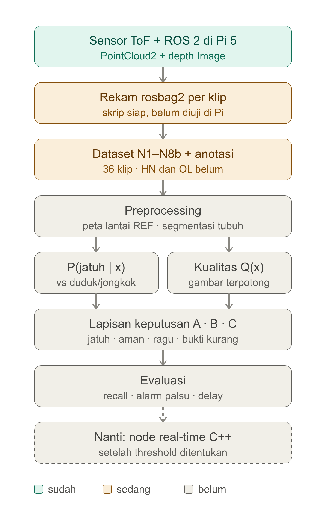

# PLAN OVERVIEW: Fall Detection ToF (Reject-Option)

Dokumen pelacak: posisi sekarang, opsi per blok, keputusan terbuka, next step.
Dokumen lain: `Skenario_Uji_Pengambilan_Data_ToF_36_Klip.md` (protokol) dan `README_PENGGUNAAN.md` (cara menjalankan skrip).
Tanda: `[x]` sudah, `[~]` sedang, `[ ]` belum. **Semua opsi di bawah adalah usulan; keputusan ada di peneliti.**

## 0. Tujuan dan batas klaim

Mengurangi alarm palsu dan keputusan overconfident saat observasi buruk (tubuh terpotong, tertutup, atau noise), dengan memisahkan **kualitas observasi `Q(x)`** dari **bukti jatuh `P(jatuh|x)`** dan memakai keputusan bertingkat (jatuh / aman / ragu / bukti kurang).

| Pertanyaan | Dijawab oleh | Butuh data |
|---|---|---|
| Jatuh vs duduk/jongkok | Blok 5a | Set HN1–HN5 (belum diambil) |
| Gambar terpotong/tertutup | Blok 5b + 6 | Set OL1–OL4 (belum diambil) |

**N1–N8b (36 klip) adalah baseline bersih.** Set ini memvalidasi pipeline dan memberi pembanding kondisi bersih; ia belum menguji dua pertanyaan di atas.

## 1. Peta blok dan status

## 2. Opsi per blok

### Blok 1: Sensor + ROS 2 `[x]`
- **Terkunci:** driver bawaan Arducam, mode 4 m. Topik dikonfirmasi pilot P1_R1: `/depth_frame` Float32MultiArray (180×240, meter, 30 Hz) dan `/point_cloud` PointCloud2 tidak terorganisir (tanpa amplitude dan `camera_info`).
- **Temuan pilot:** cloud = reproyeksi depth yang sama persis (galat 0 mm), dengan intrinsik fx 190,92 · fy 191,25 · cx 120 · cy 90, jadi `REC_CLOUD=0` aman (opsi b terpenuhi tanpa `camera_info`). Depth terkuantisasi (noise lantai ±12 cm) dan 20–50% piksel tubuh tanpa depth: parameter driver dan pakaian perlu dicek.
- **Terbuka:** pitch (60° sementara), orientasi box, titik pasang (tes grid, Skenario 2.6); `REC_CLOUD` 0 atau 1.
- **Catatan penting:** fitur tinggi tubuh butuh koordinat 3D. Sumbernya salah satu dari: (a) PointCloud2, (b) depth + `camera_info`, (c) intrinsik pendekatan dari FOV spek (kurang akurat, belum diverifikasi). Jadi `REC_CLOUD=0` hanya aman bila (b) atau (c) dipilih. Cek ada/tidaknya `camera_info` di uji teknis.

### Blok 2: Rekam `[~]`
- **Terkunci:** 1 bag per klip, `rec_clip.sh`.
- **Diperbaiki 12 Okt:** GO kini dihitung setelah recorder benar-benar merekam (pilot: recorder terlambat 0,6–4,7 dtk sehingga pre-buffer terpotong). Recorder dihentikan lewat `timeout` (SIGINT langsung diabaikan proses background). `set -u` + `source setup.bash` membuat skrip lama keluar diam-diam. `validate_clip.sh` kini memanggil `qc_clip.py`.
- **Terbukti di PC dengan publisher dummy:** bag tertutup bersih, format `ros2 bag info` Jazzy terbaca. **Belum:** satu kali uji di Pi dengan driver asli.

### Blok 3: Dataset + anotasi `[~]`
| Opsi `t_onset` | Posisi |
|---|---|
| A. Manual di Foxglove | **Default** untuk 24 klip jatuh |
| B. Semi-otomatis (usul onset dari kurva tinggi tubuh, lalu verifikasi manual) | Tunda sampai klip banyak |

### Blok 4: Preprocessing `[ ]`
| Sub-langkah | Opsi | Usulan awal | Catatan |
|---|---|---|---|
| Model lantai/latar | A. Median per-piksel dari klip REF; B. Fit bidang RANSAC; C. Latar adaptif (MOG2) | A untuk segmentasi; B hanya untuk mengukur tinggi dan pitch | C berisiko menyerap orang yang diam/rebah ke dalam latar |
| Segmentasi tubuh | A. Selisih terhadap REF > margin + komponen terhubung terbesar; B. + morphological opening; C. Klaster 3D (DBSCAN) pada cloud | A + B | Margin awal ±5–8 cm, dituning dari data |
| Noise ToF | A. Abaikan piksel depth = 0; B. Median filter 3×3; C. Buang komponen kecil (flying pixel) | A + C | B bisa menghaluskan tepi tubuh |

Keluaran: mask tubuh dan titik 3D tubuh per frame.

### Blok 5a: `P(jatuh|x)` `[ ]`
**Fitur (usulan):** tinggi persentil-95 titik tubuh di atas lantai, luas foreground, aspect ratio bounding box, perubahan tinggi per waktu (jendela 5 frame), posisi centroid. **Unit:** jendela geser ±1 dtk.

| Model | Kelebihan | Risiko | Posisi |
|---|---|---|---|
| A. Aturan ambang (tinggi + kecepatan) | Transparan, tanpa data latih | Kaku | Baseline pembanding |
| B. Regresi logistik | Probabilitas langsung, cocok data kecil | Hanya batas linier | **Usulan base classifier** |
| C. Random forest / gradient boosting | Menangkap non-linier | Probabilitas perlu dikalibrasi (Platt/isotonic) | Kandidat kedua |
| D. GRU / 1D-CNN pada deret fitur | Menangkap dinamika | Overfit pada ±150 klip | Tunda |
| E. CNN pada frame depth | Tanpa rekayasa fitur | Butuh data besar (jalur Elna) | Tidak dipakai |

Reject-option memakai `P(jatuh|x)`, jadi probabilitasnya harus terkalibrasi. Base classifier **harus identik** di Sistem A, B, C.

### Blok 5b: `Q(x)` `[ ]`
Komponen: `valid_ratio`, `edge_touch`, `continuity` (amplitude tidak tersedia).

| Cara menggabungkan | Catatan |
|---|---|
| A. Simpan terpisah, putuskan nanti | **Usulan.** N1–N8b hanya memberi distribusi kondisi bersih |
| B. Jumlah berbobot (0,5 / 0,3 / 0,2) | Bobot itu tebakan, belum ada dasar |
| C. Minimum dari komponen ternormalisasi | Sederhana, tanpa bobot |
| D. Dipelajari dari data OL (regresi logistik: OL vs bersih) | Butuh set OL |

### Blok 6: Lapisan keputusan `[ ]`
| Sistem | Aturan |
|---|---|
| A | Biner: `P(jatuh|x) > 0,5` |
| B | Reject generik (Chow): tolak bila confidence rendah |
| C | Gerbang `Q(x)` + ambang `P`; status jatuh / aman / ragu / bukti kurang |

- **Penentuan ambang:** pencarian grid di data validasi dengan target recall yang sama di ketiga sistem.
- **Bobot biaya** `w_miss : w_false : w_delay = 10 : 3 : 1` adalah usulan; butuh analisis sensitivitas.
- **Split dengan 2 partisipan:** pilot/kelayakan; per sesi; tambah partisipan; atau leave-one-participant-out (2 lipatan). Belum diputuskan.

### Blok 7: Evaluasi `[ ]`
- Unit analisis = **klip** (bukan frame).
- Metrik: recall, alarm palsu, missed-fall, rejection rate, delay; risk–coverage.
- Statistik: interval kepercayaan Clopper–Pearson; McNemar untuk membandingkan dua sistem pada klip yang sama.

### Blok 8: Real-time `[ ]`
Usulan: node `rclpy` (Python) memakai kode offline yang sama; port ke C++ hanya bila latensi di Pi 5 tidak cukup. Diputuskan setelah ada angka latensi.

## 3. Keputusan terbuka (milik peneliti)

| # | Keputusan | Opsi | Harus diputuskan sebelum |
|---|---|---|---|
| 1 | Pitch, orientasi, titik pasang kamera | Tes grid (Skenario 2.5). Pilot terukur 2,84 m / ±76° | Ambil 36 klip |
| 2 | ~~`REC_CLOUD` 0 atau 1~~ | **Diputuskan: 0** (cloud = reproyeksi depth; REF tetap merekam cloud) | Selesai 12 Okt |
| 3 | Arah jatuh relatif kamera | Usulan: menjauhi/menyamping | Ambil klip jatuh |
| 4 | Definisi `t_onset` | Usulan: Skenario Bagian 5 | Anotasi |
| 5 | Etik kampus dan consent | Belum diverifikasi | Rekam partisipan |
| 6 | Strategi split 2 partisipan | Lihat Blok 6 | Latih model |
| 7 | Base classifier | Blok 5a | Setelah data N1–N8b |
| 8 | Penggabungan `Q(x)` | Blok 5b | Setelah set OL ada |
| 9 | Bobot biaya | 10 : 3 : 1 (usulan) | Evaluasi awal |

## 4. Next step (fase sekarang: N1–N8b)

- [x] 1. Topik, format, fps, intrinsik dikonfirmasi dari pilot P1_R1; `config.sh` terisi
- [~] 2. Uji teknis `rec_clip.sh`: lolos dengan publisher dummy di PC; ulangi 1× di Pi dengan driver asli
- [ ] 2b. Cek parameter driver (kuantisasi) dan pakaian terang vs gelap (piksel tubuh invalid)
- [ ] 3. Pasang kamera, catat tinggi dan pitch; cek satu titik awal (kepala dan kaki terlihat, matras terlihat)
- [ ] 4. Klip `REF`
- [ ] 5. Ambil 36 klip (`run_rep.sh`)
- [ ] 6. Anotasi (Skenario Bagian 5)
- [ ] 7. Ekstraksi (`extract_clips.py`, sudah mendukung Float32MultiArray dan teruji di bag pilot)
- [~] 8. Sanity check: kurva tinggi tubuh per klip sudah dibuat untuk pilot (`qc_clip.py`, analisis ulang). Jatuh terlihat berbeda dari berdiri; duduk (N3) mirip jatuh pelan

**Berikutnya:** draf set HN dan OL ada di `Skenario_Uji_HN_OL.md` (13 Okt, belum diuji); keputusan terbuka di Bagian 8 dokumen itu. Lalu mulai Blok 4–6.

## 5. Log progres

| Tanggal | Catatan |
|---|---|
| 2026-10-04 | Topik terkonfirmasi: PointCloud2 + depth Image (tanpa amplitude). Folder `tof_tools` dibuat; ekstraksi diuji dengan bag sintetis; skrip bash belum diuji di Pi. Keputusan terbuka: Bagian 3 |
| 2026-10-09 | Sesi pilot P1_R1 direkam (13 bag; 3 dihapus kemudian: N2_x1, N4_x1, N6_RETRY1) |
| 2026-10-12 | Analisis ulang pilot: geometri 2,84 m / ±76°, intrinsik dari fit depth↔cloud, kuantisasi depth, 20–50% piksel tubuh invalid, klip pelan terlalu cepat, partisipan belum diam sebelum GO. P1_R1 dijadikan sesi pilot. Skrip diperbaiki (sinkronisasi GO, SIGINT, `set -u`, Float32MultiArray, `qc_clip.py`, `run_rep.sh rev`); keputusan #2 ditutup (`REC_CLOUD=0`) |
